# Agentic & Harness Engineering — Notes

These are my notes from a 12-week, self-paced course on building AI agents and the "harness" around them: the prompts, tools, loop, memory, guardrails and evals that turn a language model into something that does work.

The course arrives as a short daily email (one concept, about five minutes to read, plus a small exercise). Every week, those emails are rewritten here into one chapter in plainer language, with each exercise's worked answer placed right after the exercise.

## How to read this

Read the weeks in order. Each chapter builds on the one before it and links back when it reuses an idea. Each lesson opens with a three-line "In short" summary, then follows the same shape: the idea, an example, where it lives in the harness, common mistakes, a "try it" exercise, the worked answer, and sources. Each week ends with a review: a recap, a self-quiz with answers, and one exercise that ties the week together. Each chapter opens with a contents list; a "↑ Contents" link before each lesson takes you back to it.

Diagrams sit next to the ideas they explain, and exact API names and defaults are collected in small "API details" tables so they don't interrupt the explanation.

Most examples use one running scenario: an agent that investigates forecast errors at a portfolio of solar sites and drafts a ticket for a human to approve.

## Contents

*Figure: green weeks are done, amber is in progress, grey is still to come.*

| Week | Topic | Status |
|---|---|---|
| 1 | [What an agent is](weeks/week-01-what-an-agent-is.md) | Done |
| 2 | [Core mechanics](weeks/week-02-core-mechanics.md) | Done |
| 3 | [State and memory](weeks/week-03-state-and-memory.md) | Done |
| 4 | [Prompt and tool design](weeks/week-04-prompt-and-tool-design.md) | Done |
| 5 | [Control, safety and reliability](weeks/week-05-control-safety-reliability.md) | Done |
| 6 | [Evaluation I](weeks/week-06-evaluation-1.md) | Done |
| 7 | [Evaluation II and iteration](weeks/week-07-evaluation-2-and-iteration.md) | In progress |
| 8 | Multi-agent systems | Coming |
| 9 | Frameworks and protocols | Coming |
| 10 | Advanced capabilities | Coming |
| 11 | Safety, alignment and governance | Coming |
| 12 | Capstone | Coming |

Reference:

- [Glossary](glossary.md) — every term, in plain words, linked to the lesson that introduces it.
- [Reading list](reading-list.md) — all sources, grouped by week.
- [Changelog](CHANGELOG.md) — what each weekly update added.
- [Style guide](STYLE.md) — how the notes are written.
- [Review procedure](REVIEW.md) — how a second model checks the notes; decisions in [reviews/decisions.md](reviews/decisions.md).

## How it's updated

A scheduled task runs every Saturday morning. It reads that week's brief emails, rewrites them into the matching chapter using the style guide, fills in answers that were still pending, updates the glossary and reading list, and opens a pull request on a `weekly/YYYY-MM-DD` branch. Nothing reaches `main` until I merge it.

## How it's reviewed

A model from a different family checks the notes against [REVIEW.md](REVIEW.md): technical accuracy, nothing lost or invented in the rewrite, the style guide, links, sources and diagrams. It only comments; it never approves or pushes.

- **Every PR:** GPT (through Codex) reviews each pull request when it opens, so the Saturday update PR is reviewed as soon as it appears.
- **Monthly:** on the 1st, Fable reviews the whole repo and opens a `reviewer/` PR with its findings.
- **On request:** comment `/review` on any PR (`/review fable` for Fable, `/review force` to re-review the same commit), or add the `review` label.
- **Answering:** comment `/respond` on the reviewed PR. Claude Opus, which wrote the notes, decides on each finding (accept, modify, reject, defer), applies the fixes, runs the tests and opens a pull request into the reviewed branch. Merging it accepts the decisions; closing it rejects them.

Every review is archived on the `reviewer/archive` branch. Settings: [review/](review/) and [.github/workflows/](.github/workflows/). The machinery is shared with other repos: [cross-model-review](https://github.com/joshxinjie/cross-model-review).
