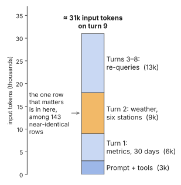

# Week 2 — Core mechanics

<!-- toc -->
## Contents

- **[2.1 Context window as working memory](#21-context-window-as-working-memory)**  
  [Idea](#the-idea) · [Example](#an-example) · [In the harness](#where-it-lives-in-the-harness) · [Mistakes](#common-mistakes) · [Try it](#try-it) · [Answer](#worked-answer) · [Sources](#sources)
- **[2.2 ReAct and reasoning-then-acting; extended thinking in the loop](#22-react-and-reasoning-then-acting-extended-thinking-in-the-loop)**  
  [Idea](#the-idea-1) · [Example](#an-example-1) · [In the harness](#where-it-lives-in-the-harness-1) · [Mistakes](#common-mistakes-1) · [Try it](#try-it-1) · [Answer](#worked-answer-1) · [Sources](#sources-1)
- **[2.3 Planning and task decomposition](#23-planning-and-task-decomposition)**  
  [Idea](#the-idea-2) · [Example](#an-example-2) · [In the harness](#where-it-lives-in-the-harness-2) · [Mistakes](#common-mistakes-2) · [Try it](#try-it-2) · [Answer](#worked-answer-2) · [Sources](#sources-2)
- **[2.4 Structured outputs and schemas](#24-structured-outputs-and-schemas)**  
  [Idea](#the-idea-3) · [Example](#an-example-3) · [In the harness](#where-it-lives-in-the-harness-3) · [Mistakes](#common-mistakes-3) · [Try it](#try-it-3) · [Answer](#worked-answer-3) · [Sources](#sources-3)
- **[2.5 Stopping conditions, step budgets and loop detection](#25-stopping-conditions-step-budgets-and-loop-detection)**  
  [Idea](#the-idea-4) · [Example](#an-example-4) · [In the harness](#where-it-lives-in-the-harness-4) · [Mistakes](#common-mistakes-4) · [Try it](#try-it-4) · [Answer](#worked-answer-4) · [Sources](#sources-4)
- **[2.6 Error handling: retries, backoff, and feeding tool errors back to the model](#26-error-handling-retries-backoff-and-feeding-tool-errors-back-to-the-model)**  
  [Idea](#the-idea-5) · [Example](#an-example-5) · [In the harness](#where-it-lives-in-the-harness-5) · [Mistakes](#common-mistakes-5) · [Try it](#try-it-5) · [Answer](#worked-answer-5) · [Sources](#sources-5)
- **[Week 2 review](#week-2-review)**  
  [Recap](#recap) · [Self-quiz](#self-quiz) · [Exercise](#integrative-exercise) · [Exercise answer](#integrative-exercise--worked-answer) · [Sources](#sources-6)

<!-- /toc -->

Week 1 ended on one fact: the transcript (the running list of messages and tool results the model is sent each turn) is the agent's only memory. A model is stateless, and the harness (all the code around the model) re-sends the whole conversation on every call ([Week 1](week-01-what-an-agent-is.md)). Week 2 is about the mechanics that let that loop survive real work:

- how much memory the transcript really is (2.1);
- the reasoning step between observing and acting (2.2);
- making the model plan a whole task (2.3);
- getting output that code can trust (2.4);
- deciding when the loop should stop (2.5);
- handling failures (2.6).

The week ends with a review that pulls all six into one function.

Most of this week lives in layer 3 (loop control), with edges into the other layers introduced in [1.4](week-01-what-an-agent-is.md#14-what-a-harness-is).


*Figure: the six harness layers from [1.4](week-01-what-an-agent-is.md#14-what-a-harness-is). This week is mostly about layer 3 (loop control).*

---

## 2.1 Context window as working memory

*Day 8 · 2026-09-10*

> **In short**
> - The context window is a large but leaky working memory, and the loop makes it grow every turn.
> - The more you put in it, the less reliably the model recalls any one item.
> - So the harness's job is to put in less, not more.

### The idea

The *context window* is the total token budget of one model call, input and output together. Anthropic's docs list what counts:

- the system prompt
- the tool definitions
- every message, including tool results and images
- extended-thinking blocks (the model's reasoning text, covered in [2.2](#22-react-and-reasoning-then-acting-extended-thinking-in-the-loop))
- the output being generated right now

On current Claude models the window is 1M tokens (200k on older ones). A separate setting, the output cap, limits only the single response.

The loop re-sends the whole transcript every turn, so usage adds up. Turn N's input is turn N−1's input, plus its output, plus the tool results. Every response reports its token counts, so you always know exactly where you are.

The naive view is "a bigger window means more memory, so fill it". Two facts break that view.

**Context rot** (answers getting less reliable as the input grows). Chroma's July 2025 study ran 18 models (GPT-4.1, Claude 4, Gemini 2.5 and Qwen3 families). The tasks stayed the same; only the input length grew. They found that "models do not use their context uniformly; performance grows increasingly unreliable as input length grows". This held even for trivially simple tasks, such as repeating a list of words.

It got worse in two cases:

- when the needed fact is semantically distant from the question;
- when there are topically similar distractors.

That is exactly what a long agent transcript looks like: lots of near-duplicate tool results.

**The attention budget.** Anthropic's context-engineering post treats every token as spending from a finite budget. Attention forms n² pairwise relationships between tokens, so it stretches thin as n grows. In their framing, context is a finite resource with diminishing returns.

So "working memory" is the right analogy. The window is large, but recall of any one item gets worse as it fills. The harness should curate the smallest set of high-signal tokens that gives the best chance of the outcome you want. It should not stuff the window.

**API details**

| What | Value |
|---|---|
| Output cap for one response | `max_tokens` |
| Token counts on every response | `usage` field |

### An example

Take the "why is SG-03 off?" investigator for the solar portfolio:

- System prompt and tool definitions: 3k tokens.
- Turn 1 pulls 30 days of hourly forecast vs actual: 6k.
- Turn 2 pulls weather history for six stations: 9k.
- Turns 3–8 re-query subsets while forming a hypothesis: 13k.

By turn 9, each call is about 31k input tokens. The number that matters is the 09:00 cloud-cover value for station 4 on the 7th. It is one row inside the turn-2 dump, surrounded by 143 near-identical rows. That is Chroma's failure case, reproduced by accident.



*Figure: the fact the model needs is a sliver of one dump, re-sent on every turn.*

Three harness moves fix it, each in a different layer:

1. **Shape at the source** (layer 2, tools and the executor). `get_weather_history` returns per-station daily aggregates plus anomalies, with a `detail=true` path for the hourly rows. This is the result shaping from [1.3](week-01-what-an-agent-is.md#13-tool--function-calling), now motivated by recall and not only by cost.
2. **Just-in-time retrieval** (layers 1–2, prompts and tools). Give the model identifiers — site codes, date ranges, a list of available metrics — and let it fetch what it needs when it needs it. Don't pre-load the whole picture. Anthropic's post describes agents keeping "lightweight identifiers (file paths, stored queries, web links)" and loading data at runtime.
3. **Clear what is spent** (layers 3–4, loop control and state). Once a tool result has been digested into a stated hypothesis, drop or summarise it. The Anthropic API now offers this server-side: tool-result clearing, thinking-block clearing and server-side compaction ([3.2](week-03-state-and-memory.md#32-context-management-summarisation-compaction-truncation)). On some models the API even tells the model its remaining budget after each tool call, through an injected tag. That lets it budget itself.

**API details**

| What | Value |
|---|---|
| Remaining-budget tag: models | Sonnet 4.5+ and Haiku 4.5 |
| Remaining-budget tag: example | `<system_warning>Token usage: 35000/200000</system_warning>` |

### Where it lives in the harness

Layer 4 (state) decides what exists. Layers 1–2 (prompts and tools) decide what enters the window. Layer 3 (the loop) decides when to compact. Week 3 covers the machinery — compaction, memory files, sub-agents. This lesson is about the constraint they all serve.

Two mechanics your loop code must handle:

- **Overflow.** If the input alone is over the window, you get an immediate 400 error. If input plus the output cap is over it, newer Claude models accept the request and stop with a stop reason (the field that says why the model stopped) meaning "context window exceeded". Your loop must handle that stop reason.
- **Thinking blocks count in full.** Older models strip thinking from earlier turns. Newer ones keep it unless cleared (see the table). So a thinking-heavy agent grows faster than its visible transcript suggests.

**API details**

| What | Value |
|---|---|
| Input plus `max_tokens` over the window | Claude 4.5+ stops with `stop_reason: "model_context_window_exceeded"` |
| Models that keep earlier thinking | Opus 4.5+, Sonnet 4.6+ and the 5-series |

### Common mistakes

Most "the agent ignored the obvious clue" bugs are a clue that was present but drowned. Beginners:

- treat the window as free storage and dump raw payloads;
- assume that because a fact is in the transcript, the model will use it;
- never read the token counts on each response, so they only notice growth when a run fails;
- forget that a 1M window is billed per token on every turn. A fat transcript is slow and expensive before it is inaccurate.

### Try it

Take your agent from [1.5](week-01-what-an-agent-is.md#15-anatomy-of-a-real-agent) and add one line after each model call:

```python
log(turn, resp.usage.input_tokens, resp.usage.output_tokens)
```

1. Run the "write mae.py" task and plot input tokens per turn (a five-point list is fine).
2. Run it again with `forecast.csv` and `actual.csv` expanded to 30 days × 24 rows. Note the new curve.
3. Make `read_file` return only the first 20 rows plus a line "…N rows omitted; use read_file(path, full=True) for all". Run a third time.

Report the three curves. Did the model still get the right MAE on run 3? Which of the three fixes above did you just implement?

Bonus: on run 2, ask the model for the actual value at row 500 and see whether it answers correctly from the dump. That is a one-question context-rot test.

### Worked answer

**Run 1** (24 rows per file). Input tokens per turn look like ~1.4k → 1.6k → 2.6k → 2.9k → 3.1k. The step at turn 3 is the two CSV reads landing. After that, each turn grows by a few hundred tokens.

**Run 2** (720 rows per file). Same shape, but the turn-3 step is ~15–20k tokens, and every later turn pays it again. Turn 5 is roughly ten times run 1's.

**Run 3** (`read_file` capped at 20 rows plus "…700 rows omitted; use full=True"). The curve is back to run 1's scale, and the model still gets the right MAE. It never needed the rows in context. It needed a script that reads the files. Python computes the MAE over the whole file; the transcript only ever held a sample.

That is "shape at the source" (layer 2): the tool decides what enters the window, with an escape hatch the model can choose to use.

**Bonus.** Asked for row 500 from the run-2 dump, models often answer confidently with a neighbouring row. That is Chroma's distractor case in one question.

Beginner mistakes:

- Logging `input_tokens` once at the end instead of per turn. You lose the step that tells you which tool caused the growth.
- "Fixing" run 2 by telling the model to be concise. Its output was never the problem.

### Sources

- Anthropic Engineering — [Effective context engineering for AI agents](https://www.anthropic.com/engineering/effective-context-engineering-for-ai-agents) (Sep 2025)
- Chroma — [Context Rot: How Increasing Input Tokens Impacts LLM Performance](https://www.trychroma.com/research/context-rot) (Jul 2025)
- Anthropic docs — [Context windows](https://platform.claude.com/docs/en/build-with-claude/context-windows)

---

2.1 was about what the model sees. 2.2 is about what it does with it before acting.

[↑ Contents](#contents)

## 2.2 ReAct and reasoning-then-acting; extended thinking in the loop

*Day 9 · 2026-09-11*

> **In short**
> - Agents do better when they reason between each observation and the next action.
> - That reasoning used to be prompt text; now it is a thinking block the model emits itself.
> - The harness must pass thinking blocks back untouched, and count what they cost.

### The idea

Reasoning is the "reason" step in the perceive → reason → act → observe loop from [1.2](week-01-what-an-agent-is.md#12-the-agent-loop). It is the one step that is pure model behaviour, though the harness still shapes it.

*ReAct* (Yao et al., 2022) observed that a model does better when it interleaves reasoning traces with actions. The alternatives are doing all the reasoning up front (chain-of-thought) or acting without reflection. The paper's format was literal text, repeated:

- *Thought:* what I know and what to check next
- *Action:* `Search[…]`
- *Observation:* the tool result, appended by the harness

The paper's claim is that the two directions feed each other:

- Reasoning "helps the model induce, track, and update action plans as well as handle exceptions".
- Actions ground the reasoning in real information, which cuts the hallucination and error propagation of pure chain-of-thought.

On ALFWorld and WebShop they reported +34 and +10 absolute points over baselines, with one or two in-context examples.

This is the 1.2 loop with the Thought made explicit. In 2022 the harness pulled "Action: Search[…]" out of free text with a regex and stopped generation at "Observation:". That was fragile, and it is why early agent frameworks broke constantly. Tool calling ([1.3](week-01-what-an-agent-is.md#13-tool--function-calling)) replaced the parsing. What survived of ReAct is the insight: a reasoning step belongs between each observation and the next action.

**Reasoning models moved that step from prompt text into the model.** On the Claude API, the Thought is now a thinking block that the model emits before its tool-call blocks.



*Figure: the reasoning step sits between every observation and the next action; only its container changed.*

**API details**

| What | Value |
|---|---|
| Thinking block type | `thinking` |
| Tool-call block type | `tool_use` |

### An example

The loop with adaptive thinking switched on:

```python
resp = client.messages.create(
    model=M, tools=TOOLS, messages=messages,
    thinking={"type": "adaptive"},
    output_config={"effort": "medium"},
)
# Append thinking + tool_use blocks exactly as returned.
messages.append({"role": "assistant", "content": resp.content})

# resp.content on turn 1:
#   [thinking(sig=…), tool_use get_site_metrics]
# then, after the tool_result:
#   [thinking "MAE tripled from the 7th, weather looks normal → check curtailment",
#    tool_use get_curtailment_log]
```

The thinking block is where the SG-03 investigator decides to move from weather to curtailment. You can read it in the transcript.

### Where it lives in the harness

Three harness facts follow.

1. **Pass thinking back untouched.** When the model calls a tool, it "pauses construction of its response to await external information". So the thinking block before the tool call must be passed back "complete and unmodified" with the tool result. It carries the reasoning behind the call. If your executor (the code that runs tool calls) rebuilds assistant messages from scratch, or keeps ordinary thinking blocks but drops redacted ones, the request fails.
2. **Adaptive thinking and effort.** On current models, thinking is adaptive and interleaves with tool use automatically. Older 4.x models needed a beta header and a fixed thinking budget. The effort setting is soft guidance. At low effort the model may skip thinking on easy turns.
3. **Cost.** Thinking tokens are billed as output. On newer models (see the table), earlier turns' thinking stays in context and is billed as input. So the growth curve from [2.1](#21-context-window-as-working-memory) gets a second component that the transcript length does not show.

**The "think" tool.** The old text-scratchpad idea still earns its keep in one form. Anthropic's "think" tool is a no-op tool. Its description says: "It will not obtain new information or change the database, but just append the thought to the log." On τ-bench airline, with a prompt telling the model when to use it, it scored 0.584 pass^1 (the share of tasks passed on a single try), against 0.332 for the baseline and 0.412 for extended thinking alone.

The difference from built-in thinking is timing. Built-in thinking happens before the response. The think tool is a deliberate pause mid-trajectory, after a tool result. It suits policy-heavy, sequential tasks where the model must check "do I have enough to act?" It is a layer 2 (tools) lever that changes layer 1 (prompts) behaviour: how the model follows instructions.

**API details**

| What | Value |
|---|---|
| Redacted thinking block type | `redacted_thinking` (must be passed back too) |
| A filter that breaks it | `block.type == "thinking"` (drops `redacted_thinking`) |
| Interleaved thinking on older 4.x models | beta header `interleaved-thinking-2025-05-14`, fixed `budget_tokens` |
| Effort setting | `effort` |
| Thinking token count | `usage.output_tokens_details.thinking_tokens` |
| Models that keep earlier thinking (billed as input) | Opus 4.5+, Sonnet 4.6+ and the 5-series |

### Common mistakes

The reasoning step is where the agent picks its next move, so it is where investigations go right or wrong. It is also visible, which makes transcripts diagnosable ([7.1](week-07-evaluation-2-and-iteration.md#71-reading-a-transcript)). Mistakes:

- Writing a "Thought:/Action:" prompt for a tool-calling model. You get the fragile 2022 protocol back for nothing.
- Stripping thinking blocks when re-sending history during tool use.
- Running at max effort on every turn of a ten-turn loop, then wondering why it is slow.
- Assuming reasoning replaces verification. A confident thought is not an observation.

### Try it

Take your 2.1 agent, with per-turn usage logging. Run the mae.py task three ways:

1. thinking disabled
2. adaptive, effort `"low"`
3. adaptive, effort `"high"`

For each, log per turn: `input_tokens`, `output_tokens`, `thinking_tokens`, and whether the assistant message contained a thinking block.

Then add the "think" tool (description as quoted above) plus one system-prompt line: "Before any edit_file, call think to state what you will change and why." Run with thinking disabled, and count think calls.

Report: turns, a total cost proxy (input + output tokens summed over turns), and whether any run changed the tool sequence. Finally, in one line each: which of the four setups would you use for the "why is SG-03 off?" investigator, and which for the nightly digest?

### Worked answer

- **Thinking off.** The familiar five calls: `list_files` → `read_file` ×2 → `edit_file` → `bash` → answer. `thinking_tokens` is 0 everywhere. Cost proxy ≈ 12–14k tokens summed over turns.
- **Adaptive, effort low.** Usually the same tool sequence. Some turns have no thinking block at all; the ones that do are a few hundred tokens.
- **Adaptive, effort high.** A thinking block on every turn, often 1–3k tokens each. On keep-all models those tokens are re-sent as input on every later turn, so the cost proxy climbs noticeably faster than the transcript length suggests. For a task this simple, the tool sequence rarely changes.
- **Think tool.** With the system-prompt line, exactly one think call lands before `edit_file`, so the run becomes six calls. The thought is the first place your hypothesis appears in the log in plain text.

**Choices.** The SG-03 investigator gets adaptive thinking at medium or high, plus the think tool if the hypothesis checklist is long. The nightly digest runs with thinking off or low — its reasoning is in the code.

Two common slips:

- Comparing output tokens only. The real cost of high effort is the input re-billing.
- Forgetting that a think call costs a whole round trip. It must earn its turn.

### Sources

- [Yao et al., ReAct: Synergizing Reasoning and Acting in Language Models (2022)](https://arxiv.org/abs/2210.03629)
- [Anthropic docs — Thinking](https://platform.claude.com/docs/en/build-with-claude/thinking) (adaptive thinking, interleaved thinking, passing blocks back)
- [Anthropic Engineering — The "think" tool](https://www.anthropic.com/engineering/claude-think-tool) (Mar 2025)

---

2.2 put a reasoning step between each observation and the next action. That is planning one step at a time. 2.3 asks when the harness should make the model plan the *whole* task first, and where that plan should live.

[↑ Contents](#contents)

## 2.3 Planning and task decomposition

*Day 11 · 2026-09-12*

> **In short**
> - A step-by-step loop drifts on long tasks; an explicit plan keeps it on track and makes its work reviewable before it acts.
> - The plan should be owned by the harness, stored outside the transcript, and revised as results come in.
> - Plan when the approach is uncertain, the change touches several files, or the code is unfamiliar; if you could describe the diff in one sentence, skip the plan.

### The idea

A ReAct loop is short-sighted by design. Every turn asks "what next?" given the transcript. That adapts well, but on long tasks it loses the thread. The HORIZON paper ([1.6](week-01-what-an-agent-is.md#16-when-not-to-build-an-agent)) found that planning failures dominate as the task horizon grows.

*Planning* means making the decomposition explicit: subgoals, their order, their dependencies. There are two extremes.

**Upfront (plan-and-execute).** A planner call produces a step list. An executor runs one step at a time with tools. A replanner looks at the results and either finishes or revises the remaining steps. LangChain's write-up gives three reasons:

- speed, because "the larger agent doesn't need to be consulted after each action";
- cost, because steps can go to smaller models;
- quality, "by forcing the planner to explicitly think through all the steps required".



*Figure: the plan lives with the harness, not in the transcript; only step notes flow back to the replanner.*

Two variants:

- *ReWOO* lets plan steps reference earlier outputs by variable (`#E2`) without replanning.
- *LLMCompiler* emits the plan as a DAG (a dependency graph) and runs independent steps in parallel.

**Incremental.** No separate plan; the model's thinking block each turn is the plan. This is the cheapest and most adaptive. It is worst when early observations should have changed the whole approach and nothing forces a re-think.

**The practical middle** is what Claude Code ships as *plan mode*: explore with read-only tools (no writes), write a plan, a human approves or edits it, then implement against it, then commit. The docs are blunt about when to bother: "Planning is most useful when you're uncertain about the approach, when the change modifies multiple files, or when you're unfamiliar with the code being modified. If you could describe the diff in one sentence, skip the plan."

### An example

A plan-and-execute sketch for the SG-03 investigator:

```python
plan = call(PLANNER_PROMPT, task, tools=None)   # JSON: [{id, goal, tool, status}]
# 1 metrics 30d  2 weather same window  3 curtailment log  4 compare  5 draft_ticket

for step in plan.pending():
    result = run_agent(step, tools=READ_ONLY, max_turns=4)   # small inner loop
    step.status, step.note = "done", summarise(result)
    plan = call(REPLAN_PROMPT, plan, step.note)              # may edit remaining steps
```

Suppose step 2 returns "all six stations null since the 7th". The replanner drops steps 3–4 and inserts "check pipeline status for the weather feed".

Two things to notice:

- The inner loop is short and its transcript is thrown away. Only the step note goes forward. So the plan is also a context-management device ([2.1](#21-context-window-as-working-memory)).
- The harness reads the plan object to decide the next call. The model proposes edits to it, but never owns it.

### Where it lives in the harness

Everywhere except the model:

- **Layer 1 (prompts):** the plan-first instruction and the plan format.
- **Layer 3 (loop control):** the planner and replanner are control flow. The harness decides when planning happens and when it is revisited.
- **Layer 4 (state):** the plan is state. Kept only in the transcript, it decays like any other tool result (2.1) and vanishes at compaction ([3.2](week-03-state-and-memory.md#32-context-management-summarisation-compaction-truncation)). Kept as a structured object outside the transcript, it survives.
- **Layer 5 (guardrails and permissions):** plan mode is a permission phase. The approval gate sits between the plan and any side effects (actions that change something outside the agent).
- **Layer 6 (feedback and evals):** a plan is a checklist to verify against ("review the diff against PLAN.md").

On layer 4: Anthropic's long-running harness uses a feature-list JSON, with every item initially "failing" and one picked per session. Just as important, the agent then cannot quietly redefine "done".

### Common mistakes

Planning is the cheapest lever against long-horizon drift. The mistakes:

- Planning simple tasks. Use the one-sentence-diff rule.
- Planning before exploring, so the plan encodes guesses that turn out wrong.
- A plan that is decoration: it sits in the prompt, nothing tracks its status, and the model bulldozes past it.
- The opposite: a rigid plan with no replanner, so the first surprising observation breaks the run.

### Try it

Give your 2.2 agent a two-phase shape.

- **Phase 1.** One call with `tool_choice="none"` and a system line asking for a JSON plan `{steps: [{id, description, tool, done: false}]}`. Parse it and store it in a Python variable.
- **Phase 2.** The usual loop, but each turn prepends a user message "Plan: … Current step: k". Add a no-op tool `mark_step_done(id)` that flips the flag.

Task: "Write mae.py that reports MAE, RMSE and mean bias between forecast.csv and actual.csv, run it, report all three." Record the number of turns and whether any metric was skipped, compared with the no-plan run.

Then delete three hours from `actual.csv` and watch. Does the model ask to change the plan (add a "handle missing rows" step) or plough on?

Finally, one paragraph: for the SG-03 investigator, which steps belong in a fixed upfront plan, which should stay incremental, and why?

### Worked answer

**No plan.** Five calls as usual. But on some runs the script prints MAE and RMSE, and mean bias is reported from memory or skipped. Nothing forced a checklist.

**With plan.** Phase 1 returns four steps: read files → write mae.py with all three metrics → run → report. Phase 2 costs one extra `mark_step_done` call per step (8–9 calls instead of 5). No metric is skipped, because "Current step: 4 — report all three" is re-injected every turn.

**Three hours deleted.** It depends on whether `bash` exposes the surprise.

- A naive join throws a shape error or NaN. Most models then say "we need a missing-rows step" — but only in text. The stored plan never changes unless you gave the model a tool that edits it.
- A script that silently drops unmatched rows shows nothing. The model reports a number computed on 21 hours.

So replanning needs two things: a plan-editing tool, and tool results that surface the anomaly.

**SG-03.** Fixed upfront: the hypothesis checklist as steps (metrics, weather, curtailment, pipeline status, ticket draft). These can be listed in advance, and a human should review them before any side effect. Incremental: which evidence to pull next once a hypothesis is live, and which steps to skip once one is confirmed.

Beginner mistakes:

- Parsing the plan JSON with a regex and crashing on a code fence ([2.4](#24-structured-outputs-and-schemas) fixes this).
- Letting the model both write the plan and declare it done.

### Sources

- LangChain — [Plan-and-Execute Agents](https://www.langchain.com/blog/planning-agents) (Feb 2024)
- Claude Code docs — [Best practices](https://code.claude.com/docs/en/best-practices), "Explore first, then plan, then code"
- Anthropic Engineering — [Effective harnesses for long-running agents](https://www.anthropic.com/engineering/effective-harnesses-for-long-running-agents) (Nov 2025)

---

In 2.3 the planner returned JSON and we parsed it "somehow". 2.4 is the somehow: how a harness gets plans, tool arguments and final answers in a shape code can trust — and what that guarantee does not cover.

[↑ Contents](#contents)

## 2.4 Structured outputs and schemas

*Day 12 · 2026-09-13*

> **In short**
> - Schema-constrained decoding makes it impossible for the model to emit JSON that breaks your schema.
> - It guarantees the shape, not the truth.
> - Checking meaning is still the executor's job.

### The idea

There are three strengths of "give me JSON":

1. **Prompted JSON.** "Respond only with JSON like this." It fails through preambles, code fences, trailing commas and missing fields. The harness grows regexes and retries.
2. **JSON mode** (an older OpenAI option). Syntactically valid JSON is guaranteed; keys and types are not.
3. **Schema-constrained output.** You supply a JSON Schema, and the output is guaranteed to conform.

The third works by *grammar-constrained sampling*. The schema is compiled to a grammar. At each decoding step, the sampler masks out every token that cannot continue a valid document. The model never decides to conform; it cannot do otherwise.

- Anthropic's docs say strict tool use "guarantees Claude's tool inputs match your JSON Schema by constraining the model's token sampling to schema-valid outputs".
- OpenAI's Structured Outputs is the same mechanism. Their guide notes that JSON mode only guarantees valid JSON and "only Structured Outputs ensure schema adherence".

On the Claude API you can apply it in two places, matching two harness jobs:

- **JSON outputs** constrain the final text: your plan, a ticket draft, a classification.
- **Strict tool use** constrains the input of every tool call.

In the docs' words: "JSON outputs control Claude's response format; strict tool use validates tool parameters." You can use both in one request. Forcing a tool call ([1.3](week-01-what-an-agent-is.md#13-tool--function-calling)) was already a form of structured output. Strict mode closes the gap between "called the tool" and "the arguments match the schema".

**API details**

| What | Value |
|---|---|
| OpenAI JSON mode | `json_object` |
| OpenAI Structured Outputs | `strict: true` |
| Claude JSON outputs | `output_config.format = {"type": "json_schema", "schema": …}` |
| Claude strict tool use | `"strict": true` on a tool; constrains each `tool_use` block's input |
| Forcing a tool call | `tool_choice` |

### An example

The 2.3 planner, done properly. The SDK turns the Pydantic model into the JSON-outputs format setting, and the tool is marked strict:

```python
class Step(BaseModel):
    id: int
    description: str
    tool: Literal["list_files", "read_file", "edit_file", "bash", "none"]
    done: bool = False

class Plan(BaseModel):
    steps: list[Step]

resp = client.messages.parse(
    model=M, max_tokens=1024,
    messages=[{"role": "user", "content": TASK}],
    output_format=Plan,             # SDK builds output_config.format
)
plan = resp.parsed_output           # a Plan, or None on refusal / max_tokens

TOOLS = [{
    "name": "mark_step_done",
    "strict": True,
    "input_schema": {
        "type": "object",
        "properties": {"id": {"type": "integer"}},
        "required": ["id"],
        "additionalProperties": False,
    },
}]
```

**Mechanics to know:**

- Only a subset of JSON Schema compiles: types, properties, required keys, enums, constants, and a ban on extra properties. Range, length and pattern limits do not compile. The SDKs strip those and append them to the field description. So a minimum of 1 becomes a hint, not a guarantee.
- The grammar covers direct output only — "not tool use calls, tool results, or thinking tags" — and resets between sections. The model thinks freely, then emits constrained JSON.
- A new schema pays a one-off compilation delay. Compiled grammars are cached for 24 hours.
- Structured output adds a hidden system prompt. Changing the format invalidates the prompt cache (the stored copy of an unchanged prompt prefix that makes repeat calls cheaper) for that thread.
- There are per-request limits on how many strict tools and parameters you can use (see the table).

**The guarantee is shape, not truth.** This is what makes it harness engineering. Constrained decoding promises that `{"site": "SG-99", "date": "2026-13-45"}` is two strings. It does not know SG-99 is not a site, or that month 13 does not exist. So validation keeps two layers:

- **Syntactic** — types, required keys, enums. This is now the API's job; delete that retry code.
- **Semantic** — allow-lists, date ranges, an id that exists in the plan. This is still the executor's job. It returns an error result (a tool result marked as an error) with the fix, as in [1.3](week-01-what-an-agent-is.md#13-tool--function-calling).

The docs list three holes in the guarantee:

- A safety refusal may ignore the schema.
- Hitting the output cap leaves truncated JSON.
- Enum values may come back with different capitalisation.

Check the stop reason before touching the parsed result.


*Figure: the API guarantees the shape; the stop-reason check and the meaning check are still yours.*

**API details**

| What | Value |
|---|---|
| Keywords that compile | `type`, `properties`, `required`, `enum`, `const`, `additionalProperties: false` |
| Keywords that do not (moved to the description) | `minimum`/`maximum`, `minLength`, `pattern` |
| Grammar cache | 24 hours |
| Limits per request | 20 strict tools, 24 optional parameters, 16 union-typed parameters |
| Error result | `is_error` |
| Refusal | `stop_reason: "refusal"` |
| Output cap | `max_tokens` |
| Parsed result | `parsed_output` |

### Where it lives in the harness

Mostly layer 2 (tools and the executor): schemas are the contract, and the executor still checks meaning. It touches three other layers:

- **Layer 1 (prompts):** field descriptions steer values, the way tool descriptions steer tool choice.
- **Layer 3 (loop control):** the loop branches on parsed objects, so a parse failure must be a handled path.
- **Layer 5 (guardrails and permissions):** a schema whose enum lists only read-only tools is a permission, enforced at sampling time.

### Common mistakes

Every hand-off from model to code used to break on formatting. Constrained decoding removes that class of failure, the way exact-match `edit_file` removed silent code loss. What remains is confusing shape with correctness:

- Skipping the allow-list because the call was strict.
- Believing range or pattern limits are enforced.
- Ignoring the refusal and output-cap branches.
- Flattening a reasoning task into a schema with no room to think. On Claude, let thinking run (it sits outside the grammar) and constrain only the answer.

### Try it

*10–15 minutes.* Take the two-phase agent from 2.3.

- (a) Replace the hand-parsed planner with `messages.parse(output_format=Plan)`. Confirm `parsed_output.steps[0].tool` is typed.
- (b) Make `mark_step_done` strict. Then call it with an id that is not in the plan — it passes the schema but is wrong in meaning. Write the executor check and its `is_error` text.
- (c) Add `"minimum": 1` to `id` and inspect the schema the SDK actually sent. Note where the constraint went.
- (d) Set `max_tokens=40` on the planner call. Record `stop_reason` and `parsed_output`, and write the two lines your loop needs.

Then one paragraph for the SG-03 investigator. For `get_site_metrics`, `get_weather_history` and `draft_ticket`, should site codes be an enum in the schema, or a free string plus an executor allow-list? What happens to each choice when a site is added?

### Worked answer

- **(a)** `client.messages.parse(..., output_format=Plan)` returns `resp.parsed_output` as a real `Plan`. `steps[0].tool` is typed to the `Literal`, so `"bash "` with a stray space cannot occur.
- **(b)** `mark_step_done({"id": 7})` passes the strict grammar — 7 is an integer. The executor checks `if id not in {s.id for s in plan.steps}` and returns `is_error: true` with "No step with id 7. Plan has ids 1–4; current step is 2." That names the problem, the fix and the data to fix it, as in 1.3.
- **(c)** `minimum: 1` vanishes from the sent schema and reappears in the field description. It is prompt text now, so `id: 0` is still possible, and the executor must range-check.
- **(d)** `max_tokens=40` gives `stop_reason: "max_tokens"`, and `parsed_output` is `None`. The two lines, before touching `parsed_output`:

  ```python
  if resp.stop_reason in ("max_tokens", "refusal"):
      raise PlanFailed(resp.stop_reason)
  ```

  Then retry with a bigger budget, or fall back to a default plan.

**Site codes:** a free string plus an executor allow-list. An enum makes adding MY-04 a schema change that recompiles the grammar. Until then, the model is physically unable to name the new site. The allow-list is runtime config, and its error message lists the valid codes.

Beginner slips:

- Treating strict mode as making the allow-list redundant.
- Parsing before checking `stop_reason`.

### Sources

- [Anthropic — Structured outputs](https://platform.claude.com/docs/en/build-with-claude/structured-outputs)
- [Anthropic — Strict tool use](https://platform.claude.com/docs/en/agents-and-tools/tool-use/strict-tool-use)
- [OpenAI — Structured model outputs](https://developers.openai.com/api/docs/guides/structured-outputs)

---

2.4 guaranteed the shape of what the model hands to code. 2.5 is the other end of layer 3 (loop control): the decision, made before every call, about whether to call the model at all.

[↑ Contents](#contents)

## 2.5 Stopping conditions, step budgets and loop detection

*Day 13 · 2026-09-14*

> **In short**
> - "The model didn't ask for a tool" is the weakest definition of done.
> - A production loop checks four things before every call: the stop reason, the budgets, whether it is stuck, and whether the task was explicitly submitted.
> - Hitting a budget must be a handled path with its own status, so every run ends in exactly one known way.

### The idea

The loop from [1.2](week-01-what-an-agent-is.md#12-the-agent-loop) ends when the stop reason (the field that says why the model stopped) is anything other than a tool call — "the model did not ask for a tool". That fails in three ways:

- **Stall.** Anthropic's docs note that Claude sometimes returns an empty 2–3-token response with a normal end-of-turn stop. Typically the harness added text after tool results and taught the model to expect user input.
- **Loop.** Same tool, same arguments, same result, forever — because nothing changed what the model sees.
- **Keep going.** Correctly and expensively, on a task with no natural end.

All three are layer 3 (loop control) problems. The model never sees the loop, only the transcript.

A production loop checks four kinds of stop condition before each call.

**1. Stop reasons.** "Always check stop_reason."

| `stop_reason` | What the loop does |
|---|---|
| `tool_use` | Run the tools, continue. |
| `end_turn` | A candidate for done. Verify it (point 4). |
| `max_tokens` | Truncated. If it contains a half-written `tool_use` block, retry with a higher `max_tokens`. Never execute it. |
| `pause_turn` | Server-side tools hit their own iteration limit (default 10). Send the response back as-is. |
| `refusal` | Do not re-ask in a loop. |
| `model_context_window_exceeded` | Treat as truncated; compact ([3.2](week-03-state-and-memory.md#32-context-management-summarisation-compaction-truncation)). |

**2. Budgets: steps, cost, wall-clock.** Frameworks handle them differently (exact names in the table):

- mini-swe-agent checks all three before every model query and turns a limit into an exit message.
- The Claude Agent SDK offers a turn cap (counting tool-use turns only) and a dollar cap, both unlimited by default. Hitting one ends the run with an error result message that carries cost and turn count but no result.
- OpenAI's Agents SDK defaults to a cap of 10 turns and raises an exception.

The exact number matters less than this: hitting the budget must be a handled path with its own status. The graceful form, from [1.4](week-01-what-an-agent-is.md#14-what-a-harness-is): append "Budget reached — answer now from what you have and say what is unverified", make one final call with tools switched off, and label the result budget-terminated.

**3. Loop detection.** A budget catches a runaway loop only after you have paid for it. OpenHands' stuck detector (on by default) scans the events since the last user message for five patterns:

- the same action with the same observation, 4+ times;
- the same action with an error, 3+ times;
- 3+ assistant messages in a row with no tool call (a "monologue");
- A, B, A, B alternation for 6+ cycles;
- repeated context-window errors.

Actions are compared by tool name and input, observations by content, ignoring ids.

**4. Explicit completion.** For batch runs, do not infer done from an end-of-turn stop. Give the model a `submit(result)` tool, or a magic string like mini-swe-agent's (see the table). Then an end-of-turn stop without a submit is a stall. The harness replies "Not submitted — call submit or continue" instead of returning a half answer. The Agent SDK's Stop hook is the same idea from the other side: validate before accepting the stop.


*Figure: an end-of-turn stop is only a candidate for done; every exit carries its own status.*

**API details**

| What | Value |
|---|---|
| The weak test from 1.2 | `stop_reason != "tool_use"` |
| mini-swe-agent | checks before every `query()`; raises `LimitsExceeded`; magic string `COMPLETE_TASK_AND_SUBMIT_FINAL_OUTPUT` |
| Claude Agent SDK caps | `max_turns`, `max_budget_usd` (both unlimited by default) |
| Claude Agent SDK end of run | `ResultMessage` with subtype `error_max_turns` or `error_max_budget_usd` |
| OpenAI Agents SDK | `max_turns=10` by default; raises `MaxTurnsExceeded` |
| Final call without tools | `tool_choice="none"` |
| OpenHands stuck detector | `StuckDetector` |

### An example

A simple stuck detector, keyed on (tool, input, result):

```python
key = (block.name, json.dumps(block.input, sort_keys=True), hash(result_text))
history.append(key)

if history[-3:] == [key] * 3:
    if nudged:
        return stop("stuck")
    nudged = True
    inject_user(
        "You have called %s with identical arguments 3 times and got the same "
        "result. Change approach, or stop and report what you know." % block.name
    )
```

The point is escalation. First a nudge, because it changes what the model sees — the one thing a pure repeat lacks. Then a hard stop. One known false positive: polling a long-running command looks like a loop. Exempt polling tools.

### Where it lives in the harness

- All four checks are layer 3 (loop control).
- The nudge text is layer 1 (prompts).
- The submit tool is layer 2 (tools and the executor).
- The run status (success / budget / stuck / refusal) is what layer 6 (feedback and evals) aggregates.

### Common mistakes

Every run ends in exactly one of these ways. An eval that cannot tell "finished" from "ran out of turns" from "stuck" measures nothing ([6.4](week-06-evaluation-1.md#64-trajectory-level-metrics-passk-steps-cost-tool-call-accuracy)). Classic mistakes:

- No budget ("it usually finishes").
- A budget that raises an exception and loses the run's cost and partial findings.
- Treating an end-of-turn stop as success.
- Executing a truncated tool call.
- A stuck detector keyed on the tool-call id, which is never the same twice.

### Try it

Take your 2.4 agent.

1. Add a strict `submit(summary: str)` tool. The loop ends only when it is called. A text-only `end_turn` gets "Not submitted yet — call submit when done."
2. Add the 3-repeat detector above — nudge, then stop — keyed on (tool, sorted-JSON input, hash of result).
3. Make `bash` lie: `python mae.py` always returns the same `FileNotFoundError`, even after a correct edit. Run the mae.py task. Record on which turn the nudge fires, whether the model changes approach, and on which turn the hard stop lands, compared with a bare `max_turns=15`.
4. Return `{status: success|budget|stuck|refusal, turns, cost_proxy, last_message}` from the loop.

Then one paragraph for the SG-03 investigator: when it runs nightly over 40 sites, which budget binds — steps, cost or wall-clock? What should the "budget reached" message ask the model to put in the ticket draft?

### Worked answer

**Submit tool.** The loop exits only on `submit`. A text-only `end_turn` gets "Not submitted yet — call submit when done." The clean run becomes five tool turns plus one submit call.

**Lying bash.** The pattern is: edit → bash (error) → re-read/edit → bash (identical) → bash (identical). The nudge fires on the third identical (tool, input, result), around turn 6–7.

A capable model then probes with `ls` or `pwd`. Those are new keys, so the streak breaks. `bash` keeps lying, the model re-runs `python mae.py`, and the hard stop lands around turn 9–10 with status `stuck`. With a bare budget it runs to turn 15.

Some models instead call `submit` with "mae.py written but cannot be executed here". That is a *success* with an honest summary — the better outcome.

**Returned results**, roughly:

| Run | Status | Turns | Cost proxy |
|---|---|---|---|
| Clean | success | 6 | ~15k |
| With detector | stuck | ~10 | ~35k |
| Bare budget | budget | 15 | ~60k |

**SG-03 nightly over 40 sites.** Wall-clock binds: the batch is due before the morning digest. Add a per-site step cap so one site cannot eat the batch. The budget message should still ask for a ticket draft with three parts: what is verified, what is unverified, and the leading hypothesis.

Two slips:

- Keying the detector on `tool_use_id`. It never fires.
- Counting submit-after-nudge as a failure, when it is exactly what the nudge asked for.

### Sources

- Anthropic — [Stop reasons and fallback](https://platform.claude.com/docs/en/build-with-claude/handling-stop-reasons)
- OpenHands — [Stuck Detector](https://docs.openhands.dev/sdk/guides/agent-stuck-detector)
- Claude Agent SDK — [How the agent loop works](https://code.claude.com/docs/en/agent-sdk/agent-loop)

---

2.5 covered the per-run checks: budgets, stuck detection, explicit completion. 2.6 is the per-call counterpart: what the harness does when one model call or one tool call fails.

[↑ Contents](#contents)

## 2.6 Error handling: retries, backoff, and feeding tool errors back to the model

*Day 14 · 2026-09-15*

> **In short**
> - There are two kinds of failure, and they need opposite treatment.
> - Infrastructure errors are hidden from the model and retried by the harness.
> - Task errors go back to the model as instructions it can act on.

### The idea

**Infrastructure errors** happen on the way to the model: 429, 500, 529, 504, a dropped connection. The model never sees them. The transcript is unchanged when the call fails, so the harness simply calls again.

**Task errors** happen inside a tool the model asked for: a bad site code, a crashed script. The model *must* see these, because it is the only party that can choose a different action.

The beginner's mistake is to cross the wires:

- retrying a bad tool call three times (and getting the same bad result three times);
- pasting a 529 into the transcript, where it has nothing to do with the task and only confuses the model.

**Infrastructure: retry with backoff and jitter.** Anthropic's error docs sort status codes into two bins:

- **Retryable:** 429, 500, 504, 529, connection errors, and 409 once the conflict is resolved.
- **Not retryable:** 400 (bad request, including an over-long context), 401, 403, 404, 413 — and a 429 *without* a retry-after header. That one is a spend cap, and it keeps failing until access resumes.

The official SDKs already retry the transient bin "twice by default, with a short exponential backoff", honouring the retry-after header. You can change the retry count on the client. The Python SDK's default timeout is 10 minutes, and timeouts are retried too.

If you roll your own, apply the AWS result. Plain exponential backoff (doubling the wait after each failure) makes all clients retry at the same instants. Use *full jitter* instead — a random wait up to the backoff limit:

```
sleep = random(0, min(cap, base * 2**attempt))
```

In AWS's simulation this saved more than half the total calls. Log each retry with its request id. When retries run out, the run ends with status `error`, not a traceback.

**Task errors: feed them back as instructions.** The mechanism is the one from [1.3](week-01-what-an-agent-is.md#13-tool--function-calling): catch the exception and return a tool result marked as an error. What matters is the text.

- The docs' rule: instead of "failed", say what went wrong and what Claude should try next. "Rate limit exceeded. Retry after 60 seconds." rather than "Error".
- The tools guide adds that errors should "clearly communicate specific and actionable improvements, rather than opaque error codes or tracebacks". They can steer the model toward cheaper strategies (filters, pagination) or show a correctly formatted input.
- The model's side is documented too. On a missing or invalid parameter it "will retry 2-3 times with corrections before apologizing". So an error that carries the correction succeeds on the first retry, while a bare "invalid input" burns all three.

Strict tool use ([2.4](#24-structured-outputs-and-schemas)) removes the missing-parameter class. What remains is semantic, and only the executor (the code that runs tool calls) can explain it.

![Where did it fail? A model-call failure is checked for retryability (429, 500, 504, 529, connection errors, and 409 once the conflict is resolved): if yes, wait with backoff and full jitter and call again with the transcript unchanged. If not, once retries run out, or on a 429 with no retry-after header (a spend cap), the run ends with status error. A failure inside a tool is first retried inside the tool if it is an infrastructure error; once those retries run out it becomes an error result saying what went wrong and what to try next, and the model picks a different action.](../diagrams/error-two-paths.svg)

*Figure: the model never sees the left path; it must see the right one.*

**API details**

| What | Value |
|---|---|
| Header that says when to retry | `retry-after` |
| Retry count on the client | `max_retries` (default: 2 retries) |
| Python SDK default timeout | 10 minutes; `APITimeoutError` is retried |
| Id to log with each retry | `request_id` |
| Error tool result | `tool_result` with `is_error: true` |

### An example

Two paths, side by side. `call_model` is the infrastructure path (layer 3, loop control). `execute` is the task path (layer 2, tools and the executor).

```python
def call_model(messages):                          # infrastructure path (layer 3)
    for attempt in range(4):
        try:
            return client.messages.create(..., messages=messages)
        except (anthropic.RateLimitError, anthropic.InternalServerError,
                anthropic.APIConnectionError, anthropic.APITimeoutError) as e:
            log("retry", attempt, type(e).__name__, getattr(e, "request_id", None))
            time.sleep(random.uniform(0, min(30, 2 ** attempt)))
    raise RunFailed("api_unavailable")             # -> run status: error


def execute(block):                                # task path (layer 2)
    try:
        return tool_result(block.id, REGISTRY[block.name](**block.input))
    except SiteNotFound as e:
        return tool_result(block.id,
            f"No site '{e.site}'. Known: {KNOWN}. Fix the code or ask the user.",
            is_error=True)
    except subprocess.TimeoutExpired:
        return tool_result(block.id,
            "Command exceeded 60 s and was killed. Run a smaller step.",
            is_error=True)
    except Exception as e:
        return tool_result(block.id,
            f"{type(e).__name__}: {e}. Change the input or approach; do not repeat the call.",
            is_error=True)
```

### Where it lives in the harness

- The retry wrapper is layer 3 (loop control).
- The error text is layer 1 (prompts) content — instructions to the model — written by layer 2 (tools and the executor).
- Errors per tool is a layer 6 (feedback and evals) metric, and an error that recurs across runs is a tool-design bug ([4.3](week-04-prompt-and-tool-design.md#43-tool-error-messages-as-instructions-designing-for-recovery)).

One subtlety. Retrying a *model* call is safe, because the failed call had no side effects. Retrying a *tool* that timed out is not safe if the tool writes anywhere. Say so in the error text.

### Common mistakes

This is where the compounding-error arithmetic from [1.6](week-01-what-an-agent-is.md#16-when-not-to-build-an-agent) is fought, turn by turn: a good error message turns a wasted turn into a corrected one. Recurring mistakes:

- Retrying 400s until the budget is gone.
- Letting a tool exception escape the loop, so the run dies with no status and no partial findings.
- Returning an empty result on failure, so the model concludes "no data". This is the null-weather case from the [Week 1 review](week-01-what-an-agent-is.md#week-1-review).
- Leaking a 40-line traceback where one sentence with the fix would do.

### Try it

Take your 2.5 agent.

- (a) Wrap the model call in retry-with-full-jitter. Monkey-patch `client.messages.create` to raise `anthropic.InternalServerError` on the first two attempts of every turn. Confirm the run completes with the same transcript, and the log shows the retries.
- (b) Make it raise `anthropic.BadRequestError` once. Confirm the loop returns `{status: "error", reason: "BadRequestError"}` at once, with no retry.
- (c) Give `bash` three failure modes — timeout, non-zero exit with stderr, command not found — and write the exact `is_error` text for each. Then plant a `SyntaxError` in mae.py and count turns-to-fix with your text versus a bare "error".

Finally, one paragraph for the SG-03 investigator: the weather vendor rate-limits `get_weather_history` mid-run. Which path handles it, what does the model see, and what do you log?

### Worked answer

**(a) Retry with full jitter.** Wrap only the model call. Catch `RateLimitError`, `InternalServerError`, `APIConnectionError` and `APITimeoutError`; sleep `random.uniform(0, min(30, 2**attempt))`; give up after 4 attempts.

With `messages.create` patched to fail twice per turn, the run completes with a byte-identical transcript. A failed call appends nothing to `messages`, so the model never knows. The log shows two "retry" lines per turn (attempt, exception type, `request_id`). Only wall-clock time changes.

**(b) BadRequestError.** It is not in the `except` tuple, so it propagates to the top of the loop. The loop returns `{status: "error", reason: "BadRequestError", turns, cost_proxy}` immediately: no sleep, no retry, partial findings preserved. A 400 will not fix itself; retrying it just burns budget.

**(c) Three bash failures, three texts:**

- *Timeout:* "Command exceeded 60 s and was killed. Output so far: … The command may have partly completed (files may be partially written). Run a smaller step or add a timeout inside the script."
- *Non-zero exit:* "Exit code 1. stderr (last 2,000 chars): … Fix the script and re-run; do not repeat the identical command."
- *Command not found:* "'pythn': command not found. Available: python3 at /usr/bin/python3. Retry with python3."

*Planted SyntaxError.* With the stderr excerpt (file, line number, caret), the model edits once and re-runs: 2 turns. With a bare "error", it re-runs unchanged, re-reads the file, guesses, sometimes adds prints: 4–6 turns, occasionally never.

Note the nuance: the rule is against *opaque* codes and 40-line dumps, not against stderr. A traceback's last three lines are the data needed for the fix.

**(d) Weather vendor rate-limits mid-run.** Two levels, in order.

1. *Inside the tool.* The tool's own HTTP client treats the vendor 429 as an infrastructure error: honour `Retry-After`, add jitter, cap at ~3 attempts, and set a wall-clock ceiling so one tool cannot eat the per-site budget from 2.5. If it succeeds, the model sees a normal result and nothing else.
2. *Retries exhausted.* Now it is a task error the model must plan around: `is_error` with "Weather vendor rate-limited after 3 retries (~60 s). Stations 1–3 returned (attached); 4–6 pending. Continue with other evidence and call again later, or draft the ticket with weather marked unverified."

Never route it through the model-call retry wrapper. It is not an Anthropic error, and the transcript is not the place for it.

Log: tool name, attempts, total wait, vendor request id, whether `is_error` was emitted, and whether the model called the tool again later. That last one is the layer 6 (feedback and evals) signal that the message worked.

Beginner mistakes:

- An executor that retries forever, so the run dies silently on wall-clock.
- Returning an empty list, which reads as "weather was normal".

### Sources

- [Anthropic — Errors](https://platform.claude.com/docs/en/api/errors) (status codes, retry bins, `request_id`)
- [Anthropic — Python SDK: errors, retries, timeouts](https://platform.claude.com/docs/en/api/sdks/python)
- [Anthropic — Handle tool calls](https://platform.claude.com/docs/en/agents-and-tools/tool-use/handle-tool-calls) (`is_error`, instructive error text)
- [AWS — Exponential Backoff and Jitter](https://aws.amazon.com/blogs/architecture/exponential-backoff-and-jitter/)

---

[↑ Contents](#contents)

## Week 2 review

*Day 15 · 2026-09-16*

Week 1 established that an agent is a stateless model plus a harness of six layers. Week 2 filled in the mechanics that let the loop survive contact with reality: the context budget, the reasoning step, explicit plans, guaranteed output shapes, stopping conditions and error handling. Week 3 moves on to state and memory.

### Recap

**2.1 Context window as working memory.** One call's budget covers the system prompt, tool definitions, the whole transcript, thinking and output. It grows every turn, because the loop re-sends everything. It is not free storage. Context rot (Chroma, 18 models) shows recall of any one fact gets worse as input grows, worst amid near-duplicate distractors — which is exactly what a transcript of raw tool dumps is. Three harness moves:

- shape results at the source (layer 2);
- retrieve just-in-time by handing the model identifiers instead of data (layers 1–2);
- clear what is spent (layers 3–4).

Read `usage` on every call, and handle `model_context_window_exceeded`.

**2.2 ReAct and reasoning in the loop.** A reasoning step between each observation and the next action makes the agent's choice of next move visible and correctable. Tool calling retired the regex-parsed Thought/Action/Observation text. Reasoning models moved the Thought into thinking blocks that interleave with tool use, under adaptive thinking and effort. Harness duties:

- pass `thinking` and `redacted_thinking` blocks back untouched during a tool-use turn;
- budget for the re-billed input tokens on keep-all models.

The no-op "think" tool is a deliberate mid-trajectory pause after a tool result (τ-bench airline 0.584 vs 0.332).

**2.3 Planning and task decomposition.** ReAct plans one step at a time and drifts on long tasks. Plan-and-execute makes the decomposition explicit (planner → executor → replanner). Claude Code's plan mode is the practical middle: explore read-only, write a plan, a human approves, then implement.

- The harness owns the plan as structured state outside the transcript, so it survives compaction and the model cannot redefine "done".
- Replanning needs both a plan-editing tool and tool results that surface the surprise.
- Skip planning when the diff fits in one sentence.

**2.4 Structured outputs and schemas.** Grammar-constrained sampling (Claude's `output_config.format` and `strict: true` on tools; OpenAI Structured Outputs) makes non-conforming JSON impossible. That removes the formatting failure class, the way exact-match `edit_file` removed silent code loss. It guarantees shape, not truth.

- Syntactic validation moves to the API; semantic validation (allow-lists, ranges, ids that exist) stays in the executor.
- Unsupported keywords like `minimum` become description hints.
- Thinking runs outside the grammar.
- Check `refusal` and `max_tokens` before parsing.
- Keep values that change (site codes) out of enums.

**2.5 Stopping conditions, budgets, loop detection.** `stop_reason != "tool_use"` is the weakest definition of done — stalls, loops and open-ended tasks all pass it. A production loop checks four things before each call:

- Handle every stop reason: retry a truncated `tool_use` on `max_tokens`, continue on `pause_turn`, never re-ask a refusal.
- Enforce step, cost and wall-clock budgets as a handled path with its own status.
- Detect stuck patterns by comparing (tool, input, result) with ids stripped, and nudge before hard-stopping (OpenHands thresholds: 4× same action and observation, 3× same error, 6 alternations).
- Require an explicit completion signal such as a submit tool.

Every run ends with exactly one status: success, budget, stuck, refusal or error.

**2.6 Error handling.** Two failure kinds, opposite treatment.

- Infrastructure errors on the model call — 429 with `retry-after`, 500, 504, 529, connection, timeout; never 400/401/403/404/413 or a spend-cap 429 — are invisible to the model. The harness retries them with exponential backoff plus full jitter, and ends with status `error` when retries run out.
- Task errors inside a tool go back as `is_error` tool results whose text names the problem, the fix and the data to apply it. The model retries 2–3 times with corrections, so an error that carries the correction costs one turn and "invalid input" costs three.

Never retry a bad tool call blindly, never paste a 529 into the transcript, never return empty on failure.

### Self-quiz

**1.** A 12-turn investigator run reports 28k input tokens on turn 12, although the transcript text is only ~14k tokens. Name two things that can account for the gap, and say which harness lever reduces each.

> **Answer.** First, thinking blocks from earlier turns, kept in context on keep-all models. Lever: effort, or thinking-block clearing. Second, tool definitions and the system prompt re-sent on every call, plus tool results that were never shaped. Lever: aggregates by default, and clearing spent results.

**2.** Your executor rebuilds each assistant message as `[b for b in resp.content if b.type in ("text", "tool_use")]` before appending it. The run works with thinking off and fails with a 400 when adaptive thinking is on. Explain exactly why, and give the one-line fix.

> **Answer.** The rebuild drops `thinking` and `redacted_thinking` blocks. The assistant message that carried the `tool_use` no longer matches what the model produced, so the API rejects the tool-use turn. Fix: append it untouched — `messages.append({"role": "assistant", "content": resp.content})`.

**3.** A planner call returns a five-step JSON plan, which the loop stores in a Python variable and re-injects each turn. On turn 4 the model writes in text "we also need a step to handle the missing hours", then continues with step 4. Which two preconditions for replanning are missing, and which layer does each live in?

> **Answer.** A tool that edits the plan object (layers 2 and 4: tools and state), and a harness that re-reads the plan to choose the next step (layer 3: loop control). Text in a message changes nothing.

**4.** `draft_ticket` is a strict tool with `root_cause` as an enum over five hypotheses and `site` as a free string. The model calls it with `site: "SG-07"`, a site that does not exist. Which guarantees did strict mode give you here, which did it not, and what does the executor return?

> **Answer.** Strict mode guaranteed a valid tool name, the right types and enum shape, and `root_cause` being one of the five hypotheses. It did not guarantee that the site exists. The executor returns `is_error`: "No site 'SG-07'. Known: SG-01…SG-06. Fix the code or ask the user."

**5.** Nightly batch, 40 sites, one shared API key. Site 17's `get_weather_history` starts returning the same vendor timeout on every call. The model re-calls it four times, then the Anthropic API returns 529 twice. Trace which mechanism from 2.5 or 2.6 should fire at each point, in order, and what the run status for site 17 should be if nothing recovers.

> **Answer.** In order:
>
> 1. Inside the tool, the vendor client retries with jitter. This is invisible to the model.
> 2. When those retries run out, the tool returns `is_error` with whatever partial data it has.
> 3. The model re-calls identically three times, so the stuck detector nudges. On the fourth identical call it hard-stops — *unless* the model has changed approach.
> 4. The two 529s hit the model-call retry wrapper: backoff, transcript unchanged.
>
> If nothing recovers, the status is `stuck` if the repeat streak ended the run, or `error` if the 529s exhausted the retries. Never both, and never a traceback.

### Integrative exercise

Take the SG-03 investigator design from the [Week 1 review](week-01-what-an-agent-is.md#week-1-review) and upgrade its layer 3 (loop control) into a single `run_site(site) -> RunResult` function that combines the whole week. Requirements:

1. A tool-free planner call via `messages.parse(output_format=Plan)`, with `stop_reason` checked before `parsed_output`.
2. An execution loop with adaptive thinking at medium effort, and assistant messages appended untouched.
3. Every data tool returns aggregates by default, with a `detail=true` path. `usage.input_tokens` is logged per turn.
4. A strict `submit_ticket` tool as the completion signal, with `root_cause` and `confidence` as enums, and `site` checked against an executor allow-list.
5. A per-site step cap of 12, a wall-clock cap, and a 3-repeat stuck detector keyed on (tool, sorted input, result hash) that nudges once and then stops.
6. Model calls wrapped in retry-with-full-jitter for retryable errors only. Tool exceptions converted to problem/fix/data `is_error` texts.

`RunResult` must carry the status (success / budget / stuck / refusal / error), turns, total input tokens, and the ticket draft or the last message.

Write it in about 80 lines of Python (fake tools are fine). Then answer in one paragraph: run 40 sites in sequence. Which cap binds first? What does the total input-token bill look like if `get_weather_history` returns hourly rows instead of aggregates? Which single line of the function would you change to cut it most?

Keep the code. Week 3 adds state and compaction to exactly this function, and the capstone reuses it.

### Integrative exercise — worked answer

A sketch of `run_site`. `call_model` contains the retry-with-jitter wrapper from 2.6, and `execute` returns the problem/fix/data error texts.

```python
def run_site(site) -> RunResult:
    t0 = time.time(); seen = deque(maxlen=3); nudged = False; toks = 0
    if site not in KNOWN:
        return RunResult("error", 0, 0, f"unknown site {site}")

    # (i) tool-free planner; check stop_reason before parsed_output
    p = call_model(parse=True, output_format=Plan,
                   messages=[user(PLAN_PROMPT.format(site=site))])
    if p.stop_reason in ("refusal", "max_tokens"):
        return RunResult(p.stop_reason, 1, p.usage.input_tokens, None)
    plan = p.parsed_output

    messages = [user(f"Plan: {plan.model_dump_json()}\n"
                     f"Investigate {site}; finish by calling submit_ticket.")]

    for turn in range(12):                                   # (v) step cap
        if time.time() - t0 > WALL:                          # (v) wall-clock cap
            return RunResult("budget", turn, toks, last_text(messages))
        try:
            resp = call_model(messages=messages, tools=TOOLS,
                              thinking={"type": "adaptive"},
                              output_config={"effort": "medium"})   # retry-with-jitter inside
        except RunFailed as e:
            return RunResult("error", turn, toks, str(e))

        toks += resp.usage.input_tokens; log(turn, resp.usage.input_tokens)
        messages.append({"role": "assistant", "content": resp.content})  # untouched

        if resp.stop_reason == "refusal":
            return RunResult("refusal", turn, toks, last_text(messages))
        if resp.stop_reason != "tool_use":
            messages.append(user("Not submitted yet — call submit_ticket when done."))
            continue

        results = []
        for b in [b for b in resp.content if b.type == "tool_use"]:
            if b.name == "submit_ticket":
                if b.input["site"] not in KNOWN:             # (iv) semantic check
                    results.append(err(b.id, f"No site {b.input['site']}. Known: {KNOWN}"))
                    continue
                return RunResult("success", turn, toks, b.input)
            r = execute(b)                                   # problem/fix/data is_error texts
            key = (b.name, json.dumps(b.input, sort_keys=True), hash(r.text))
            seen.append(key)
            results.append(r)
        messages.append(user(results))

        if len(seen) == 3 and len(set(seen)) == 1:           # (v) stuck detector
            if nudged:
                return RunResult("stuck", turn, toks, last_text(messages))
            nudged = True
            messages.append(user(NUDGE))

    return RunResult("budget", 12, toks, last_text(messages))
```

**Forty sites in sequence.** Wall-clock binds first. Forty sites × (up to 12 turns × several seconds, plus vendor calls) runs past the morning digest long before any single site hits 12 steps. So the batch needs a per-site wall-clock cap, and ideally a fan-out across sites (8.3).

**The bill.** With aggregates, about 30k input tokens per site over 10 turns, so ≈ 1.2M for the batch. With hourly rows — 30 days × 24 hours × 6 stations ≈ 4k rows ≈ 15–20k tokens landing on turn 2 and re-sent on every later turn — each site is closer to 200k tokens, so ≈ 8M for the batch. Roughly 7× more.

**The line to change** is the tool's default: `get_weather_history(..., detail=False)`, returning per-station daily aggregates. Shaping at the source beats every budget knob.

Common slips:

- Counting `submit_ticket` as a turn but not validating its site.
- A stuck detector on a `deque(maxlen=3)` that never clears after the nudge. It should reset, so that a changed approach gets credit. (The sketch above does not reset it either; add `seen.clear()` after the nudge.)

### Sources

The week's anchor texts:

- [Anthropic — Effective context engineering for AI agents](https://www.anthropic.com/engineering/effective-context-engineering-for-ai-agents)
- [Anthropic — Stop reasons and fallback](https://platform.claude.com/docs/en/build-with-claude/handling-stop-reasons)
- [Anthropic — Handle tool calls](https://platform.claude.com/docs/en/agents-and-tools/tool-use/handle-tool-calls) (instructive error messages)
