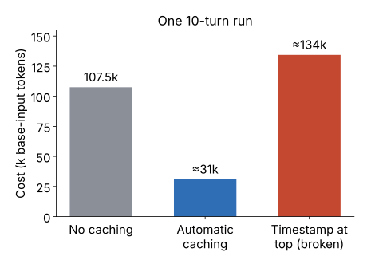

# Week 4 — Prompt and tool design

[Week 3](week-03-state-and-memory.md) was about layer 4 (state): everything the harness keeps outside the transcript, so the loop can survive and remember. (The harness is all the code around the model; the transcript is the running list of messages and tool results the model is sent each turn — see [1.4](week-01-what-an-agent-is.md#14-what-a-harness-is).) This week moves to layer 1 (prompts) and layer 2 (tools and the executor): the text and the tools that shape each turn. In other words, it is about what the model *reads* every turn.


*Figure: the six harness layers from [1.4](week-01-what-an-agent-is.md#14-what-a-harness-is). This week is about layer 1 (prompts) and layer 2 (tools and the executor).*

The week goes from the inside out:

- the system prompt (4.1);
- the tools the model chooses from (4.2), and the text it gets back when a tool fails (4.3);
- the whole channel between agent and environment, the agent-computer interface (4.4);
- skills, which hold procedures the agent loads only when it needs them (4.5);
- what all of this costs, and how prompt caching keeps that cost down (4.6).

One theme runs through every lesson: most agent failures you can fix are interface failures, not model failures. Fix the interface first.

The running example is the same as in earlier weeks: a read-only investigator that looks into forecast errors at solar sites (mostly the SG-03 meter-fault case) and ends by drafting a ticket for a human to approve.

---

## 4.1 System prompt architecture for agents

*Day 23 · 2026-09-24*

> **In short**
> - An agent's system prompt is not a message. It is the stable top of a document the model re-reads on every turn.
> - Write it in four sections — role, constraints, procedure, examples — at the "right altitude": heuristics, not scripts and not adjectives.
> - Put anything that changes per run or per turn below a cache boundary.

### The idea

In a chatbot, the system prompt is read once before a conversation. In an agent, it is re-read on every turn of the loop. It sits beside a growing transcript, tool definitions, memory files and injected context. So treat it as the stable head of an assembled document, not as a message.

Two things follow from that:

- It must say what tool results cannot say: who the agent is, what it must never do, in what order it works, and when it is done.
- It is cached (prompt caching reuses the model's work on an unchanged start of the prompt; see [4.6](#46-prompt-caching-and-cost)). The stable part must stay byte-identical across turns. Anything per-run or per-turn goes below it.

**Altitude.** Anthropic's context-engineering guide names two ways a system prompt fails:

- **Hardcoded, brittle logic.** If-else chains written as prose: "if MAE is over 3× and weather is normal, check curtailment, unless…". These break on the first case nobody planned for. They are really a workflow that should have been written as code ([1.6](week-01-what-an-agent-is.md#16-when-not-to-build-an-agent)).
- **Vague guidance.** "Investigate carefully and be thorough." This gives the model no concrete signal.

The target in between is the "right altitude": specific enough to steer, general enough that the model still makes the edge-case calls. Heuristics, not scripts. Two tests for any line:

1. If the line could be a check in the executor (the code that runs tool calls), move it there, like the site allow-list from [1.4](week-01-what-an-agent-is.md#14-what-a-harness-is).
2. If deleting it would change no decision across ten transcripts, delete it.

**Sections.** The guide recommends distinct sections, marked with XML tags or Markdown headers. Four sections recur in every serious agent:

- **Role.** Who the agent is and what "done" looks like, in about three sentences.
- **Constraints.** What it must never do. For the investigator: read-only; never write `checklist.md`; no root cause without a deciding number; say what was not verified. These mirror layer 5 (guardrails and permissions). The prompt version saves wasted turns. The executor version actually prevents the action. You need both.
- **Procedures.** Checklist order, when to delegate, how to take notes, and the completion rule: "Finish by calling `submit_ticket`; text without it is not done." This is the section most tempted toward if-else logic. Keep the ordering and the stop rule. Leave the branching to the model.
- **Examples.** Not a long list of edge cases. A few varied, typical ones: one good ticket draft, one good note line, one correct handling of a null result. Examples fix the output format more reliably than adjectives do.

**Assembly.** Claude Code's system prompt is not one string. Drew Breunig's analysis shows it is assembled from roughly twenty-five conditional parts, in this order:

1. intro, system rules, doing tasks, executing actions with care, using your tools, tone and style;
2. a cache boundary marker;
3. session guidance, memory and output-style instructions;
4. environment info (working directory, platform, model);
5. MCP server instructions (recomputed every turn, not cached);
6. finally scratchpad, budget and git status.

(MCP, the Model Context Protocol, is the open standard for plugging outside tool servers into an agent.)

Piebald's extraction of one Claude Code version counts 500+ strings, 150+ prompt sections, separate prompts for the Explore and Plan sub-agents, and 27 tool descriptions. Each part is switched on or off by flags, such as whether skills are enabled.

The structural lesson is an order:

1. stable text first (role, constraints, procedures, examples — cacheable across every run);
2. then a boundary;
3. then per-run material (site, window, triage table, memory index);
4. then per-turn material (budget, notes).

The order encodes two things at once: cache economics, and attention. Rules come before volatile facts.


*Figure: the further down the stack, the more often it changes. Everything above the boundary is cacheable across every run.*

**API details**

| What | Value |
|---|---|
| Claude Code version in Piebald's extraction | v2.1.259 |

### An example

The investigator's system prompt, in four sections plus a run block below the boundary:

```text
<role> Forecasting-ops investigator for solar sites. Read-only.
Your output is a ticket draft a human approves. </role>

<constraints> Never assert a root cause without a deciding number from a tool result.
Never write to memory/checklist.md. State what was not verified. </constraints>

<procedure> Read MEMORY.md and the site file before pulling metrics. Test hypotheses
in checklist order; skip any rejected in notes. After each verdict call note(...).
Delegate multi-station or archive pulls. Finish by calling submit_ticket. </procedure>

<examples> Note: "2 weather: st.1-6 normal, max delta 4% (st.4 09:00 7th) — rejected".
Null result: "no_data for 3 days — treat feed as suspect; check pipeline status". </examples>

---- cache boundary ----
<run> site SG-03, window 2026-09-07..09, triage: ..., MEMORY.md: ... </run>
```

Everything above the boundary is the same for every site and every night. Everything below it changes per run.

### Where it lives in the harness

The system prompt is layer 1 (prompts). But each section points at another layer:

- constraints point at layer 5 (guardrails and permissions);
- the completion rule points at layer 3 (loop control);
- the examples point at the output schema that layer 2 (tools and the executor) enforces ([2.4](week-02-core-mechanics.md#24-structured-outputs-and-schemas));
- the assembly order points at caching and layer 4 (state).

### Common mistakes

The system prompt is the cheapest lever, and the most abused. Every observed failure gets a sentence appended, until a 3,000-token prompt is both brittle and ignored.

Anthropic's rule: start minimal, on the best model, and add instructions and examples only against failures you have actually observed. This is the discipline of [1.4](week-01-what-an-agent-is.md#14-what-a-harness-is) applied to text.

Other mistakes:

- prompt rules that the executor should enforce;
- per-run data placed above the stable text, which invalidates the cache every turn;
- describing tools in the prompt instead of in their own definitions ([4.2](#42-tool-design-naming-descriptions-parameters));
- no completion rule, so a stall looks like success.

### Try it

Rewrite your `run_site` system prompt into the four sections, plus a run block below a cache boundary. Keep the stable part under 400 tokens.

Run the SG-03 meter-fault case four ways against your fake tools:

1. the full prompt;
2. with `<examples>` deleted;
3. with `<constraints>` deleted;
4. with `<procedure>` replaced by "investigate thoroughly".

For each, record: number of turns, whether the ticket carried a deciding number, whether `submit_ticket` was called, and whether any tool result was ignored.

Then write one paragraph: which removal changed behaviour most, which changed nothing (cut it, or move it to the executor), and the single line you would keep if you were allowed only one.

### Worked answer

Deleting one section at a time and comparing is an *ablation*. What the four runs look like:

- **Full prompt.** 7–8 turns. The site file is read first, the ticket carries a deciding number, and `submit_ticket` is called.
- **Examples deleted.** Same number of turns and the same tools. But the note lines and the ticket drift in format: verdicts without numbers ("weather looks normal"), and a null result described as "no anomaly" instead of "feed suspect". Nothing was ignored. The shape just got worse.
- **Constraints deleted.** On the happy path the model still behaves. But on a run where the meter ratio is borderline, it asserts a root cause with no deciding number and skips "not verified". This section's removal is invisible until the awkward case. That is why its executor twin (refuse a ticket with no number) must exist regardless.
- **Procedure replaced by "investigate thoroughly".** The big change. 10–12 turns. Metrics are pulled before the site file is read. Weather is re-checked after the notes had already rejected it. On about a third of runs the model ends with a text-only `end_turn` (stopping with plain text) and no `submit_ticket`, which the loop correctly treats as a stall.

So:

- **Procedure** changed behaviour most. Ordering and the completion rule live nowhere else.
- **Examples** changed format, not decisions.
- **Constraints** changed nothing on the easy case and everything on the hard one. Keep them as a two-line summary of what the executor enforces.

The one line to keep: "Finish by calling `submit_ticket`; text without it is not done."

Common slips:

- judging an ablation on one run of a stochastic system (use five);
- reading "constraints changed nothing" as "constraints are unnecessary", when it really means "this case never tested them".

### Sources

- Anthropic Engineering, [Effective context engineering for AI agents](https://www.anthropic.com/engineering/effective-context-engineering-for-ai-agents) (Sep 2025).
- Drew Breunig, [How Claude Code builds a system prompt](https://www.dbreunig.com/2026/04/04/how-claude-code-builds-a-system-prompt.html) (Apr 2026).
- Piebald-AI, [claude-code-system-prompts](https://github.com/Piebald-AI/claude-code-system-prompts) (v2.1.259, Sep 2026).

---

The system prompt is one half of what the model reads every turn. The other half is the list of tool definitions — and unlike the prompt, tools are the part of the interface the model actually operates.

## 4.2 Tool design: naming, descriptions, parameters

*Day 24 · 2026-09-25*

> **In short**
> - To the model, a tool set is a user interface. It sees only names, descriptions and parameter schemas.
> - Four decisions carry most of the weight: which tools exist, what they are called, how they are described, and what parameters they take.
> - Wrong-tool and wrong-argument calls are mostly interface bugs: remove overlapping tools before polishing the wording.

### The idea

The model cannot see your database or your codebase. It sees a list of names, descriptions and parameter schemas (the typed list of arguments a tool takes). It picks among them the way a person picks among buttons on a screen they have never seen before.

Anthropic's *Writing effective tools for AI agents* calls a tool "a contract between deterministic systems and non-deterministic agents". The same function can be exposed well or badly. Badly exposed tools show up as the agent picking the wrong tool, inventing arguments, or burning turns.

**1. Which tools exist.** Do not mirror your API. Anthropic's rule is to build a few thoughtful tools that match how the agent will actually work, not one wrapper per endpoint.

If the agent always calls `list_users`, then `list_events`, then `create_event`, expose one `schedule_event` that does the join inside. The agent makes one decision instead of three. Each removed call is one less term in the compounding-error product ([1.6](week-01-what-an-agent-is.md#16-when-not-to-build-an-agent)).

OpenAI's guide says the same thing from the other side: combine functions that are always called in sequence, and keep the set small. Their guidance is under twenty tools active at once, because tool-selection accuracy falls as the menu grows. Consolidated tools sit *beside* primitives, not instead of them (like `get_site_metrics` in [1.3](week-01-what-an-agent-is.md#13-tool--function-calling)).

**2. Names.** The name is the first thing the model matches against its intent.

- Use `verb_noun` that says the effect: `query_metrics`, `draft_ticket`.
- When there are many tools, add a namespace by service or resource: `weather_get_history`, `archive_search_incidents`. The agent can then tell which family a tool belongs to before reading its description.
- Two tools whose names differ only by a modifier are a coin flip.

**3. Descriptions.** The Claude docs ask for three or four sentences at minimum, covering:

- what the tool does;
- when to use it and when not to (name the sibling tool — the nearby tool it could be confused with);
- what each parameter means;
- what it returns, and any caveats.

Anthropic's example: "Gets the stock price for a ticker" is poor. A good description gives the input domain, the units and shape of the return, and what the tool will not do. Descriptions are prompt text ([1.3](week-01-what-an-agent-is.md#13-tool--function-calling)). Write them for a new colleague, not the way API docs describe an endpoint.

**4. Parameters.**

- Use unambiguous names: `user_id`, not `user`; `window_days`, not `n`.
- Use enums (a fixed list of allowed values) and object structure, so invalid states cannot be expressed: `agg: "hourly" | "daily"`, not a free string.
- Keep things whose set of valid values changes over time (like site codes) as free strings, with an allow-list in the executor ([2.4](week-02-core-mechanics.md#24-structured-outputs-and-schemas)).
- Do not make the model fill in arguments the harness already knows. If every call in this run is for SG-03, bind the site in code and remove the parameter.
- Give every parameter a description and a default.
- Offer a concise-or-detailed knob, so the model can ask for the short version. In Anthropic's example the same result was 72 tokens concise versus 206 detailed.

**API details**

| What | Value |
|---|---|
| A concise/detailed style knob (pattern) | `response_format: concise \| detailed` |

### An example

The investigator's weather tool, before and after:

```text
before:
  get_weather(s, d1, d2, full)
  "Gets weather."

after:
  weather_get_history(site: str, window_days: int = 7,
                      agg: "daily" | "hourly" = "daily",
                      stations: list[str] | None)
  "Returns per-station weather for one site over the last window_days,
   compared with a 30-day baseline. Use this to test the weather hypothesis;
   use pipeline_get_status if you suspect the feed itself. Daily returns
   max cloud delta and null counts per station (~200 tokens); hourly returns
   raw rows and can exceed 15k tokens — call it only for one station and a
   short window. no_data for a station is a normal result, not an error."
```

The "after" version has:

- a namespaced name;
- clear parameter names with defaults, and an enum;
- a sibling clause;
- the return size;
- a note that "no data" is a normal result.

### Where it lives in the harness

Tool definitions are layer-1 (prompts) text produced by layer-2 (tools and the executor) code.

- Names and descriptions steer which tool is chosen.
- The schema and defaults constrain arguments at sampling time.
- Result shaping ([2.1](week-02-core-mechanics.md#21-context-window-as-working-memory)) and error text ([4.3](#43-tool-error-messages-as-instructions-designing-for-recovery)) close the loop.

Anthropic's final step is the eval loop from layer 6 (feedback and evals): run the tools on realistic tasks, read the transcripts for wrong-tool and wrong-argument calls, and let a model rewrite the descriptions against that eval. They report that their own tools improved this way.

### Common mistakes

Wrong-tool and wrong-argument calls are the most common agent failures you can fix without touching the model. Most of them are interface bugs. The usual causes:

- one tool per endpoint;
- two overlapping tools;
- parameters named after your database columns;
- free strings where an enum would do;
- a description that leaves out the sibling tool, so the model picks by name alone.

### Try it

Take the five investigator tools: `get_site_metrics`, `get_weather_history`, `get_pipeline_status`, `search_incidents`, `draft_ticket`.

1. Rename each into a namespaced `verb_noun`. Rewrite each description in four parts: does / when vs. the sibling / parameters / returns and limits.
2. Cut one parameter the harness already knows, and add one enum.
3. Add a sixth tool that deliberately overlaps: `fetch_weather(site)` with a one-line description. Run the SG-03 case five times with it and five times without it. Count how often the overlap tool is chosen and what it costs in turns.
4. Remove the overlap. Ask a model to rewrite your five descriptions against three failure transcripts from earlier exercises, and diff the result against your own.

Then one paragraph: which of the four decisions (which tools, names, descriptions, parameters) moved behaviour most, and which single description sentence you would keep if you could keep only one.

### Worked answer

**(1) Renaming.** The five tools become `metrics_get_site`, `weather_get_history`, `pipeline_get_status`, `archive_search_incidents` and `ticket_draft`. Each gets a four-part description. For example, weather:

> Returns per-station weather for one site over window_days, compared with a 30-day baseline. Use it to test the weather hypothesis; use pipeline_get_status if you suspect the feed itself. agg=daily returns max cloud delta and null counts per station (~200 tokens); hourly can exceed 15k tokens, so restrict to one station and a short window. A station with no data is a normal result.

**(2) Parameters.** Cut `site` from every tool for a single-site run and bind it in the executor. Add `agg: daily | hourly` as an enum.

**(3) The overlap.** With `fetch_weather(site)` ("Gets weather.") planted beside `weather_get_history`, expect it to be chosen in roughly 2 of 5 runs. It is shorter and has fewer arguments, and the model has nothing else to go on.

Each pick costs one to two extra turns. It returns unshaped data with no baseline, so the model either calls the real tool again or reasons over raw rows with no deciding number.

**(4) Model rewrite.** A model rewriting descriptions against three failure transcripts usually adds exactly what the failures lacked:

- an explicit "do not use for X" clause;
- the return size;
- the sibling's name.

The diff is useful because it shows what you would have written if you had read the transcripts first.

**Which decision moved behaviour most:** which tools exist. The overlap tool changed behaviour more than any wording did. Names and descriptions decide between tools that exist, so remove the coin flip before polishing the text.

**The one sentence to keep:** the sibling clause — "use `pipeline_get_status` if you suspect the feed itself". It is the only sentence that settles the choice the model actually faces.

Common slips: counting a `fetch_weather` pick as a model error (it is a menu error), and measuring on one run instead of five.

### Sources

- Anthropic Engineering, [Writing effective tools for AI agents](https://www.anthropic.com/engineering/writing-tools-for-agents) (Sep 2025).
- Claude docs, [Define tools](https://platform.claude.com/docs/en/agents-and-tools/tool-use/define-tools).
- OpenAI docs, [Function calling (best practices)](https://developers.openai.com/api/docs/guides/function-calling).

---

Lesson 4.2 designed the happy path: what the model reads before it calls a tool. The next lesson is the unhappy path: what it reads when the call fails.

## 4.3 Tool error messages as instructions; designing for recovery

*Day 25 · 2026-09-26*

> **In short**
> - A tool error the model sees is a prompt. Its only job is to get the model to take a *different* action in one turn.
> - So it states the problem, the fix, and the data needed to apply the fix.
> - Not everything that "failed" is an error: "no data" is a result.

### The idea

[Lesson 2.6](week-02-core-mechanics.md#26-error-handling-retries-backoff-and-feeding-tool-errors-back-to-the-model) set up two error paths: retry infrastructure problems invisibly, and feed task errors back to the model. This lesson is about the design of that fed-back text — treated as tool design, not exception handling.

A tool result marked as an error lands in the transcript exactly where a successful result would. It is re-read on every later turn. And it is the only thing the model knows about why its action failed.

Anthropic's tools guide says it directly: error responses should "clearly communicate specific and actionable improvements, rather than opaque error codes or tracebacks".

The MCP spec (the Model Context Protocol, the open standard for tool servers) makes the same split. It separates:

- **protocol errors** — unknown tool, malformed request. These are protocol-level errors the client handles.
- **tool execution errors** — API failures, invalid input, business-logic errors. These come back as a normal result with an error flag set.

The reason for the split is that the second kind should stay in the model's context, where it can act on it. So the design question is: **what does the model need to read to choose a different next action, in one turn?**

**Four shapes** cover nearly every recoverable error:

- **Bad argument.** State the rule the value broke, and offer the corrected value where you can compute it: "date '03/09/2026' does not match YYYY-MM-DD; did you mean 2026-09-03?"
- **Wrong order or wrong state.** Name the precondition and the tool that sets it up: "cannot terminate a running instance; call stop_instance first" (Alpic's example).
- **Too-expensive request.** Truncate or refuse, and point toward the cheaper strategy: "hourly for 6 stations × 30 days is ~40k tokens; call with agg=daily, or one station and ≤3 days".
- **Unavailable.** Say what was obtained, what is pending, and the options — the vendor-rate-limit text from [2.6](week-02-core-mechanics.md#26-error-handling-retries-backoff-and-feeding-tool-errors-back-to-the-model).

Behind all four is the triad from [1.3](week-01-what-an-agent-is.md#13-tool--function-calling): the problem, the fix, and the data to apply the fix without another round trip.

**Not every failure is an error.** "No incidents match" and "station 4 returned no data" are *results*.

- Return them flagged as errors and you teach the model to retry an answer that was already correct.
- Return them as an empty list and you teach it that nothing was wrong (the null-weather case from the [Week 1 review](week-01-what-an-agent-is.md#week-1-review)).

The executor decides, per tool, which outcomes are:

- **errors** — the model must act differently;
- **findings** — the model should reason on them;
- **invisible** — retried inside the tool, never shown to the model.


*Figure: the executor sorts every outcome. Only real errors reach the model as errors, and each one carries its fix.*

**API details**

| What | Value |
|---|---|
| Claude API: error flag on a tool result | `is_error` |
| MCP: protocol errors | JSON-RPC errors, handled by the client |
| MCP: tool execution error flag | `isError: true` |

### An example

A small error type and the executor that renders it:

```python
class ToolError(Exception):
    def __init__(self, problem, fix, data=None, retryable=False): ...

def execute(block):
    try:
        return result(block.id, REGISTRY[block.name](**block.input))
    except ToolError as e:
        text = f"{e.problem} {e.fix}" + (f" {e.data}" if e.data else "")
        log(tool=block.name, error=type(e).__name__)
        return result(block.id, text, is_error=True)

# Inside the weather tool:
# if agg == "hourly" and stations * days > 90:
#     raise ToolError("Request would return ~40k tokens.",
#                     "Use agg='daily', or hourly for one station and <=3 days.",
#                     f"Stations available: {ids}")
```

Every tool raises the same structured error. The executor turns it into "problem, fix, data", marks it as an error, and logs which tool failed.

### Where it lives in the harness

- The error text is layer-1 (prompts) content, produced by the layer-2 executor.
- The decision to feed back rather than retry is layer 3 (loop control), from [2.6](week-02-core-mechanics.md#26-error-handling-retries-backoff-and-feeding-tool-errors-back-to-the-model).
- Errors per tool per run is a layer-6 (feedback and evals) metric. An error that keeps recurring across runs is a description or parameter bug ([4.2](#42-tool-design-naming-descriptions-parameters)), not something to explain better.

### Common mistakes

A recoverable error costs one turn when the message carries the fix, and three to six turns when it says "invalid input" (the planted SyntaxError test in [2.6](week-02-core-mechanics.md#26-error-handling-retries-backoff-and-feeding-tool-errors-back-to-the-model)). The usual mistakes:

- the same string for every exception;
- an error that names the problem but not the fix;
- a 40-line traceback where only the last three lines were useful;
- marking findings as errors, or errors as empty results;
- explaining a recurring error more eloquently instead of fixing the tool that causes it.

### Try it

Take the investigator's executor.

1. Define `ToolError(problem, fix, data, retryable)` and make every tool raise it for its own failure modes. At least: bad site, bad window, over-sized hourly request, vendor unavailable with partial data, and "no data" (which must *not* raise).
2. Write an `ERROR_CATALOGUE`: one row per tool per failure mode, with the exact text returned.
3. Run the SG-03 case five times with three planted faults — a window in DD/MM/YYYY, hourly for all stations, the vendor going down after 2 stations — under two executors: yours, and one that returns `f"{type(e).__name__}: {e}"`. Record turns-to-recover, and whether the model ever treated "no data" as a failure.
4. One paragraph: which of the three faults should have been made impossible by the schema ([2.4](week-02-core-mechanics.md#24-structured-outputs-and-schemas)) rather than explained by the executor, and what that tells you about where the catalogue should shrink over time.

### Worked answer

**The executor.** Every tool raises `ToolError(problem, fix, data, retryable)`. The executor renders it as "problem, fix, data", and adds "Do not repeat the identical call" when `retryable` is False.

**Sample catalogue rows:**

- *Bad window:* "window '07/09/2026' is not YYYY-MM-DD; did you mean 2026-09-07?"
- *Hourly too large:* "6 stations × 30 days hourly ≈ 40k tokens; use agg='daily', or hourly for one station and window_days ≤ 3."
- *Vendor down:* "Vendor unavailable after 3 retries. Stations 1–2 returned (attached), 3–6 pending. Continue with other evidence, or draft the ticket with weather marked unverified."
- *No data:* never raises. It returns `{"status": "no_data", …}` with a suggestion.

**Your executor against the `str(e)` one:**

- **Date fault:** about one turn under both, because Python's `ValueError` text is already half an instruction.
- **Vendor fault:** this is where `str(e)` hurts. "ConnectionError: …" throws away the two stations already fetched. The model repeats the identical call, and the stuck detector fires. Yours moves on in one turn.
- **Hourly fault:** the surprise. Under `str(e)` nothing raises at all, so 40k tokens land in context. A missing error costs more than a bad one.

**What the schema should have prevented:**

- The date fault. Replace the window string with `window_days: int` (or `format: date`).
- The hourly fault is half a schema fix: an `agg` enum that defaults to daily.
- The vendor outage cannot be fixed by a schema, because it comes from the world.

So over time the catalogue should shrink toward the "unavailable" shape: errors that come from the world, not from the interface.

Common slips: raising on `no_data`, and fix text that names a tool the agent doesn't have.

### Sources

- Anthropic Engineering, [Writing effective tools for AI agents](https://www.anthropic.com/engineering/writing-tools-for-agents) (Sep 2025).
- [MCP specification — Tools: error handling](https://modelcontextprotocol.io/specification/2025-06-18/server/tools).
- Alpic, [Better MCP tool call error responses](https://alpic.ai/blog/better-mcp-tool-call-error-responses-ai-recover-gracefully) (Jul 2025).

---

Lessons 4.2 and 4.3 designed single tools and the text they return. The next lesson zooms out to the interface as a whole: what the agent sees back each turn, how much one action does, and which state it can see.

## 4.4 Agent-computer interface (ACI)

*Day 26 · 2026-09-27*

> **In short**
> - A language model is a new kind of user, and interfaces built for humans fit it badly.
> - Holding the model fixed and changing only the interface took SWE-agent from 11.0% to 18.0% on SWE-bench Lite.
> - More information does not keep helping, and human-style interaction can hurt.

### The idea

The term comes from SWE-agent (Yang et al., NeurIPS 2024). It defines an agent-computer interface (ACI) as "an abstraction layer between the LM agent and computer". The claim: a shell or an IDE, built for humans, fits a language model badly — much as a raw terminal fits a novice badly.

The authors kept the model fixed (GPT-4 Turbo) and changed only the interface. They worked to four principles:

- **Simple actions.** Commands the model understands without needing examples.
- **Efficient actions.** Navigation and editing folded into as few actions as possible.
- **Feedback that is informative but concise.**
- **Guardrails for error recovery.**


*Figure: the ACI sits between the model and the environment, shaping both what the agent can do and what it sees back.*

The SWE-bench Lite ablation is the part to remember. (SWE-bench Lite is a software-engineering benchmark, covered in [6.6](week-06-evaluation-1.md#66-public-benchmarks-swe-bench-τ-bench-gaia-terminal-bench-and-their-limits). An ablation changes one part at a time and compares the scores.)

| What changed | Score (resolved) |
|---|---|
| Shell only | 11.0% |
| Full ACI | 18.0% |
| File viewer: 30-line window | 14.3% |
| File viewer: 100-line window | 18.0% |
| File viewer: whole file | 12.7% |
| Search: summarised list of matching files (capped at 50) | 18.0% |
| Search: no search tool | 15.7% |
| Search: IDE-style "next match" | 12.0% |
| Editing: without the flake8 linter that blocks syntax errors | 15.0% |

Two lessons carry over to other agents:

1. **More information does not keep helping.** With too small a window the agent scrolls blindly. With the whole file it drowns — context rot, answers getting worse as the context fills ([2.1](week-02-core-mechanics.md#21-context-window-as-working-memory)).
2. **What suits humans can hurt an agent.** Stepping through search matches one at a time scored *below no search at all*. Every step is a turn, and every turn re-sends the whole transcript.

**Small details count.** When a command prints nothing, SWE-agent replies "Your command ran successfully and did not produce any output." Silence is ambiguous to a model (compare findings vs. errors in [4.3](#43-tool-error-messages-as-instructions-designing-for-recovery)).

Anthropic's *Building effective agents* asks you to put as much effort into agent-computer interfaces as into human-computer ones. They report spending more time on tools than on the prompt for their SWE-bench agent.

One example: after the agent changed directory, it got relative paths wrong. They made every path absolute, and the problem went away. They call this kind of mistake-proofing "poka-yoke".

Their editor matches an exact string instead of a line range, because line numbers go stale after the first edit. SWE-agent solves the same problem differently: line ranges, plus the linter, plus re-showing the edited region. Two different interfaces remove the same failure.

### An example

A viewer over a time series for the investigator, instead of dumping all 720 rows:

```text
series_open("SG-03", "actual_vs_forecast", at="2026-09-07 00:00")

[SG-03 actual vs forecast | rows 145–192 of 720 | 672 omitted]
145 09-07 06:00 f=1.20 a=0.41 err=-0.79
146 09-07 07:00 f=2.85 a=1.62 err=-1.23
…
(Open: SG-03 actual_vs_forecast | cursor 145 | window 48)
Other commands: series_goto(ts), series_scroll(n),
                series_find(cond) → row numbers only, max 20
```

- The header says where you are and what is hidden.
- The footer repeats the state every turn, so the agent never has to remember it.
- Search returns row numbers, not rows.

### Where it lives in the harness

Tool design ([4.2](#42-tool-design-naming-descriptions-parameters)) was one tool at a time. The ACI is the whole channel between agent and environment:

- **Layer 2 (tools and the executor):** how much one action does, and how results are rendered.
- **Layer 1 (prompts):** the observation format, which the model reads as prompt text.
- **Layer 4 (state):** state the harness holds for the agent, such as which file is open and where the cursor is.
- **Layer 5 (guardrails and permissions):** guardrails such as the linter.

### Common mistakes

Teams tune prompt wording while the interface wastes half the turns. The usual mistakes:

- copying human interfaces (a "next page" button);
- handing over whole files "to be safe";
- returning nothing on success;
- line-number edits without re-showing the result;
- hiding state the agent needs, like the current directory.

### Try it

*(10–15 min)*

Build the three series commands above with fake data for SG-03's meter fault. Run the case 5 times at each window size: 12, 48 and 720 rows (a full dump). Record turns, peak input tokens, and whether the ticket carries the correct deciding number.

Then remove the state footer, and count how often the agent re-opens a series it already has open.

Finally, one paragraph: which window won, what the shape of the curve tells you, and which of the four principles the footer serves.

### Worked answer

Five runs per window size over SG-03:

- **12 rows.** The agent scrolls blind: 11–14 turns, low peak input (~7–9k). On one or two runs the step cap hits before it reaches the anomaly, so the ticket has no deciding number.
- **48 rows.** `series_find(err < -1.0)` returns row numbers, then one `series_goto`, and one 48-row window covers the fault. 6–8 turns, peak ~10–12k, correct number every run.
- **720 rows.** Fewest turns (5–6), but the dump lands early and is re-sent every turn. Peak 30k+, and on a run or two the "deciding number" is a neighbouring hour.

The curve is an inverted U: the SWE-agent ablation (30 / 100 / whole file) reproduced on a time series. Too small costs turns. Too large costs attention.

**Without the footer**, expect the agent to call `series_open` again in roughly 2 of 5 runs, usually after a `series_find`, because it no longer knows which series or cursor it is on.

The footer mainly serves *informative but concise feedback*: state the harness already holds, repeated so the model never has to remember it or ask for it. It also makes actions more efficient, since the re-query disappears.

Common slips: letting `series_find` return rows instead of row numbers (that is just a dump by another route), and picking a winner from one run each.

### Sources

- Yang et al., [SWE-agent: Agent-Computer Interfaces Enable Automated Software Engineering](https://proceedings.neurips.cc/paper_files/paper/2024/file/5a7c947568c1b1328ccc5230172e1e7c-Paper-Conference.pdf) (NeurIPS 2024). Also on [arXiv](https://arxiv.org/abs/2405.15793).
- [SWE-agent docs — ACI background](https://github.com/SWE-agent/SWE-agent/blob/main/docs/background/aci.md).
- Anthropic, [Building effective agents](https://www.anthropic.com/engineering/building-effective-agents), Appendix 2: Prompt engineering your tools.

---

The ACI is the interface the agent acts through. Back in [4.1](#41-system-prompt-architecture-for-agents), the system prompt kept only stable, always-needed instructions and set aside "multi-step procedures used occasionally". The next lesson is where those set-aside procedures go.

## 4.5 Skills: procedural knowledge loaded on demand

*Day 27 · 2026-09-28*

> **In short**
> - A skill is a folder with a `SKILL.md` file: a short name and description that are always visible, and a body of instructions (plus optional scripts) that load only when the model decides they are relevant.
> - The agent can carry dozens of procedures and pay only for the one in use.
> - The description is the only thing that decides whether a skill fires, so write it like a tool description.

### The idea

A skill is a folder containing a `SKILL.md` file: a short YAML header (the frontmatter) with a name and a description, followed by Markdown instructions. It can also bundle scripts, reference files and assets.

Anthropic describes writing one as putting together "an onboarding guide for a new hire". Since December 2025 the format has been an open standard ([agentskills.io](https://agentskills.io)), read by Claude Code, Codex, Cursor, VS Code, goose and others.

The mechanism is **progressive disclosure** — revealing detail only as it is needed. It works in three levels:

1. **Metadata — ~100 tokens per skill, always loaded.** The harness puts every skill's name and description into the system prompt. This is a menu, just like tool definitions.
2. **Instructions — under 5k tokens recommended, loaded when triggered.** When the model decides a skill is relevant, it reads the full `SKILL.md` with a file tool or a Skill tool. The body enters the transcript as a message and stays there.
3. **Resources — free until used.** Reference files are read only if the body points to them. Scripts are *executed*, not read, so only their output costs tokens.


*Figure: each level is paid for only when the one above it calls for it.*

**API details**

| What | Value |
|---|---|
| `SKILL.md` header | YAML frontmatter with `name` and `description` |
| Optional bundled folders | `scripts/`, `references/`, `assets/` |

### An example

The investigator with a `checking-weather-feed` skill:

```text
system prompt (level 1):
  <skills> checking-weather-feed: Tests whether a site's
  error comes from the weather feed (nulls, staleness,
  station disagreement). Use when the weather hypothesis
  is next or a weather tool returned nulls. </skills>

turn 4  tool_use read_file("skills/checking-weather-feed/SKILL.md")
        → 60 lines: steps, deciding thresholds, ticket wording
turn 5  tool_use bash("python skills/.../scripts/station_deltas.py SG-03 2026-09-07 3")
        → "max cloud delta 4% | nulls 0/432 | verdict: feed OK"
```

Runs that never reach the weather hypothesis pay about 60 tokens for this skill. Runs that do reach it get the full procedure, plus a script whose output is the deciding number.

### Where it lives in the harness

A skill touches four layers:

- **Layer 1 (prompts) — the description.** It is prompt text, and it is the *only* thing that decides whether the skill fires. Write it like a tool description ([4.2](#42-tool-design-naming-descriptions-parameters)): third person, what it does and when to use it, with the key terms in it.
- **Layer 4 (state) — the body.** It lives in the transcript. It is not re-read later. After compaction (the harness replacing old transcript with a summary), Claude Code re-attaches the most recent invocation of each skill, capped at 5k tokens each and 25k in total ([3.2](week-03-state-and-memory.md#32-context-management-summarisation-compaction-truncation)).
- **Layer 2 (tools and the executor) — scripts.** They run through the executor, usually via code execution.
- **Layer 5 (guardrails and permissions) — controls.** Claude Code's frontmatter adds three: a switch so that only a human can trigger skills with side effects, a list of allowed tools, and an option to run the skill as a sub-agent, a separate model call with its own transcript ([3.6](week-03-state-and-memory.md#36-sub-agents-and-context-isolation)).

**Authoring rules** follow from all this:

- Include only what the model doesn't already know. "The context window is a public good."
- Match how specific you are to how fragile the task is: exact steps for a narrow bridge, general direction for an open field.
- Keep `SKILL.md` under 500 lines, with references only one level deep.
- Write the evals first: run without the skill, record the failures, then write the minimum text that fixes them.

**API details**

| What | Value |
|---|---|
| Claude Code: human-only trigger | `disable-model-invocation: true` |
| Claude Code: allowed tools | `allowed-tools` |
| Claude Code: run as a sub-agent | `context: fork` |

### Common mistakes

Skills apply the just-in-time principle of retrieval ([3.3](week-03-state-and-memory.md#33-retrieval-for-agents-rag-vs-agentic-search)) to know-how. The usual mistakes:

- a vague description ("Helps with weather"), so the skill never fires or fires every time;
- putting a skill's content in the system prompt "to be safe";
- making the model regenerate code that a script could run deterministically;
- installing skills from untrusted sources. A skill is instructions plus code, so treat it like software you install.

How to tell skills apart from memory ([3.4](week-03-state-and-memory.md#34-persistent-memory-files-and-memory-as-documents)) and tools ([4.2](#42-tool-design-naming-descriptions-parameters)): **memory** holds facts about the past, a **tool** is an action, and a **skill** is a way of doing something.

### Try it

*(15 min)*

1. Move the weather part of the investigator's `<procedure>` into `skills/checking-weather-feed/`: a `SKILL.md` under 60 lines, and a `scripts/station_deltas.py` that prints one line with the deciding numbers.
2. Add a loader to `run_site`. It scans `skills/*/SKILL.md` and puts each name and description into the system prompt *above* the cache boundary (the skill list is stable text). Add `load_skill(name)`, which returns the body.
3. Run five SG-03 meter-fault cases and five weather-outage cases. Record whether the skill loaded (it should load only for the outage), the turn-1 input tokens compared with leaving the procedure inline, and whether the ticket carries the script's number.
4. Change the description to "Helps with weather." and re-run.

Then one paragraph: which parts of the investigator belong in the system prompt, which in a skill, which in a tool and which in memory, with one example of each.

### Worked answer

**The skill.** `skills/checking-weather-feed/SKILL.md` with:

- `name: checking-weather-feed`
- `description: Tests whether a site's forecast error comes from the weather feed (nulls, staleness, station disagreement). Use when the weather hypothesis is next on the checklist or a weather tool returned nulls.`

The body (about 40 lines) says: run `scripts/station_deltas.py SITE START DAYS`, apply the thresholds (a cloud delta over 15%, or nulls over 5%, means the feed is suspect), and use the exact ticket wording it gives. The script prints one line, for example:

```text
max cloud delta 4% | nulls 0/432 | stale 0h | verdict: feed OK
```

**The loader** globs `skills/*/SKILL.md`, parses the frontmatter, and puts a `<skills>` list above the cache boundary. `load_skill(name)` returns the body.

**Results:**

- **Meter-fault cases:** the skill loads 0–1 times in 5. When it does load, it is because the checklist put weather ahead of meter. That is a procedure-order problem; the description is fine.
- **Outage cases:** it loads 5/5, usually right after the weather tool returns nulls. Every ticket carries the script's numbers.
- **Turn-1 input** drops by about 1k tokens: roughly 1.1k of inline procedure becomes an ~80-token listing line. You save that on every turn.
- **"Helps with weather."** Loading becomes unreliable: roughly 2–3 of 5 outage runs load it. The runs that don't load it read the raw rows, and their deciding numbers drift.

**Where each thing goes:**

- **System prompt:** "finish by calling `submit_ticket`".
- **Skill:** the weather-feed check and its thresholds.
- **Tool:** `weather_get_history`.
- **Memory:** "SG-03 meter under-reads below 200 W/m², since 2026-08-14".

Common slips:

- putting the "when to use" in the body, which the model only sees *after* it has loaded the skill;
- expecting the body to be re-read later in the run.

### Sources

- Anthropic, [Equipping agents for the real world with Agent Skills](https://www.anthropic.com/engineering/equipping-agents-for-the-real-world-with-agent-skills) (Oct 2025).
- [Agent Skills open standard — specification](https://agentskills.io/specification).
- Claude Code docs, [Skills](https://code.claude.com/docs/en/skills).

---

So far this week has been about what the agent reads: the prompt, tools, errors, the interface and skills. The last lesson is about what all of that costs. It also explains the "cache boundary" that [4.1](#41-system-prompt-architecture-for-agents) put into the system prompt without saying why.

## 4.6 Prompt caching and cost

*Day 28 · 2026-09-29*

> **In short**
> - Every turn re-sends almost the same prompt. Prompt caching lets the model reuse the work it did on an identical prefix, at about a tenth of the price.
> - For an agent, that can make a run roughly 3.5× cheaper.
> - But only if the prefix stays byte-identical: a single changing byte near the top can make things worse than no cache at all.

### The idea

Every loop turn re-sends the whole prompt ([1.2](week-01-what-an-agent-is.md#12-the-agent-loop)), and most of it is identical to the previous turn.

**Prompt caching** stores the model's computed state for a prefix of the request (the KV cache). The next request that starts with exactly the same bytes skips recomputing that prefix and pays a fraction of the price for it.

**How the prefix is built on Claude.** In this order: tools, then system, then messages. A change at any level invalidates that level and everything after it.

You mark cache points (breakpoints) yourself, up to 4 of them. Or you set one top-level cache setting ("automatic caching"), which moves the breakpoint forward as the conversation grows.

**Prices**, relative to the base input price:

- cache reads: 0.1× (lower still on some newer models);
- 5-minute cache writes: 1.25×;
- 1-hour cache writes: 2×.

The cache lifetime (TTL, time to live) counts from the start of the request that last used the entry. Each model has a minimum length below which a prompt is not cached.

Agents are where this matters most. Manus reports an input-to-output ratio of about 100:1, and calls the KV-cache hit rate "the single most important metric for a production-stage AI agent".

**API details**

| What | Value |
|---|---|
| Cache marker | `cache_control` |
| Explicit breakpoints | up to 4 |
| Automatic caching | one top-level `cache_control` |
| Minimum cacheable length | between 512 and 4,096 tokens, depending on the model |

### An example

Take the investigator:

- The prefix (tools, system prompt, skill listing and the per-run block) is 4k tokens.
- Each turn adds about 1.5k tokens.
- A run is 10 turns.

Costs, in base-input-token equivalents:

- **No caching.** The inputs add up to 40k + 1.5k × 45 = 107.5k.
- **Automatic caching.** Turn 1 writes 4k (× 1.25 = 5k). Turns 2–10 read everything before them (90k in total × 0.1 = 9k), and write only the new 1.5k each time (9 × 1.875k ≈ 16.9k). Total ≈ 31k — about 3.5× cheaper. Time to first token drops too.
- **The classic bug.** The system prompt starts with `f"Current time: {datetime.now()}"`. Now the prefix differs at byte ~60 on every call, so with one automatic breakpoint nothing is ever read. Every token is written at 1.25× every turn: about 134k. That is *worse than having no cache at all*.



*Figure: a working cache cuts the run to under a third of the cost; a broken one costs more than no cache.*

**Things that break the cache in an agent:**

- Adding or removing tools mid-run. This invalidates everything, because tools come first.
- Changing the tool-choice setting in any way — for example forcing the final answer from [2.5](week-02-core-mechanics.md#25-stopping-conditions-step-budgets-and-loop-detection). This invalidates the messages level.
- Changing thinking or effort settings, depending on the model.
- Switching model. Caches are per model.
- Non-deterministic JSON key order in tool results.
- Editing earlier messages. Context clearing and compaction ([3.2](week-03-state-and-memory.md#32-context-management-summarisation-compaction-truncation)) are deliberate cache breaks, so let them fire rarely and clear a lot each time. The API's tool-result clearing has a minimum-to-clear setting for exactly this.

**Claude Code's rules.** The Claude Code team (Thariq Shihipar, Apr 2026) turn this into rules:

- Static content first, dynamic content last.
- Never change tools mid-session. Plan mode is a pair of tools, not a different tool set.
- Load MCP schemas lazily.
- When something changes, add a reminder to the next message. Don't edit the system prompt.
- Compaction reuses the parent's exact prefix.
- "We alert on cache breaks and treat them as incidents."

Manus adds a related trick: when some tools shouldn't be available, *mask* them instead of removing them.

**An accounting trap.** With caching on, the usual input-token count covers only the tokens after the last breakpoint. The real total is:

```text
cache_read_input_tokens + cache_creation_input_tokens + input_tokens
```

Per-turn logs from earlier exercises that used `input_tokens` alone will under-report.

**API details**

| What | Value |
|---|---|
| Tool-choice setting (any change breaks the cache) | `tool_choice` |
| Tool-result clearing (API) | `clear_tool_uses`, with `clear_at_least` |
| Load MCP tool schemas lazily | `defer_loading` |
| Claude Code: change notice | a `<system-reminder>` in the next message |
| Input tokens after the last breakpoint | `usage.input_tokens` |
| Cached tokens read / written | `cache_read_input_tokens` / `cache_creation_input_tokens` |

### Where it lives in the harness

Caching touches every layer:

- **Layer 1 (prompts):** assembly order and the cache boundary.
- **Layer 2 (tools and the executor):** a fixed tool set with deterministic serialisation.
- **Layer 3 (loop control):** where the breakpoints go, and which TTL to use.
- **Layer 4 (state):** state changes are appended, never edited in.
- **Layer 6 (feedback and evals):** log the hit rate.

### Common mistakes

Caching is the difference between an agent bill that grows roughly quadratically at full price and one where most of the growth is at a tenth of the price. But it is invisible: a broken cache still gives correct answers, just slower and dearer. The usual culprits:

- timestamps or run ids in the system prompt;
- per-phase tool sets;
- dict-order drift in serialised results;
- a batch whose sites are spaced further apart than the TTL.

### Try it

Add caching to `run_site`.

1. Log `cache_read_input_tokens`, `cache_creation_input_tokens` and `input_tokens` per turn. Compute hit rate = read / (read + creation + input).
2. Run the SG-03 case four ways:
   - (a) no `cache_control`;
   - (b) automatic caching (top-level `cache_control`);
   - (c) (b) with `datetime.now()` planted in the stable system text;
   - (d) (b) with `tool_choice` forced to `submit_ticket` on the last turn.

   For each, report the hit rate and a cost in base-token equivalents (reads 0.1×, writes 1.25×).
3. Search your own harness for three places where a byte could change between two calls of the same run — for example the `<run>` block, `json.dumps` without `sort_keys`, or the skill listing order from `glob`.
4. One paragraph on the nightly 40-site batch: should the global prefix use the 5-minute or the 1-hour TTL if sites run one after another at about 3 minutes each? What changes if the batch fans out 8 at a time?

### Worked answer

Use the same cost model as above: 4k-token global prefix, +1.5k per turn, 10 turns, costs in base-token equivalents (reads 0.1×, writes 1.25×).

| Case | Cost | Hit rate |
|---|---|---|
| (a) No `cache_control` | 107.5k raw input = 107.5k | 0% |
| (b) Automatic caching | ≈ 31k | ≈ 84% |
| (c) `datetime.now()` in system text | ≈ 134k | 0% |
| (d) Forced `tool_choice` on last turn | ≈ 49k | ≈ 69% |

- **(b)** Turn 1 writes 4k (5k cost). Each later turn reads the previous prefix and writes its new 1.5k. That is 90k tokens read (9k cost) and 13.5k written (16.9k cost), about 31k in total. Hit rate = 90 / 107.5 ≈ 84%.
- **(c)** The prefix changes every turn, so nothing is ever read. Every token is written at 1.25×: about 134k, *worse than no caching*. The answers are still correct, which is why this bug hides.
- **(d)** Changing `tool_choice` invalidates the messages level. With only the automatic breakpoint, the last turn rewrites about 17.5k tokens at 1.25× instead of reading them. That adds roughly 18k, bringing the run to about 49k. Two fixes:
  - keep `tool_choice` constant, and send "budget reached — call submit_ticket" as an appended message; or
  - add an explicit breakpoint at the end of the system prompt, so tools and system survive the change.

**Bytes that drift:**

- a `<run>` block that carries "turns remaining" or a timestamp;
- tool results serialised from vendor JSON or sets without `sort_keys`;
- `glob()` skill order, which depends on the filesystem — sort it;
- a tool list built from a set;
- float formatting that differs between code paths.

**TTL.** With sites running one after another at about 3 minutes each, the 5-minute TTL wins. Every read refreshes the entry, and the next site starts seconds after the last call. Paying 2× for 1-hour writes buys nothing, unless a single run can pause for more than 5 minutes (a long vendor back-off, for example).

Fanning out 8 at a time changes one thing. A cache entry becomes available only after the first response begins, so 8 simultaneous cold starts means 8 writes. Pre-warm once (one call ahead of the fan-out), then launch the 8. The parallel traffic keeps the 5-minute entry warm.

Common slips: computing hit rate from `input_tokens` alone, which leaves out cached tokens; and treating a forced `tool_choice` as free.

### Sources

- Anthropic docs, [Prompt caching](https://platform.claude.com/docs/en/build-with-claude/prompt-caching).
- Claude blog, [Lessons from building Claude Code: prompt caching is everything](https://claude.com/blog/lessons-from-building-claude-code-prompt-caching-is-everything) (Apr 2026).
- Manus, [Context Engineering for AI Agents: Lessons from Building Manus](https://manus.im/blog/Context-Engineering-for-AI-Agents-Lessons-from-Building-Manus) (Jul 2025).

---

## Week 4 review

*Day 29 · 2026-09-30*

Weeks 2 and 3 made the loop survive and remember. Week 4 was about what the model reads every turn: layer 1 (prompts) and layer 2 (tools and the executor). The common theme was fixing failures in the interface rather than in the model. [Week 5](week-05-control-safety-reliability.md) moves to layer 5 (guardrails and permissions): control and safety.

### Recap

**[4.1](#41-system-prompt-architecture-for-agents) System prompt architecture.** The system prompt is the stable head of a document the model re-reads every turn, so it says what tool results cannot. Write it at the "right altitude": heuristics, not if-else prose and not adjectives. Four sections:

- role;
- constraints (mirror layer 5; each needs an executor twin);
- procedure (ordering plus the completion rule);
- examples (fix the format).

After those comes a cache boundary, then per-run material. Start minimal, add lines only against observed failures, and test sections by ablation. The ablation showed that the procedure section carries the decisions.

**[4.2](#42-tool-design-naming-descriptions-parameters) Tool design.** Tools are the agent's UI; the model sees only names, descriptions and schemas. Four decisions, in order of impact:

- **Which tools exist:** shaped around the workflow, few, no overlaps. A planted overlap was chosen in about 2 of 5 runs.
- **Names:** namespaced `verb_noun`.
- **Descriptions:** four parts — does / when vs. the sibling / parameters / returns and limits.
- **Parameters:** enums for closed sets, a free string plus allow-list for changing domains, nothing the harness already knows, concise output by default.

**[4.3](#43-tool-error-messages-as-instructions-designing-for-recovery) Error messages as instructions.** An `is_error` result is a prompt, and its job is to get a *different* action within one turn. Four shapes cover most cases:

- bad argument (plus the corrected value);
- wrong state (plus the tool that fixes it);
- too expensive (plus the cheaper strategy);
- unavailable (what was obtained, what is pending, the options).

Findings such as `no_data` or zero hits are not errors, and are never returned empty. Keep an error catalogue, and let it shrink as schema and description gaps close.

**[4.4](#44-agent-computer-interface-aci) Agent-computer interface.** The ACI is the whole observation–action channel. SWE-agent held the model fixed and went from 11.0% to 18.0% on SWE-bench Lite by changing only the interface.

Two lessons: information is non-monotonic (a 100-line window beat both 30 lines and the whole file), and human-style interaction can hurt an agent (iterative search scored below no search). Small details remove whole classes of failure:

- state footers;
- an explicit message when a command produces no output;
- absolute paths;
- edits by exact string;
- an edit linter.

**[4.5](#45-skills-procedural-knowledge-loaded-on-demand) Skills.** Occasional procedures leave the prompt and become folders with a `SKILL.md`. They load by progressive disclosure:

- a ~100-token description that is always present;
- a body under 5k tokens, read when relevant;
- scripts that are executed, so only their output costs tokens.

The description is the trigger, so write it like a tool description. The body stays in the transcript and is not re-read later. Skills with side effects should be human-invoked only.

**[4.6](#46-prompt-caching-and-cost) Prompt caching.** A byte-identical prefix (tools → system → messages) is read at about 0.1× the price. So an agent that re-sends its transcript can pay about a quarter to a third of the uncached cost — as long as the harness stays append-only:

- nothing volatile above the boundary;
- a fixed tool set;
- sorted serialisation;
- state changes sent as messages;
- clearing and compaction treated as deliberate breaks.

Measure hit rate from all three usage fields.

### Self-quiz

**1.** Your investigator prompt has a constraint line: "never assert a root cause without a deciding number". Ablating it changes nothing across five SG-03 runs. Give two readings of that result. Which one decides whether you may delete the line, and what must exist in the executor either way?

> **Answer.** Either the line does nothing, or none of the five runs was a borderline case that would test it. The second reading is the one that matters: rerun the test on a case where the ratio is borderline before you delete the line. Either way, the executor twin must exist: `ticket_submit` refuses a ticket that has no deciding number.

**2.** Transcripts show the model calling `weather_get_history(agg="hourly")` for all six stations on 4 of 10 runs, getting your too-expensive error, then retrying correctly. The error text is good. Name the three upstream places (from 4.2 and 2.4) where this failure should be closed, and say what happens to the catalogue row once it is.

> **Answer.** Fix it upstream in three places: make `agg` an enum that defaults to daily; put the return size of hourly in the description; and require a single station and `window_days` ≤ 3 whenever `agg=hourly`. After that, the catalogue row stops firing and you can delete it. A shrinking catalogue is a sign the harness is healthy.

**3.** Why can a tool that returns the whole 720-row series score *worse* than one that returns 48 rows, even though it contains strictly more information? Name the mechanism from Week 2 and the SWE-agent result that shows it.

> **Answer.** Context rot and the attention budget ([2.1](week-02-core-mechanics.md#21-context-window-as-working-memory)): rows that look almost the same pull attention away from the one row that matters. In SWE-agent's ablation, a 100-line viewer scored 18.0% and the whole file scored 12.7%.

**4.** A colleague moves the four per-hypothesis procedures into skills. Turn-1 input tokens fall, but on weather-outage cases the weather skill now loads in only 2 of 5 runs. Where is the bug, what does the fix look like, and why would copying the procedure back into the system prompt "just in case" be the wrong fix?

> **Answer.** The bug is in the description, because the description is the trigger. It needs a "Use when … a weather tool returned nulls" clause, and you should check on the labelled cases that it fires when it should. Copying the procedure back into the prompt makes you pay for it on every turn of every run, and leaves two copies that will drift apart.

**5.** List three harness changes from this week that would silently break the prompt cache if made carelessly: one from 4.1, one from 4.2 or 4.5, and one from 3.2. For each, give the cache-safe version.

> **Answer.**
> - (4.1) A clock or "turns remaining" in the system prompt → move it into an appended message.
> - (4.2 / 4.5) A tool set that changes per phase, or a skill listing in unsorted glob order → keep the tool set fixed and sort the listing.
> - (3.2) Clearing a small amount of context often → clear rarely, and use `clear_at_least`.

### Integrative exercise

Write a **harness lint** for the investigator: a `check_harness(tools, system_sections, skills, build_request)` function (about 60 lines, run in CI) that fails on week-4 anti-patterns. At minimum it should check:

1. No digit-date, clock or "remaining" text above the cache boundary; and two consecutive `build_request` calls for the same run produce byte-identical tools + system.
2. Every tool name is a namespaced `verb_noun`, and no two names share a verb and object.
3. Every description has at least 3 sentences, mentions its return size, and names a sibling tool where one exists.
4. Every `ToolError` raised in the tool module has a non-empty fix, and no tool raises on `no_data`.
5. Every skill description is third-person, contains "Use when", and is under 1,024 characters.
6. Tool and skill lists are sorted.

Run it against your current investigator and fix what it flags. Then one paragraph: which check caught a real problem, and which week-4 failure *cannot* be linted statically and needs a five-run ablation instead.

### Worked answer

`check_harness` does the following:

- Builds the request twice and asserts that the two tools + system are byte-identical.
- Applies a regex for digit-dates and the word "remaining" above the boundary.
- Checks tool names against `^[a-z]+_[a-z]+_[a-z_]+$`, and fails on any duplicate (verb, object) pair.
- Checks that each description has at least 3 sentences, a size phrase ("≈N tokens" or "max N"), and the name of any sibling tool that exists.
- Runs AST checks over `raise ToolError(...)` to confirm each has a non-empty fix, and that nothing raises on `no_data`.
- Checks skill descriptions for "Use when" and a length cap.
- Asserts `sorted(x) == x` for the tool and skill lists.

On a typical investigator, the checks that catch real bugs are the **sort check** (glob order) and the **return-size check**.

What it cannot lint: whether a skill actually triggers, whether a prompt section earns its place, and what the window size should be. Those still need five-run ablations.

### Sources

- Claude docs, [Prompt caching](https://platform.claude.com/docs/en/build-with-claude/prompt-caching).
- Anthropic, [Writing effective tools for AI agents](https://www.anthropic.com/engineering/writing-tools-for-agents).
- Yang et al., [SWE-agent (ACI)](https://arxiv.org/abs/2405.15793).
