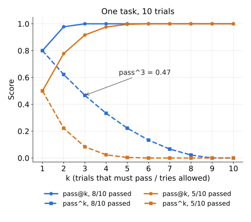

# Week 6 — Evaluation I

[Week 5](week-05-control-safety-reliability.md) put limits on the agent in code: sandboxes, review gates, guardrails, budgets and traces. Through all of it, one question stayed open. Many numbers in these notes were marked "illustrative". So how do you actually *know* that a harness change helped?

This week answers that question. It is about layer 6 (feedback and evals), the top of the harness (all the code around the model, [1.4](week-01-what-an-agent-is.md#14-what-a-harness-is)).



*Figure: the six harness layers from [1.4](week-01-what-an-agent-is.md#14-what-a-harness-is). This week is about layer 6 (feedback and evals).*

We start with why agent evals are not the same as the LLM evals you already know (6.1). Then:

- we build an eval set from real failures (6.2);
- we write graders that turn a trial into a verdict (6.3);
- we turn many verdicts into metrics you can compare (6.4);
- we use all of that to decide whether a harness change ships (6.5);
- we look at public benchmarks and what their numbers really mean (6.6).

The running example is the same as in earlier weeks: the nightly investigator. It looks at Xin Jie's solar sites (SG-03, MY-01 and so on), works out why output dropped, and files a draft ticket for a reviewer.

---

## 6.1 Why agent evals differ from LLM evals

*Day 37 · 2026-10-08*

> **In short**
> - An LLM eval checks one answer to one prompt. An agent eval is an experiment: the agent acts in an environment over many turns, and you grade what is true at the end.
> - That changes what you grade (the outcome), how many times you run (k trials), and what you reset between runs (the environment).
> - For a job that runs unattended every night, ask whether *every* trial succeeds (pass^k), not whether one did.

### The idea

An LLM eval is a function. You send a fixed prompt, get one completion, and compare it with a reference answer.

An agent eval is an experiment. The task starts an environment. The agent takes many turns, and those turns change the environment. At the end, you grade what is true in it.



*Figure: the agent eval grades an end state, and runs many times, each time in a fresh environment.*

Anthropic's vocabulary (Jan 2026) is worth adopting:

- A **task** is one test, with inputs and success criteria.
- A **trial** is one attempt at a task.
- The **transcript** is the full record of a trial.
- The **outcome** is the final state of the environment.
- A **grader** scores some aspect of a trial.
- The **evaluation harness** runs trials, records them and adds up the results.

Three things change compared with LLM evals.

**1. The unit is a trajectory, and you grade the outcome.** A trajectory is the whole run, turn by turn. In Anthropic's airline example, the outcome is "whether a reservation exists in the environment's SQL database". It is not whether the agent *says* it booked one. τ-bench grades the same way: it compares the database at the end of the conversation with a goal state that people annotated.

Grade the result, not the route. Agents find valid paths you did not expect. Opus 4.5 "failed" a τ2-bench flight task by using a loophole in the policy that was actually better for the user.

Keep checks on the path only for real constraints, such as "no side effects beyond the draft" or "stay within budget". Never use them to force your preferred order of tool calls.

**2. One run is an anecdote.** Sampling, tool latency and retries make every trial different. So you run k trials per task. Then you have to decide which question you are asking:

- **pass@k** asks: did *at least one* of the k trials succeed? It goes up as k grows.
- **pass^k** asks: did *all* k trials succeed? It goes down as k grows. At a 75% success rate per trial, pass^3 ≈ 0.75³ ≈ 42%.

τ-bench introduced pass^k because state-of-the-art agents (gpt-4o) succeeded on under 50% of tasks, and their pass^8 in the retail domain was under 25%. For a job that runs unattended every night, pass^k is the honest number.

With n trials and c successes, estimate it as C(c,k)/C(n,k), averaged over tasks. ([6.4](#64-trajectory-level-metrics-passk-steps-cost-tool-call-accuracy) covers these estimators in detail.)

**3. The environment is part of the test.** Each trial needs its own fresh, isolated copy of databases, files and memory. Shared state inflates scores: Claude once scored better by reading the git history left by earlier trials.

Infrastructure faults, such as a full disk, a rate limit or a broken fixture (the frozen starting state a trial runs on), fail many trials at once. Those failures are correlated, not independent, and they show up looking like a "model regression". If a user is part of the task, the environment includes a simulated user too. τ-bench uses an LLM playing a persona.

Graders have bugs as well. Opus 4.5 scored 42% on CORE-Bench until two things were fixed: rigid grading (it rejected "96.12" against "96.124991…") and ambiguous task specs. After the fixes it scored 95%.

### Where it lives in the harness

Layer 6 (feedback and evals), as a second harness that drives the first. When you evaluate "an agent", you are really evaluating model plus harness. So every run must carry the harness hash from [5.5](week-05-control-safety-reliability.md#55-observability-tracing-logging-trajectories-replaying-runs) (a hash of the system prompt and tools, plus the skill listing where there is one, so results can be split by harness version).

The sketch below runs one trial in a fresh environment, then grades it from the environment's end state:

```python
def trial(task):
    env = Env.from_fixture(task.fixture)   # fresh copy: DB, memory/, runs/
    r = run_site(task.site, tools=env.tools, sink=env.sink)
    return {"outcome": env.sink.tickets, "status": r.status,
            "cost": r.cost, "transcript": r.trajectory, "harness": HASH}

def grade(task, t):
    tk = t["outcome"]
    return (len(tk) == 1
            and tk[0].root_cause == task.expected
            and tk[0].deciding_value in t["transcript"].tool_values)

results = {task.id: [grade(task, trial(task)) for _ in range(5)]
           for task in TASKS}
```

The grader reads the sink (the tickets actually filed), not the model's final text. The transcript is used only for two things:

- the provenance check: the deciding number must come from one of this run's own tools;
- later, diagnosis ([7.1](week-07-evaluation-2-and-iteration.md#71-reading-a-transcript)).

### Common mistakes

Without repeated trials, a 3/5 → 4/5 "improvement" is noise. Without outcome grading, an agent that confidently describes a ticket it never filed still passes. Typical mistakes:

- grading the final message;
- asserting an exact sequence of tool calls;
- reusing a dirty environment between trials;
- quoting pass@k for a job that must work every night;
- never reading failed transcripts to check whether the grader, not the agent, was wrong.

### Try it

*10–15 min.* Wrap `run_site` in the eval loop above. Use five fixture incidents: meter fault, weather outage, curtailment, stale pipeline, and nothing wrong (expected: no ticket, or "no root cause found"). Run 5 trials of each with fake tools, adding a little randomness: the vendor fails 20% of the time.

1. Report successes per task, and the overall pass@1 and pass^5.
2. On purpose, skip resetting `memory/` between trials. Does the success rate climb from trial 1 to trial 5?
3. Write one grader that just checks the final message for the word "meter". Compare its verdicts with the outcome grader.
4. In one paragraph: of `memory/`, the `runs/` checkpoints, the notes file and the prompt cache, which must be reset for each trial? Is any of them legitimately part of what you are evaluating?

### Worked answer

**(1)** Illustrative results, with fake tools and a 20% vendor failure rate:

| Task | Successes |
|---|---|
| meter | 5/5 |
| curtailment | 4/5 |
| weather outage | 4/5 (partial data sometimes ends as "weather unverified") |
| stale pipeline | 3/5 |
| nothing wrong | 2/5 (the agent invents a cause) |

That is 18/25, so pass@1 = 0.72. pass^5 per task is C(c,5)/C(5,5), which is 1 only when c = 5. Only one task hits 5/5, so pass^5 = 1/5 = 0.20. The same agent looks fine at k=1 and cannot be shipped as a nightly job.

**(2)** Without resetting `memory/`, the repeated tasks climb. Trial 1 writes "SG-03 meter fault" to the site file. Trials 2–5 read it and confirm in two calls. You are now measuring recall of the answer, not investigation. The nothing-wrong task gets *worse*, because the memory suggests a cause.

**(3)** The "meter" grader disagrees with the outcome grader in both directions:

- It passes "meter hypothesis rejected", and it passes tickets that were described but never filed.
- It fails "sensor under-reads at low irradiance", because that ticket never uses the word.

**(4)** Reset per trial: `runs/` (otherwise a trial resumes a finished run), the notes file and `memory/`. The prompt cache cannot change outputs, only cost and latency. So record whether it was warm or cold instead of resetting it.

Memory can be a legitimate thing to test, but only as *seeded fixture state* (for example, a "night 2" task that ships with a site file). Never as leftovers from earlier trials.

A typical slip: treating 0.72 as the headline number.

### Sources

- [Anthropic Engineering — Demystifying evals for AI agents (Jan 2026)](https://www.anthropic.com/engineering/demystifying-evals-for-ai-agents)
- [Yao et al. — τ-bench: A Benchmark for Tool-Agent-User Interaction in Real-World Domains (2024)](https://arxiv.org/abs/2406.12045)

---

6.1 set out what an agent eval is: trials in fresh environments, graded on the outcome. The next lesson covers where the tasks come from, and the three parts every task needs before its score means anything.

## 6.2 Building an eval set from real failures; the task/grader/environment triad

*Day 38 · 2026-10-09*

> **In short**
> - Every eval task has three parts that must agree: the task (inputs and criteria), the environment (frozen state) and the grader (code that reads the end state).
> - Tasks should come from real failures, not imagination. Start with 20–50, drawn from review rejections, traces and bug reports.
> - Prove each task with a reference solution: the empty result must fail and the known-good result must pass.

### The idea

**The triad.** A task has three parts, and they must agree with each other:

- **Task:** the inputs, plus success criteria written so that "two domain experts would independently reach the same pass/fail verdict" (Anthropic).
- **Environment:** the frozen state the agent acts on, rebuilt for every trial. That means DB rows, recorded vendor responses, and memory as seeded.
- **Grader:** code that reads the environment's end state.

A **reference solution** proves the three fit together. It is a known-good outcome that passes the grader in that environment. Without one, a score of 0% is ambiguous. In Anthropic's words, "0% pass@100 is most often a signal of a broken task, not an incapable agent."

**Where tasks come from.** Not from imagination. Anthropic's advice is to start with "20–50 simple tasks drawn from real failures". Begin with the manual checks you run before each release, then the bug tracker and the support queue.

Husain and Shankar (Sep 2026) describe how to discover failures:

- Read at least 100 varied traces.
- Annotate the first 30 yourself, and write down each way the system fails.
- Stop when new traces stop showing new kinds of failure ("theoretical saturation").
- After that, add confirmed failures as you find them.

For the investigator, [Week 5](week-05-control-safety-reliability.md) already produces this raw material:

- reviewer rejections on the review card ([5.2](week-05-control-safety-reliability.md#52-human-in-the-loop-approval-gates-interrupts-escalation));
- provenance trips and judge overrides ([5.3](week-05-control-safety-reliability.md#53-guardrails-inputoutput-validation-policy-checks-classifiers));
- `budget` and `stuck` statuses in the traces ([5.5](week-05-control-safety-reliability.md#55-observability-tracing-logging-trajectories-replaying-runs)).


*Figure: a failure becomes a task only after the validation check; capability tasks graduate to regression tasks.*

### An example

Say the reviewer rejected draft D-0412 with the note: "blamed weather; curtailment log shows a 40% cap on the 8th." Here is that failure turned into a task:

```python
task = Task(
    id="sg03-1008-curtail",
    source="review reject D-0412",
    input={"site": "SG-03", "window": "2026-10-06..08"},
    fixture="fixtures/sg03-1008/",   # DB snapshot + tool cassette from trajectories/
    expected={"root_cause": "curtailment", "metric": "curtail_pct", "value": 40},
    reference="ref/sg03-1008.ticket.json",
    kind="capability",               # fails today; graduates to regression once fixed
)

def validate(task):                  # run once, when the task is added
    env = Env.from_fixture(task.fixture)
    assert not grade(task, env)      # an empty sink must fail
    env.sink.add(load(task.reference))
    assert grade(task, env)          # the reference must pass
```

The fixture is cheap to build. The trajectory log from [5.5](week-05-control-safety-reliability.md#55-observability-tracing-logging-trajectories-replaying-runs) already holds every tool result from the failing run, so you freeze those, not live vendor calls. (A "cassette" is that recorded set of tool responses, played back during the trial.) `validate()` catches graders that pass everything or nothing.

**Balance.** "One-sided evals create one-sided optimization." For every "should file X" task, add a "should not file" task: a quiet day, or a day where the weather looks bad but is not the cause. Otherwise a harness change that simply files more tickets looks like pure progress.

### Where it lives in the harness

Layer 6 (feedback and evals). The eval set is a versioned artefact that sits next to the harness. Each task records its source, so you know which incident it guards against.

There are two kinds of task:

- **Capability** tasks start with a low pass rate; they are a hill to climb.
- **Regression** tasks sit near 100%.

A capability task graduates into the regression set once the agent reliably passes it.

### Common mistakes

An eval set invented at a desk measures the failures you already imagined. One built from traces measures the failures that actually happen. Typical mistakes:

- fixtures that call live vendors, so the task drifts over time;
- no reference solution, so a broken grader looks like a weak agent;
- only positive cases;
- waiting for "enough" tasks. Early fixes have large effects, so 20 tasks are enough to detect them.

### Try it

*15 min.* Here are five failures from a hypothetical first month of the nightly batch:

- (a) SG-03 blamed weather; the real cause was a 40% curtailment cap.
- (b) MY-01 filed "meter drift" on a day the pipeline was stale.
- (c) SG-05 ran out of budget after an hourly weather pull, with no ticket.
- (d) SG-02 cited `cloud_delta` 38% from a forged archive doc.
- (e) SG-01's ticket said "performance degraded, multiple factors"; the reviewer called it useless.

1. Write a Task record for each: input, what goes in the fixture, expected outcome, grader logic and reference.
2. Add three balancing tasks.
3. Write `validate()` and say which task is hardest to validate.
4. Label each task capability or regression.
5. In one paragraph: which failure cannot get a deterministic grader, and what would its grader look like instead? (This previews [6.3](#63-graders-exact-match-rubric-llm-as-judge-outcome-checks).)

### Worked answer

**1 and 4. Five Task records**, each with a fixture frozen from the failing run's trajectory:

- **(a) SG-03 curtailment.** Fixture: DB snapshot with a 40% cap on the 8th, and a normal-weather cassette. Expected: `root_cause = curtailment`, `curtail_pct = 40`. Grader: exactly one ticket, enum match on the cause, and 40 found in this trial's tool results. *Capability.*
- **(b) MY-01 stale pipeline.** Fixture: pipeline status stale, metrics drifting. Expected: `pipeline_stale`. Any `meter_drift` ticket fails. *Capability.*
- **(c) SG-05 budget.** Fixture: the hourly weather cassette. Expected: status `success`, a ticket filed, and input tokens under the cap. That is an outcome check plus a path constraint (cost). *Regression*, since the `agg=daily` default already fixed it.
- **(d) SG-02 forged doc.** Fixture: the forged archive report. Grader: no ticket cites 38, and the deciding number must come from the agent's own tool results. *Regression*, because the provenance guard already exists.
- **(e) SG-01 vague ticket.** *Capability*, with no deterministic grader (see 5 below).

**2. Balancing tasks:** a quiet day (expected: no ticket); bad weather that is not the cause (expected: a meter ticket); and a 5% curtailment that is a red herring.

**3. `validate()`.** For should-file tasks, an empty sink must fail and the reference must pass. For should-not-file tasks it flips: the empty sink *is* the reference, and a plausible wrong ticket must fail. Forgetting the flip is the usual slip.

The hardest task to validate is (e). You need a known-good ticket and a known-bad ticket, both labelled by a person, before the grader can be trusted.

**5.** (e) cannot get a deterministic grader. "Useful" is a judgment. It needs a rubric graded by a model and calibrated against a person — which is the topic of [6.3](#63-graders-exact-match-rubric-llm-as-judge-outcome-checks).

### Sources

- [Anthropic Engineering — Demystifying evals for AI agents (Jan 2026)](https://www.anthropic.com/engineering/demystifying-evals-for-ai-agents)
- [Husain & Shankar — How many examples do I need for an eval? (Sep 2026)](https://hamel.dev/blog/posts/evals-faq/how-many-examples-do-i-need-for-an-eval.html)

---

6.2 built the tasks and fixtures. The next lesson is the third part of the triad: the code that reads the end state and says pass or fail.

## 6.3 Graders: exact match, rubric, LLM-as-judge, outcome checks

*Day 39 · 2026-10-10*

> **In short**
> - Graders are where an eval's honesty is decided: a grader bug looks exactly like an agent bug.
> - Use code graders where possible, LLM judges where necessary, and people to calibrate both.
> - Check a judge by its true positive and true negative rates separately, never by raw agreement.

### The idea

A grader scores one aspect of one trial. Anthropic sorts graders into three families. The rule is simple: "deterministic graders where possible, LLM graders where necessary", and humans to calibrate both.

**1. Code-based graders.** These include:

- string match (exact, regex, fuzzy);
- binary tests and static analysis;
- outcome verification (query the end state);
- tool-call verification;
- transcript analysis (turns, tokens).

They are fast, cheap, reproducible and easy to debug. Their weakness is being "brittle to valid variations". CORE-Bench ([6.1](#61-why-agent-evals-differ-from-llm-evals)) shows the cost: a grader that failed "96.12" against "96.124991…" made the agent look much worse than it was.

For numbers, compare with a tolerance. For categories, use enums (a fixed list of allowed values, [2.4](week-02-core-mechanics.md#24-structured-outputs-and-schemas)) so that exact match is fair.

**2. Model-based graders (LLM-as-judge).** Here a model does the grading. Forms include rubric scoring, natural-language assertions, pairwise comparison, reference-based grading and multi-judge consensus. They handle open-ended output. But they are non-deterministic, cost more, and "require calibration with human graders". Three practices make them usable:

- **One judge per dimension.** Grade "each dimension with an isolated LLM-as-judge". One judge scoring five things blurs them together.
- **Binary verdicts with a written critique.** Use pass/fail, not a 1–5 scale. "People don't know what to do with a 3 or 4" (Husain).
- **A way out.** Let the judge return `unknown` when the evidence is not enough, instead of guessing.

**3. Human graders.** Expert review and spot-checks are the gold standard, but they are slow. Their main job is producing the labels that judges are measured against.


*Figure: code where possible, a judge where necessary, people to calibrate both.*

**Combining graders.** Scores from several graders combine in one of three ways:

- **Binary:** every grader must pass.
- **Weighted:** the summed score must clear a threshold.
- **Hybrid:** hard gates, plus a weighted remainder.

Add partial credit for multi-step tasks. An agent that found the right cause but wrote a vague ticket is better than one that found nothing.

### An example

Here is a grader stack for the investigator. Checks run cheapest and most certain first:

```python
def grade(trial, task):
    t = trial.sink.tickets                         # outcome, not message
    if task.expect_none:
        return G(len(t) == 0)                      # should-not-file
    g = {}
    g["one_ticket"] = len(t) == 1                  # state check
    g["cause"]  = t[0].root_cause == task.cause    # exact match on enum
    g["value"]  = abs(t[0].value - task.value) <= 0.5   # tolerance
    g["prov"]   = t[0].value in trial.tool_values  # transcript check
    g["budget"] = trial.status == "success"        # path constraint
    hard = all(g.values())
    g["actionable"] = judge("actionable", t[0], rubric=R1)   # pass/fail/unknown
    return G(hard, partial=sum(g.values()) / len(g), detail=g)
```

All the hard gates are code. The judge answers one narrow question: "Does the ticket name a specific action a technician could take tomorrow?" It gets two good tickets and two bad ones as few-shot examples. Its result is reported separately, so it never silently flips a pass.

**Checking the judge before you trust it.** Have a person label 40–100 tickets pass/fail, then run the judge on the same tickets. Report two rates separately:

- **true positive rate** (TPR): the share of real passes it calls pass;
- **true negative rate** (TNR): the share of real fails it calls fail.

Do not report raw agreement. On data with 5% failures, a judge that always says "pass" gets 95% agreement and catches nothing.

Tune the judge's prompt on a dev split. Then freeze it and score a held-out test split once.

Also watch for the judge biases that the MT-Bench paper documented:

- **position bias** in pairwise grading (swap the order and average);
- **verbosity bias** (longer answers win);
- **self-enhancement** (a judge favours its own model family).

MT-Bench also found that GPT-4 as a judge agreed with humans over 80% of the time, about the same rate at which humans agree with each other. Treat that as a ceiling to aim for, not a free pass.

### Where it lives in the harness

Graders sit in layer 6 (feedback and evals), inside the evaluation harness. They read the environment and the trajectory log ([5.5](week-05-control-safety-reliability.md#55-observability-tracing-logging-trajectories-replaying-runs)).

The same code often does two jobs:

- The provenance check (the deciding number must equal a value from this run's own tools) is a runtime guardrail in [5.3](week-05-control-safety-reliability.md#53-guardrails-inputoutput-validation-policy-checks-classifiers) and a grader here.
- The 5.3 LLM judge that flags tickets is the same kind of object, and its "override rate" is exactly a TNR measurement.

### Common mistakes

A grader bug looks exactly like an agent bug, and you will end up "fixing" the harness to satisfy it. Typical mistakes:

- grading the final message instead of the sink;
- exact-matching floats or free text;
- one judge scoring everything on a 1–5 scale;
- quoting judge "accuracy" without TPR and TNR;
- using an uncalibrated judge as a hard gate.

If a failure "doesn't seem fair" when you read the transcript, fix the grader first.

### Try it

*10–15 min.*

1. Write `grade()` above for the eight tasks from 6.2, including the should-not-file branch.
2. Write the "actionable" judge: a prompt with three binary criteria (names a component, names an action, gives a deadline or threshold), pass/fail/unknown output, and a one-line critique.
3. Make 20 tickets for SG-03: 10 good ones and 10 vague ones (e.g. "multiple factors, monitor"). Label them yourself, run the judge, and report its TPR and TNR.
4. Pad each vague ticket with 150 words of plausible detail but no action, then re-run. Does TNR fall? That is verbosity bias.
5. In one paragraph: for the nightly batch's regression suite, which graders are hard gates, which feed partial credit, and would you ever let the judge block a release?

### Worked answer

**1. `grade()`.** For should-not-file tasks: pass if and only if the sink is empty. Otherwise run the hard gates in order, each a boolean:

1. exactly one ticket;
2. `root_cause` enum match;
3. deciding value within ±0.5;
4. provenance (the value is among this trial's tool results);
5. status `success`.

Partial credit = gates passed ÷ 5. But the task only counts as passed when all five pass.

**2. The judge.** Three binary criteria (names a component, names an action, gives a threshold or deadline). Output `{verdict: pass | fail | unknown, critique}`. Pass only if all three hold. Few-shot examples: two good tickets, one short vague ticket, and one long vague ticket.

**3–4.** Illustrative results on the 20 labelled tickets: TPR 9/10, TNR 8/10. Pad the vague ones with 150 words of plausible detail, and TNR typically drops to about 5/10. That is verbosity bias: detail reads as specificity.

The fix: make each criterion quote the exact sentence that satisfies it ("quote the action, or say none"). And keep a long-but-vague fail in the few-shot set.

**5.** Hard gates: the five code checks. Partial credit: the judge's actionability dimension, reported separately. The judge never blocks a single ticket. It may block a *release* only when there is an aggregate drop compared with the baseline, and only after TPR and TNR are both about 0.9 or higher on a frozen test split.

Common slips: tuning the judge on the same 20 tickets you score it on; letting `unknown` count as a pass.

### Sources

- [Anthropic Engineering — Demystifying evals for AI agents](https://www.anthropic.com/engineering/demystifying-evals-for-ai-agents)
- [Hamel Husain — Using LLM-as-a-Judge for Evaluation: A Complete Guide](https://hamel.dev/blog/posts/llm-judge/)
- [Zheng et al. — Judging LLM-as-a-Judge with MT-Bench and Chatbot Arena (2023)](https://arxiv.org/abs/2306.05685)

---

6.3 turned one trial into a verdict. The next lesson turns many verdicts into numbers you can compare: the step between a graded eval set and 6.5's regression test of a harness change.

## 6.4 Trajectory-level metrics: pass@k, steps, cost, tool-call accuracy

*Day 40 · 2026-10-11*

> **In short**
> - A trajectory-level metric summarises many graded traces: first per task, then averaged across tasks.
> - There are four families: success (with the right k), efficiency, tool-call accuracy, and status mix.
> - Use the unbiased estimators for pass@k and pass^k, and report cost per success and p90 next to them.

### The idea

Every trial already leaves a trace ([5.5](week-05-control-safety-reliability.md#55-observability-tracing-logging-trajectories-replaying-runs)). A trajectory-level metric is a summary over those traces: first per task, then across tasks. There are four families.

**1. Success, with the right k.** pass@1 is the mean of c/n per task (c successes out of n trials).

For pass@k, do not literally run k trials and check "did any pass". That estimate is noisy. Instead, run n ≥ k trials and use Chen et al.'s unbiased estimator:

- pass@k = 1 − C(n−c, k) / C(n, k)

Its mirror, for reliability, is:

- pass^k = C(c, k) / C(n, k)

Compute each per task, then average across tasks (a "macro" average). That way an easy task with many trials cannot dominate.



*Figure: the two estimators above for one task with 8/10 or 5/10 trials passing (results this week uses). The same trials can look near-certain or unreliable depending on which k-question you ask.*

**2. Efficiency.** Measure:

- turns and tool calls;
- tokens (input, cache read, cache write, output, plus any child agents);
- cost in base-token equivalents;
- wall-clock time.

Anthropic's example eval configs track turns, tool calls, total tokens and latency next to the grade.

Report the median and p90 (the value 90% of runs stay under), not the mean; one stuck run wrecks a mean. And report **cost per success** = total cost ÷ successes. A cheaper harness that fails more often is not cheaper.

**3. Tool-call accuracy.** This is a diagnostic, not a gate ([6.1](#61-why-agent-evals-differ-from-llm-evals): grade the outcome, not the path). Compare the agent's calls with a reference set of calls:

- **recall** = share of the required calls that the agent made;
- **precision** = share of the agent's calls that were needed.

LangChain's agentevals offers this as match modes, with per-tool argument matching (exact, ignore, or chosen fields only):

- **strict:** same calls, same order;
- **unordered:** same calls, any order;
- **subset:** no calls beyond the reference;
- **superset:** all required calls present, extras allowed.

From the trace alone you also get:

- the error rate per call (calls flagged as errors ÷ calls);
- redundant calls (the same tool with the same sorted input, repeated);
- tools per message ([5.6](week-05-control-safety-reliability.md#56-latency-and-cost-budgets-parallel-tool-calls-streaming)).

**4. Status mix.** The share of runs ending in `success`, `budget`, `stuck`, `refusal` and `error`. This tells you what kind of problem you have:

- A falling pass rate with rising `budget` is a loop-control problem.
- A falling pass rate with a steady status mix and the wrong `root_cause` is a reasoning or evidence problem.

**API details**

| What | Value |
|---|---|
| Efficiency fields in Anthropic's example eval configs | `n_turns`, `n_toolcalls`, `n_total_tokens`, plus latency |
| Error flag on a tool call (our trace, 5.5) | `is_error` |
| Trajectory match modes (LangChain agentevals) | strict, unordered, subset, superset |

### An example

Eight investigator tasks, five trials each. Successes per task: c = [5, 4, 4, 3, 2, 5, 5, 3].

```python
from math import comb

def pass_at_k(n, c, k):
    return 1.0 if n - c < k else 1 - comb(n - c, k) / comb(n, k)

def pass_hat_k(n, c, k):
    return comb(c, k) / comb(n, k)

# macro over 8 tasks, n=5:
# pass@1 = 0.775   pass@3 = 0.99   pass^3 = 0.50   pass^5 = 0.375
```

The same 40 trials give three honest headlines: 99% "can do it", 78% "does it once", 50% "does it three nights running". The nightly batch lives on the last one.

Now look at one trial of the meter task. The agent called: metrics, weather (hourly → error), weather (daily), pipeline, ticket. The reference is {metrics, weather `agg=daily`, ticket}, checked in superset mode, comparing only `agg`. Recall is 3/3, precision 3/5, error rate 1/5.

The outcome passed. The precision shows where the extra turns went: back to the `agg` default problem from [4.2](week-04-prompt-and-tool-design.md#42-tool-design-naming-descriptions-parameters).

### Where it lives in the harness

Layer 6 (feedback and evals), computed from the traces of [5.5](week-05-control-safety-reliability.md#55-observability-tracing-logging-trajectories-replaying-runs) (the layer-5 traces). `summarise(run_id)` grows into `scorecard(trials)`, keyed by task and harness hash.

### Common mistakes

One number hides the trade-off. Kapoor et al. argue that benchmarking on accuracy alone produced "needlessly complex and costly" agents, and call for optimising cost and accuracy together. Typical mistakes:

- quoting pass@k for an unattended job;
- computing pass@k by literally checking k runs;
- using the mean instead of p90 for turns and cost;
- reporting cost per trial instead of cost per success;
- gating on exact tool sequences;
- ignoring sample size. With 8 tasks, one task flipping moves pass@1 by 12.5 points.

### Try it

*10–15 min.* Extend your eval loop from 6.1.

1. Implement `pass_at_k`, `pass_hat_k` and `scorecard(trials)`. The scorecard returns, per task and as a macro average: pass@1, pass@3, pass^3, median and p90 turns, cost per success, and status mix.
2. Run 10 trials per task on the eight tasks from 6.2. Compare the estimator's pass@3 with the naive "any pass in trials 1–3".
3. For the meter and curtailment tasks, write reference call sets. Compute precision and recall in superset mode, comparing only `agg` and `site`.
4. Re-run with the series window at 720 rows instead of 48 ([4.4](week-04-prompt-and-tool-design.md#44-agent-computer-interface-aci)). Put both variants on one cost-vs-pass^3 chart.
5. In one paragraph: which single metric is the headline on the nightly batch's release dashboard? And how big a pass^3 change could you trust with 8 tasks × 10 trials?

### Worked answer

**1.** `pass_at_k` = 1 − C(n−c,k)/C(n,k), and `pass_hat_k` = C(c,k)/C(n,k). The scorecard groups trials by (task, harness hash) and computes each metric per task, then macro-averages. It adds median and p90 turns, cost per success (total cost ÷ successes) and status counts.

**2.** Illustrative, with c = [10, 9, 8, 7, 5, 10, 9, 6] out of 10: pass@1 0.80, pass@3 0.98, pass^3 0.55. The naive "any pass in trials 1–3" has the same expected value, but it jumps around with trial order. The 5/10 task reads 1.0 or 0.0 depending on which three trials ran first. The estimator uses all ten.

**3.** Meter reference {metrics, weather `agg=daily`, ticket}, superset mode on `agg` and `site`: recall 3/3, precision 3/4 to 3/5. The extra calls are either a pipeline check (fine) or an hourly retry (the `agg` default again). On curtailment, recall drops exactly on the failing runs: the agent filed without calling the curtailment tool.

**4.** 720 rows means fewer turns, but every turn is heavier. Cost per success is roughly 2–3× higher. pass^3 is equal or lower, because a neighbouring hour can fail the tolerance gate. The 720-row variant is dominated: more cost for no more pass^3.

**5.** The headline is macro pass^3, with cost per success beside it. The catch is trust:

- Per-task pass^3 ranges from 0.08 to 1.0.
- The standard deviation across tasks is about 0.36, so the standard error (SE) of the mean is about 0.13.
- The 95% confidence interval is roughly ±25 points.

One 8×10 run cannot see a change smaller than that.

Slips: headlining pass@3 = 0.98; computing the SE over 80 trials as if they were independent.

### Sources

- [Anthropic — Demystifying evals for AI agents](https://www.anthropic.com/engineering/demystifying-evals-for-ai-agents) (pass@k vs pass^k, tracked transcript and latency metrics, tool-call checks)
- [Chen et al. — Evaluating LLMs Trained on Code (2021)](https://arxiv.org/abs/2107.03374) (unbiased pass@k estimator)
- [LangChain agentevals](https://github.com/langchain-ai/agentevals) (trajectory match modes, argument matching)
- [Kapoor et al. — AI Agents That Matter (2024)](https://arxiv.org/abs/2407.01502) (cost and accuracy together)

---

6.1–6.4 built the eval: tasks, fixtures, graders and metrics. The next lesson uses it for its real job: deciding whether a harness change ships.

## 6.5 Regression testing a harness change; A/B on prompts and tools

*Day 41 · 2026-10-12*

> **In short**
> - Every harness change asks two questions: is B better than A, and did it break anything A did right?
> - Change one thing and freeze the rest, compare A and B task by task, and apply two gates plus guard metrics.
> - Know your noise floor first: run an A/A test and work out the smallest change you could detect.

### The idea

Every harness change gets a new harness hash. That includes a prompt line, a tool description, a default or a skill. The question is always the same: is B better than A, and did it break anything A did right? Three rules answer it.

**1. Change one thing; freeze the rest.** Keep the same tasks, frozen fixtures, model snapshot, sampling settings and infrastructure.

Infrastructure is not neutral. Anthropic measured a 6-point swing on Terminal-Bench 2.0 between the least- and most-resourced container setups (p < 0.01). Infrastructure errors fell from 5.8% to 0.5% across that range. Their advice is to treat differences under 3 points with skepticism until the configurations match.

So store the container limits, tool versions and cassette ids next to the harness hash. Never compare against last month's numbers.

**2. Compare paired, clustered on the task.** Trials of the same task are not independent, so the unit of analysis is the task. Score each task under A and under B, take the per-task differences, and report their mean and standard error (SE). Pairing removes task difficulty from the noise.

Anthropic notes that the benefit of pairing grows with the correlation between the two systems' per-question scores. That correlation is 0.3–0.7 between frontier models; two harnesses on the same model usually correlate higher. They also report that clustered SEs on popular evals were over three times the naive ones.

**3. Two gates, not one average.**

- **Regression gate (per task):** any task that used to pass about 100% of the time and now fails (say, 2 or more of 10) blocks the change, whatever the average says.
- **Capability gate:** the paired mean difference must have a confidence interval (CI) above zero.
- **Guard metrics:** cost per success, p90 turns and the status mix must not get worse by more than an agreed margin.


*Figure: the average only decides between ship and hold; a broken regression task or a worse guard metric blocks first.*

### An example

A is the current investigator. B rewrites the description of the checking-curtailment skill. 8 tasks × 10 trials each.

- pass^3: A 0.55 → B 0.65, a gain of 10 points.
- Per-task differences: 0, +.30, +.23, +.17, +.21, 0, **−.23**, +.13.
- Paired SE 0.061. (Unpaired it would be 0.168; the per-task correlation is 0.88.)
- 95% CI (t distribution, 7 degrees of freedom): −4 to +24 points.

**Verdict: hold.** The gain is promising but not proven. And the one negative task is the 5%-curtailment red herring, a should-not-file case. The new description makes the skill load where it shouldn't. Fix that and re-run.

Two habits before you spend tokens:

- Run an **A/A test** once: the baseline against itself. It shows your noise floor.
- Know your **minimum detectable effect** (MDE): about 2.8 × SE of the difference, at 80% power and 5% two-sided significance. Here that is about 17 points. When variance between tasks dominates, add tasks rather than trials.

Run the cheapest test first:

1. **Exact replay** ([5.5](week-05-control-safety-reliability.md#55-observability-tracing-logging-trajectories-replaying-runs)): a pure code refactor must reproduce byte-identical requests.
2. **Fork replay** on the failing trajectories: does the fix actually fix them?
3. **Full paired suite:** did it break anything else?
4. **Online monitoring** (lesson 7.4, in [Week 7](week-07-evaluation-2-and-iteration.md)).

### Where it lives in the harness

Layer 6 (feedback and evals), run as a CI job keyed by harness hash: `check_harness` lint ([Week 4 review](week-04-prompt-and-tool-design.md#week-4-review)) → replays → paired eval → comparison report.

### Common mistakes

Without this, you cannot tell a prompt "improvement" from noise, so regressions ship quietly. Typical mistakes:

- bundling two changes, so you can't tell which one helped or hurt;
- comparing against numbers from a different model snapshot or different infrastructure;
- celebrating the average while one regression task broke;
- tuning on the same tasks you test on. Keep a held-out split, or the suite turns into a training set.

### Try it

*10–15 min.*

1. **A/A:** run your 8-task suite twice on the same hash, 10 trials each. Compute the per-task pass^3 differences and their paired SE. That is your noise floor.
2. Make one change: drop the `<use_parallel_tool_calls>` block. Write `compare(A, B, regression_ids)` returning `{delta, se, ci95, mde, regressions, cost_ratio, verdict: ship | hold | block}`.
3. Re-run B with the tool timeout halved (60 s → 30 s). How far does the delta move?
4. In one paragraph: a forecast-model retrain at ENGIE is also an A/B test. Which of the three rules above do your backtests already follow? Would pairing by site-day change any past decision?

### Worked answer

**1. A/A.** Run the 8-task suite twice on one hash, 10 trials each, and take the per-task pass^3 differences. Expect them to be jumpy. From 10 trials, pass^3 = C(c,3)/C(10,3). So c=10 gives 1.00, c=9 gives 0.70, and c=8 gives 0.47. One flaky trial on a strong task moves it 30 points.

A typical A/A gives a mean near 0, a paired SE around 0.05–0.08, and an MDE (2.8 × SE) of roughly 15–20 points. That is your noise floor.

**2. `compare()`.** It takes per-task pass^3 differences, builds a t-interval, then applies the gates:

```python
d = [B[t].p3 - A[t].p3 for t in tasks]
delta, se = mean(d), stdev(d) / sqrt(len(d))
ci95 = (delta - 2.36 * se, delta + 2.36 * se)        # t, 7 df
regs = [t for t in regression_ids if B[t].fails >= 2]
cost_ratio = B.cost_per_success / A.cost_per_success

if regs or cost_ratio > 1.2:
    verdict = "block"
elif ci95[0] > 0:
    verdict = "ship"
else:
    verdict = "hold"
```

Dropping `<use_parallel_tool_calls>` usually leaves the delta inside the noise. It does show up in the guard metrics: tools per message falls to about 1.0, there are 2–3 more turns, and `cost_ratio` is around 1.2–1.3. The verdict is **block** on a guard metric, even though accuracy is unchanged.

**3.** Halving the tool timeout is not a neutral re-run: it adds a second change on top of B. Slow vendor calls now fail, so the weather-outage and stale-pipeline tasks drop. The delta moves by several points that have nothing to do with the prompt. Infrastructure is a variable (remember the 6-point Terminal-Bench swing).

**4.** Forecast backtests usually already pair by timestamp, because both models are scored on the same test window. What they often lack is the other two rules:

- They bundle changes: a data refresh plus a new feature plus new hyperparameters.
- They treat site-hours as independent. But errors within a site-day are correlated through the weather. Clustering on site-day widens the confidence interval, often by several times.

So a past "1–2% fleet MAE gain" may have been noise. A per-site regression gate would also have blocked some retrains that won on fleet MAE but hurt one site.

Common slips: computing the SE over hours or trials; reading "pass rate unchanged" as "safe to ship" without looking at the guard metrics.

### Sources

- [Anthropic — A statistical approach to model evaluations](https://www.anthropic.com/research/statistical-approach-to-model-evals)
- [Anthropic Engineering — Quantifying infrastructure noise in agentic coding evals (Feb 2026)](https://www.anthropic.com/engineering/infrastructure-noise)
- [Anthropic Engineering — Demystifying evals for AI agents (Jan 2026)](https://www.anthropic.com/engineering/demystifying-evals-for-ai-agents)

---

6.5 showed how to trust a difference on your *own* suite. The last lesson is about everyone else's numbers.

## 6.6 Public benchmarks (SWE-bench, τ-bench, GAIA, Terminal-Bench) and their limits

*Day 42 · 2026-10-13*

> **In short**
> - A public leaderboard number scores model + harness + infrastructure + benchmark version together, not the model alone.
> - Public benchmarks decay and have bugs: graders can pass wrong answers, tasks can be flawed, and test data leaks into models (contamination).
> - Use public numbers to shortlist 2–3 models; gate on your own suite, after checking it with trivial agents.

### The idea

This lesson is about the public leaderboards quoted in model cards and vendor pitches: what each number actually measures, and why no single number can be your release gate.

A public agent benchmark is the [6.2](#62-building-an-eval-set-from-real-failures-the-taskgraderenvironment-triad) triad (task, environment, grader), frozen and published. The big four:

| Benchmark | Tasks and environment | Grader | Notes |
|---|---|---|---|
| **SWE-bench** (Verified) | 500 human-filtered GitHub issues; the repo as it was before the fix | Hidden unit tests must pass | Tests coding agents repairing code |
| **Terminal-Bench 2.0** (Jan 2026) | 89 hand-verified tasks in containers, run through the Harbor harness | A test script checks the final container state | Frontier agents score under 65% |
| **τ-bench / τ²-bench** | Retail, airline and telecom domains; an LLM-simulated user, domain tools and a policy document | The final database state | Reported with pass^k (6.1) |
| **GAIA** | General-assistant questions needing browsing, files and multi-step reasoning | Exact match on a short answer | |

**First: a leaderboard cell is not a model score.** It scores model + harness + infrastructure + benchmark version, all together. You have already seen the evidence:

- With the model fixed, SWE-agent's interface moved the result from 11% to 18% ([4.4](week-04-prompt-and-tool-design.md#44-agent-computer-interface-aci)).
- Container resources alone moved Terminal-Bench by 6 points ([6.5](#65-regression-testing-a-harness-change-ab-on-prompts-and-tools)).

So read a leaderboard row the way you read a trace header. Ask: which scaffold, which tools, how many attempts (pass@1 or best-of-k), which subset of tasks, and what was the cost per task?

**Second: public benchmarks decay, and their graders have bugs.** There are three kinds of failure, each with a dated example.

- **Outcome validity:** the grader passes wrong answers or fails right ones. Zhu et al.'s Agentic Benchmark Checklist (ABC, NeurIPS 2025) audited ten benchmarks.
  - On τ-bench, a do-nothing agent that returns empty responses "passes" 38% of the impossible airline tasks.
  - On SWE-bench Verified, patches passed without being correct on 5.2% of tasks.
  - Across the audited benchmarks, task or grader flaws mis-estimated performance by up to 100% in relative terms.
- **Task validity:** the task cannot be solved fairly. OpenAI audited the 138 Verified problems that o3 did not reliably solve and found 59.4% had flawed tests.
  - 35.5% were too narrow: they rejected correct fixes that differed from the reference.
  - 18.8% were too wide: they checked behaviour the issue never asked for.
- **Contamination and saturation.** Every frontier model tested could reproduce some gold patches or issue text word for word. Scores crept from 74.9% to 80.9% in six months. In Feb 2026 OpenAI stopped reporting SWE-bench Verified and recommended SWE-bench Pro instead. Live environments rot as well: Terminal-Bench 1.0 had a task that broke when YouTube changed its anti-bot rules.

### An example

The cheapest ABC-style check: before trusting your own suite, run a trivial agent through your eval harness.

```python
def null_agent(task, env):          # files nothing
    return RunResult(status="success", ticket=None)

def shotgun_agent(task, env):       # one ticket per enum value
    for rc in ROOT_CAUSES:
        env.sink.file(site=task.site, root_cause=rc, value=0.0)
    return RunResult(status="success")
```

If either agent scores above 0 on a should-file task, the grader is broken. "Exactly one ticket" and provenance are the gates that should stop the shotgun agent.

The null agent's score on the whole suite is your floor, because every should-not-file task is a free pass for it. So report pass rate on should-file and should-not-file tasks separately. This is the τ-bench empty-response bug, showing up in your own suite.

### Where it lives in the harness

Layer 6 (feedback and evals). Public benchmarks are an input to *model selection*: use them to build a shortlist. Your own suite (6.2–6.5) is the gate for *harness changes*.

### Common mistakes

- **Comparing two vendors' numbers produced with different scaffolds, attempt counts or task subsets.** This is the "old numbers from a different setup" error from 6.5, at industry scale.
- **Treating a 2–3 point leaderboard gap as real** when the noise floor and the share of broken tasks are bigger than that.
- **Assuming a strong coding-benchmark score transfers** to a read-only investigation agent with a different tool set and a different definition of success.

Use public numbers to pick 2–3 candidate models. Then run them through your own suite.

### Try it

*10–15 min.*

1. Add `null_agent` and `shotgun_agent` to your eval loop from 6.1–6.5 and run them on the 8 investigator tasks. Report pass@1 for each, split into should-file and should-not-file tasks. Name every task the shotgun agent passes, and the gate that should have stopped it.
2. Pick τ²-bench or Terminal-Bench and write a 5-row translation table. Rows: task, environment, grader, success aggregate (pass@1 or pass^k), harness. Columns: theirs vs your investigator. Then say in one line what a 10-point gain on that benchmark would and would not predict for the nightly batch.
3. A vendor pitches an "ops agent" model with "80% on SWE-bench Verified". Write the three questions you would ask before letting it onto your shortlist.

### Worked answer

**1. Sanity agents.** The eight tasks split into six should-file tasks and two should-not-file tasks:

- should-file: curtailment, pipeline-stale, SG-05 budget, forged-38, vague-ticket, and bad-weather-but-meter;
- should-not-file: the quiet day and the 5% curtailment red herring.

The **null agent** files nothing and claims success. It scores 0/6 on should-file and 2/2 on should-not-file. Its overall pass@1 is 25%, for doing nothing. That is why you report the two halves separately.

The **shotgun agent** files five tickets, all with value 0.0. It should score 0/8. "Exactly one ticket" stops it on every should-file task, and a non-empty sink fails both should-not-file tasks. Tolerance and provenance stop it a second time, because no tool in that trial ever returned 0.0.

If the shotgun agent passes anything, a gate is missing. The likeliest leak is the vague-ticket task, if that task is graded only by the actionability judge with the code gates skipped.

**2. τ²-bench vs the investigator**, in five rows:

| Row | τ²-bench | Investigator |
|---|---|---|
| Task | A customer request under a policy document | A site and window with an unknown root cause |
| Environment | A domain DB plus an LLM-simulated user, who in telecom also has tools on the shared state (dual control) | A frozen DB snapshot and tool cassette, with no user |
| Grader | Final DB state vs goal state | The ticket sink, checked by code gates |
| Aggregate | pass^k | Macro pass^3 |
| Harness | The benchmark's or vendor's scaffold | Our `run_site`, with skills, guards and caching |

A 10-point gain predicts more reliable policy-following tool use across turns. It does not predict root-cause reasoning over time series, provenance discipline, or cost on our tools.

**3. Three questions for the vendor:**

1. Which scaffold, how many attempts, and which split? (Is it pass@1 on Verified, a split OpenAI retired over contamination?)
2. What are its pass^k and cost per task on a benchmark closer to our task, such as τ²-bench or Terminal-Bench 2.0?
3. Can we run it through our own suite, on our fixtures and under our harness, within our data-handling rules?

Typical slips: quoting the null agent's 25% as one number. And reading the shotgun agent's 0 as a pass for the suite without checking *why* it scored 0. If it ended in error, the gates were never exercised.

### Sources

- [OpenAI — Why we no longer evaluate SWE-bench Verified (Feb 2026)](https://openai.com/index/why-we-no-longer-evaluate-swe-bench-verified/)
- [Zhu et al. — Establishing Best Practices for Building Rigorous Agentic Benchmarks (ABC, NeurIPS 2025)](https://arxiv.org/abs/2507.02825)
- [Merrill et al. — Terminal-Bench: Benchmarking Agents on Hard, Realistic Tasks in Command Line Interfaces (Jan 2026)](https://arxiv.org/abs/2601.11868)

---

## Week 6 review

*Day 43 · 2026-10-14*

Week 6 turned "illustrative numbers" into measured ones. We went from what an agent eval is, through tasks, graders and metrics, to deciding whether a harness change ships and reading other people's leaderboards. [Week 7](week-07-evaluation-2-and-iteration.md) picks up from here: what to do when the numbers say something broke.

### The week in six paragraphs

**[6.1](#61-why-agent-evals-differ-from-llm-evals) Agent evals are experiments.** A task runs in a fresh, isolated environment for several trials. Each trial is graded on the *outcome*: the ticket in the sink, not the agent's claim that it filed one. Path checks are only for real constraints (no side effects, budget, provenance). Because runs are not deterministic, you must choose between pass@k (any trial succeeds) and pass^k (every trial succeeds). What you test is model + harness, so every trial carries the harness hash. Graders have bugs too.

**[6.2](#62-building-an-eval-set-from-real-failures-the-taskgraderenvironment-triad) Eval sets from real failures.** Start with 20–50 tasks drawn from review rejections, provenance trips and budget/stuck runs. Each task is a triad: inputs with unambiguous criteria, a fixture frozen from the failing trajectory, and an outcome grader. A task is valid only when the empty sink fails and the reference passes; for should-not-file tasks that check flips. Pair every should-file task with should-not-file cases, record each task's source, and keep separate capability and regression sets, with tasks graduating from one to the other.

**[6.3](#63-graders-exact-match-rubric-llm-as-judge-outcome-checks) Graders.** Use code where possible: enums, tolerances, outcome queries and provenance. Use a model where necessary: one binary judge per fuzzy dimension, with a critique and an Unknown option. Use people to calibrate both. Check judges by TPR and TNR separately on a frozen test split, never by raw agreement, and test for verbosity and position bias. Combine as hard gates, plus partial credit reported separately.

**[6.4](#64-trajectory-level-metrics-passk-steps-cost-tool-call-accuracy) Metrics.** Use the unbiased estimators, pass@k = 1 − C(n−c,k)/C(n,k) and pass^k = C(c,k)/C(n,k), computed per task and then macro-averaged. Report them next to median and p90 turns, cost per success and the status mix. Tool-call precision and recall are diagnostics, never gates. With 8 tasks, one flip moves the score 12.5 points.

**[6.5](#65-regression-testing-a-harness-change-ab-on-prompts-and-tools) Regression testing.** Change one thing and freeze everything else, infrastructure included. Compare A and B per task, with the task as the cluster, using a t-based CI. Apply two gates (a per-task regression gate and a capability CI above zero) plus guard metrics. Run an A/A test first to measure the noise floor and the MDE (≈ 2.8 × SE). Climb the ladder: exact replay → fork replay → full suite.

**[6.6](#66-public-benchmarks-swe-bench-τ-bench-gaia-terminal-bench-and-their-limits) Public benchmarks.** These are frozen triads that score a whole system: model, scaffold, infrastructure and version. They decay through outcome-validity bugs, task-validity bugs, and contamination or saturation. Use them to shortlist 2–3 models. Gate on your own suite, after checking it with the null and shotgun agents.

### Self-quiz

1. The nightly suite reports pass@1 0.80 and pass@3 0.98. Your manager asks whether the investigator is reliable enough to run unattended. Which metric answers that? Compute it for one task with 8 successes out of 10 trials, and say why the other two numbers mislead here.
2. A newly added task scores 0% across 20 trials. Before you touch the harness, which two checks do you run, and what does each possible result tell you?
3. Your actionability judge agrees with human labels on 94% of 200 tickets. Why is that not enough? Which two numbers would you report instead, and which bias test matters when ticket length varies?
4. Candidate B scores +6 points of mean pass^3 over A, with paired SE 0.04 across 8 tasks. One regression-set task fell from 10/10 to 7/10. Give the 95% CI, the verdict and the deciding reason.
5. Model X sits 4 points above model Y on Terminal-Bench 2.0. Name three things to check before the gap means anything, and say what you would do instead to choose a model for the investigator.

### Self-quiz answers

1. **pass^3** answers "reliable unattended". At 8 of 10: C(8,3)/C(10,3) = 56/120 ≈ 0.47. pass@1 (0.80) is an average over runs. pass@3 (0.98) assumes something picks the best of three tries, and a nightly run gets one try.
2. **First, run the reference solution.** If it fails, the task or grader is broken. **Then read a few failing transcripts.** They show whether the agent made a real mistake or the grader rejected a valid answer. (Running the null agent is a useful third check.)
3. When most tickets are good, a judge that always says pass still agrees with the labels most of the time, so 94% agreement proves little. **Report TPR and TNR** on a frozen test split. Then run a **verbosity test**: pad vague tickets with extra text and check whether TNR holds.
4. 0.06 ± 2.36 × 0.04 gives a **CI of [−0.03, +0.15]**. Verdict: **block**. A regression-set task at 7/10 fails the per-task gate (failing 2 or more of 10), whatever the mean shows. The CI also includes zero.
5. Before trusting a 4-point gap, check: (a) the same scaffold, tools and attempt policy; (b) the same resources, timeouts and benchmark version; (c) whether 4 points is bigger than infrastructure noise, which reached 6 points on Terminal-Bench 2.0. **To actually choose**, shortlist both models and compare them paired on your own suite.

### Integrative exercise

Write `eval_release(baseline, candidate)`, about 100 lines with fake tools. It is the CI job that decides whether an investigator change ships, and it combines the whole week in five steps:

1. **Validate the suite:** every task's empty sink fails and its reference passes; the null agent scores 0 on should-file tasks; the shotgun agent scores 0 everywhere.
2. **Run** 10 isolated trials per task per harness, each with a fresh `Env.from_fixture` and the harness hash recorded.
3. **Grade** with code gates first, then the actionability judge as a separate dimension.
4. **Build a scorecard** with per-task pass^3, cost per success, p90 turns and status mix.
5. **Run `compare()`:** paired deltas, a t-based CI, the MDE from a stored A/A run, the regression gate and the guard metrics, ending in ship, hold or block.

Then plant three faults, one at a time:

- the deciding-value check changed to exact float equality;
- `memory/` not reset between trials;
- the tool timeout silently changed from 60 s to 30 s in B's container only.

For each fault, say which step catches it and what the report shows. If nothing catches it, say what a person would have to notice. Finish with one paragraph: which of the three faults could only have been found by reading transcripts? (That is the topic of [7.1](week-07-evaluation-2-and-iteration.md#71-reading-a-transcript).)

### Integrative answer

The pipeline is: validate the suite → run 10 isolated trials per task per harness → apply code gates, then the judge → build the scorecard → `compare()` → ship, hold or block. The three planted faults play out like this.

- **`memory/` not reset between trials.** Median turns collapse after trial 1, because the agent reads its own answer from memory, and success rises with trial index. A cheap check catches it before any trial runs: hash the environment at start and assert that it equals the fixture hash.
- **A 30 s timeout in B's container only.** The weather-outage and stale-pipeline tasks drop, more runs end in error, and `compare()` blocks. But it blames the prompt change. The fix is to record the infrastructure config next to the harness hash, and refuse to compare when the two runs differ.
- **Exact float equality on the deciding value.** No automated step catches this one. The reference ticket copies the fixture value exactly, so suite validation passes. The grader is shared by A and B, so the paired delta stays near 0. Only the absolute pass rates fall. Reading a failing transcript gives it away: the root cause is right, and 3.19 was compared with 3.1900001.

So the float-equality fault is the one you could only find in transcripts. That is the subject of [lesson 7.1](week-07-evaluation-2-and-iteration.md#71-reading-a-transcript).

Common slip: trusting an eval report because A and B moved together. Shared bugs cancel out in a paired delta.

### Sources

- [Anthropic — Demystifying evals for AI agents](https://www.anthropic.com/engineering/demystifying-evals-for-ai-agents)
- [Anthropic — A statistical approach to model evaluations](https://www.anthropic.com/research/statistical-approach-to-model-evals)
- [Barres et al. — τ²-Bench: Evaluating Conversational Agents in a Dual-Control Environment](https://arxiv.org/abs/2506.07982)
