# Week 7 — Evaluation II and iteration

<!-- toc -->
## Contents

- **[7.1 Reading a transcript](#71-reading-a-transcript)**  
  [Idea](#the-idea) · [Example](#an-example) · [In the harness](#where-it-lives-in-the-harness) · [Mistakes](#common-mistakes) · [Try it](#try-it) · [Answer](#worked-answer) · [Sources](#sources)
- **[7.2 Error taxonomies and common failure modes](#72-error-taxonomies-and-common-failure-modes)**  
  [Idea](#the-idea-1) · [Example](#an-example-1) · [In the harness](#where-it-lives-in-the-harness-1) · [Mistakes](#common-mistakes-1) · [Try it](#try-it-1) · [Answer](#worked-answer-1) · [Sources](#sources-1)
- **[7.3 Simulated users and environments](#73-simulated-users-and-environments)**  
  [Idea](#the-idea-2) · [Example](#an-example-2) · [In the harness](#where-it-lives-in-the-harness-2) · [Mistakes](#common-mistakes-2) · [Try it](#try-it-2) · [Answer](#worked-answer-2) · [Sources](#sources-2)
- **[7.4 Online evaluation and monitoring](#74-online-evaluation-and-monitoring)**  
  [Idea](#the-idea-3) · [Example](#an-example-3) · [In the harness](#where-it-lives-in-the-harness-3) · [Mistakes](#common-mistakes-3) · [Try it](#try-it-3) · [Answer](#worked-answer-3) · [Sources](#sources-3)
- **[7.5 The improvement loop](#75-the-improvement-loop)**  
  [Idea](#the-idea-4) · [Example](#an-example-4) · [Mistakes](#common-mistakes-4) · [Try it](#try-it-4) · [Answer](#worked-answer-4) · [Sources](#sources-4)
- **[7.6 Case study: how labs iterate on coding-agent harnesses](#76-case-study-how-labs-iterate-on-coding-agent-harnesses)**  
  [Idea](#the-idea-5) · [Mistakes](#common-mistakes-5) · [Try it](#try-it-5) · [Answer](#worked-answer-5) · [Sources](#sources-5)
- **[Week 7 review](#week-7-review)**  
  [Recap](#recap) · [Self-quiz](#self-quiz) · [Quiz answers](#self-quiz-answers) · [Exercise](#integrative-exercise) · [Exercise answer](#integrative-answer) · [Sources](#sources-6)

<!-- /toc -->

[Week 6](week-06-evaluation-1.md) turned runs into numbers you can trust: tasks, graders, metrics, and a paired comparison that says ship, hold or block. This week is about what you do when one of those numbers is bad. It stays in layer 6 (feedback and evals).


*Figure: the six harness layers from [1.4](week-01-what-an-agent-is.md#14-what-a-harness-is). This week is about layer 6 (feedback and evals), and its diagnoses point back into the other five.*

Step one is always reading the run that produced the bad number. A score tells you *that* something failed. The transcript tells you *where* and *why*. We start with how to read one failed transcript properly (7.1), then group many diagnoses into a counted list of failure types that tells you what to fix first (7.2).

Then we make offline tests more realistic with simulated tools and users (7.3), carry evaluation into production (7.4), and tie it all into an improvement loop that ships verified harness changes (7.5). Three public write-ups from AI labs show the same loop at work (7.6).

The running example is still the nightly investigator for a portfolio of solar sites.

---

## 7.1 Reading a transcript

*Day 44 · 2026-10-15*

> **In short**
> - Reading a failed transcript is a procedure, not skimming: check the failure is fair, walk back to the earliest step that decided it, rebuild what the model actually saw there, and confirm the fix with a fork replay.
> - The last bad step is rarely the cause, and your log is not what the model saw.
> - If a fork replay does not flip the outcome, you have a story, not a diagnosis.

### The idea

A **transcript** is the full record of one run: outputs, tool calls, reasoning and intermediate results ([6.1](week-06-evaluation-1.md#61-why-agent-evals-differ-from-llm-evals)). Anthropic's eval guide ends with three words: "Read the transcripts!" Reading one well takes four steps.

**1. Check the failure is fair.** Before blaming the agent, rule out the grader (the logic that scores the run), the task and the infrastructure:

- Does the reference solution pass?
- Is the expected answer right?
- Did a tool time out because of the environment?

In Anthropic's words: "Failures should seem fair: it's clear what the agent got wrong and why."

**2. Walk backwards to the decisive error.** The wrong ticket is the *symptom*. What you want is the **decisive error step**: the earliest step where a correction would have turned the failure into a success. That definition comes from the Who&When paper (Zhang et al., ICML 2025).

Errors compound: small per-step error rates multiply over many steps (the p<sup>n</sup> of [lesson 1.6](week-01-what-an-agent-is.md#16-when-not-to-build-an-agent)). So the last bad step is rarely the cause.

**3. Rebuild what the model saw at that step, then name the layer.** Your trajectory log (the harness's own record of the run, [5.5](week-05-control-safety-reliability.md#55-observability-tracing-logging-trajectories-replaying-runs)) is not the model's context. Several things change what was actually sent:

- clearing (old tool results removed, [3.2](week-03-state-and-memory.md#32-context-management-summarisation-compaction-truncation));
- compaction (older turns replaced by a summary, also 3.2);
- skill loading (instructions pulled in on demand, [4.5](week-04-prompt-and-tool-design.md#45-skills-procedural-knowledge-loaded-on-demand)).

So rebuild the exact request at turn k and ask three questions:

- Was the needed fact present, or buried among distractors? (Layers 2 and 4: tools and the executor, and state.)
- Did the tool menu, the tool description or the error text point the right way? (Layer 2: tools and the executor.)
- Did the prompt or the loop control allow the right action? (Layers 1, 3 and 5: prompts, loop control, and guardrails and permissions.)

Only when the information was present, clear and allowed is it a model reasoning error.

**4. Confirm with a fork replay.** A fork replay restarts the run from a saved turn with one thing changed, using the live model ([5.5](week-05-control-safety-reliability.md#55-observability-tracing-logging-trajectories-replaying-runs)). Patch the suspected cause at turn k. Re-run five times, with tools served from the recorded cassette (the saved tool responses), and see whether the outcome flips. If it does not flip, you have a story, not a diagnosis.



*Figure: "model reasoning error" is what is left only after the fairness check and the three context questions; a fork replay then tests the suspected step.*

### An example

PVA-03 was expected to be a meter fault. The run filed `root_cause=weather`, with status `success`. Render the run as a turn table:

| Turn | Call | Result |
|---|---|---|
| T1 | `read_memory sites/PVA-03.md` | "meter under-reads <200 W/m² since 08-14" |
| T2 | `metrics_get_site` | MAE 3× from the 7th, worst at low irradiance |
| T3 | `weather_get_history(agg=hourly, 6 stations)` | about 38k tokens |
| T4 | *thinking* | "station 4 cloud variability high…" |
| T5 | `ticket_draft(weather, 22%)` | |

(MAE is the mean absolute error of the forecast.) Read forwards, T4 looks like a reasoning failure: the model "ignored the memory".

Rebuilding the T4 request shows something else. T3 pushed the context past 30k tokens, and the API's tool-result clearing ([lesson 3.2](week-03-state-and-memory.md#32-context-management-summarisation-compaction-truncation)) wiped the T1 result. Only `note` was excluded from clearing. The model never saw the meter fact.

So the decisive step is T3: an hourly pull that both buried the evidence and triggered the clear. The fixes are in the harness, not the prompt:

- make `agg=daily` the default;
- exclude `read_memory` from clearing.

Fork at T3 with `agg=daily`: 5 of 5 runs file meter. Confirmed.

*Note (2026-10-27):* with the clearing set-up from 3.2 (keep the last 3 tool uses), this trace cannot lose T1: only three tool calls come before T4, so all three are kept. The story holds if clearing keeps 2, or if more tool calls sit between T1 and T4. Before calling it confirmed, check the response's record of applied edits: it should show T1's result among those cleared.

**API details**

| What | Value |
|---|---|
| Tool-result clearing (Claude API context editing) | `clear_tool_uses` |

### Where it lives in the harness

Layer 6 (feedback and evals). It uses the observability from [lesson 5.5](week-05-control-safety-reliability.md#55-observability-tracing-logging-trajectories-replaying-runs), which is also part of layer 6: traces (timed records of each step) joined to trajectories by the tool call's id, plus fork replay.

Write each diagnosis as one line, called an **open code**. For example: "T3: hourly pull → memory cleared → weather blamed". In [7.2](#72-error-taxonomies-and-common-failure-modes) those lines get grouped into a taxonomy.

**API details**

| What | Value |
|---|---|
| Join key between traces and trajectories (Claude API tool call id) | `tool_use_id` |

### Common mistakes

Finding the error is hard even for models. On Who&When, the best automated method found the responsible agent 53.5% of the time, but the decisive step only 14.2% of the time. So people read first, and LLM tools (for example Transluce's Docent) help search and cluster many runs.

Typical mistakes:

- fixing the last bad step;
- reading the log instead of the rebuilt context;
- diagnosing from one run;
- reaching for a new prompt line when the cause sits in a tool or in what got cleared.

### Try it

*10 min.* PVB-01 was expected to be `pipeline_stale`: the ETL (the data pipeline) was stuck and the actuals were forward-filled (the last value repeated). The run filed `meter_drift`.

| Turn | Call | Result |
|---|---|---|
| T1 | `read_memory MEMORY.md` | "PVB-01: no notes" |
| T2 | `metrics_get_site(3d)` | MAE 2.4×; actual flat at 4.1 MW from 10-12 14:00 to 10-14 02:00 |
| T3 | *thinking* "flat actuals = stuck sensor" · `pipeline_get_status` | `is_error`: "Error: timeout" |
| T4 | `weather_get_history(daily)` | normal, max delta 3% |
| T5 | `note` | "pipeline: n/a; weather 3% rejected; meter: flat 4.1 MW 36 h, likely stuck" |
| T6 | `ticket_draft(meter_drift, 4.1)` | no "unverified" line |

1. Write the one-line open code.
2. Name the decisive step and its layer, and say why it is not T6.
3. List every harness fix you can see, ranked by how many future failures each removes.
4. Write the fork replay that would confirm your top fix.
5. Name one thing this transcript cannot tell you, and where you would look for it.

### Worked answer

**1. Open code:** "T3: `pipeline_get_status` timed out with a bare 'Error: timeout'; the agent dropped the pipeline hypothesis as n/a and read 36 h of flat actuals (forward-fill) as a stuck meter."

**2. The decisive step is T3**, in layer 2 (the executor, the code that runs tool calls, and its error text). The tool failed with no retry and no information. Fix T3 and the run flips. The fix could be either:

- a retry that returns "stale since 10-12 13:55"; or
- an error that says "status UNKNOWN, do not rule pipeline out; flat actuals are also what forward-fill looks like".

T6 is only the symptom. By T6 the notes already said "pipeline: n/a". So even a perfect T6 could at best have produced an honest "unverified" meter ticket, never `pipeline_stale`. The thinking at T3 ("flat = stuck sensor") is anchoring, but the model only had one candidate explanation in front of it.

**3. Fixes, ranked by reach:**

1. **Executor-wide:** retry infrastructure errors in the tool client, then return problem/fix/data with "status unknown, not ruled out" ([lesson 4.3](week-04-prompt-and-tool-design.md#43-tool-error-messages-as-instructions-designing-for-recovery)). This covers every tool, every night.
2. **`guard_ticket`** rejects a ticket when any checklist hypothesis is untested but missing from an "unverified" section, and caps confidence at low.
3. **`metrics_get_site`** flags runs of identical consecutive actuals as "possible forward-fill / stuck sensor" (both, not one).
4. **The note format** bans "n/a" and requires "untested (reason)".

**4. Fork replay.**

- Take the messages up to T3 and replace the pipeline `tool_result` with the new error text.
- Run 5 times on the live model, with other tools served from the cassette.
- Decide up front what happens if the agent retries `pipeline_get_status`: serve a "stale" fixture, and mark the fork as partly synthetic.
- Run 5 unpatched forks as a control.
- Pass: at least 4 of 5 end in `pipeline_stale` or an escalation, not `meter_drift`.

**5. What the transcript can't tell you:** whether the timeout was a real API outage or a harness timeout set too short. Look at the span latency in the trace and at the pipeline service's own logs.

Common slips: calling T6 decisive, and fixing it with a prompt line ("always check the pipeline").

### Sources

- [Anthropic — Demystifying evals for AI agents](https://www.anthropic.com/engineering/demystifying-evals-for-ai-agents)
- [Zhang et al. — Which Agent Causes Task Failures and When? (Who&When, ICML 2025)](https://arxiv.org/abs/2505.00212)
- [Langfuse — Error analysis to evaluate LLM applications](https://langfuse.com/blog/2025-08-29-error-analysis-to-evaluate-llm-applications)

---

7.1 turned one failed run into one open code. The next lesson turns a hundred open codes into a taxonomy, which tells the rest of Week 7's improvement loop what to fix first.

[↑ Contents](#contents)

## 7.2 Error taxonomies and common failure modes

*Day 45 · 2026-10-16*

> **In short**
> - A taxonomy is a counted list of failure categories, built by grouping many open codes (about a hundred).
> - Counts tell the rest of Week 7's improvement loop what to fix first; rank by count × severity, not count alone.
> - Give every category a definition, a harness layer and owner, and a detector; keep "unfair" categories separate.

### The idea

An open code is one anecdote: a one-line diagnosis of the first thing that went wrong in a failed run ([7.1](#71-reading-a-transcript)). A **taxonomy** is the same anecdotes grouped into named categories and counted. Hamel Husain calls the grouping step, **axial coding**, "the most important step". The procedure:

1. **Open-code** about 30 failing traces yourself: one line each about the *first* thing that went wrong.
2. **Cluster** the lines into categories. An LLM can propose the clusters, but you decide them.
3. **Write definitions:** one sentence per category, plus one example that belongs and one that doesn't.
4. **Re-code and count.** Keep adding traces until new ones stop producing new categories (saturation; a working pool of about 100 traces, as in [lesson 6.2](week-06-evaluation-1.md#62-building-an-eval-set-from-real-failures-the-taskgraderenvironment-triad)).

You don't have to start from a blank page. Two published agent taxonomies work as checklists.

**MAST** (Cemri et al., NeurIPS 2025) comes from 200+ traces across 7 multi-agent frameworks. It has 14 failure modes in 3 groups:

- **Specification issues**, 41.8% of failures. Includes step repetition (17.1%) and being unaware of stopping conditions (9.8%).
- **Inter-agent misalignment**, 36.9%. Includes reasoning–action mismatch (14.0%) and failing to ask for clarification (11.7%).
- **Task verification**, 21.3%. Includes premature termination, missing verification and incorrect verification.

The method matters as much as the list. Agreement between annotators is measured as κ (kappa): how often two labellers give the same label, beyond what chance would give. It started at 0.24 and reached 0.88 only after several rounds of refining the definitions. An o1 judge given few-shot examples reached κ = 0.77 against the experts.

**AgentErrorTaxonomy** (Zhu et al., 2025) is built from 500+ failed single-agent trajectories. It groups errors by module:

| Module | Error types |
|---|---|
| Memory | hallucination, retrieval failure |
| Reflection | progress misjudgement, outcome misinterpretation, causal misattribution |
| Planning | impossible action, constraint ignorance |
| Action | format or parameter error, action–plan mismatch |
| System | tool execution error, step limit, environment error |

Even with step-level labels, its annotators only reached κ = 0.55. Its **AgentDebug** method finds the critical (earliest decisive) error in 45% of cases, against 28% for baselines. Re-running from that step improved ALFWorld (a benchmark) success by up to 26% relative.

Both papers make the same point as 7.1: early errors cascade, so you label the root, not the wreckage.

**The harness twist.** Published labels describe what the *agent* did ("outcome misinterpretation"). Your own taxonomy should also say *where the fix lives*. The PVB-01 failure from 7.1 is "causal misattribution" in the paper's terms, but the cause was an opaque tool error. So every category needs three things:

- a **definition**;
- a **harness layer and owner**;
- a **detector**: a code check or a calibrated judge that can find more cases in traces automatically.

Keep separate "unfair" categories (grader bug, task bug, infrastructure), so they never count against the agent.



*Figure: a category is useful when it has a definition, a layer, an owner and a detector, so it points at where the fix lives.*

### An example

A worked fragment from 40 nightly failures:

| Category | n | Layer | Detector |
|---|---|---|---|
| Tool failure absorbed silently | 11 | 2 | `is_error`/timeout followed by a verdict of "n/a" or "normal" in the notes |
| Context flooded or cleared | 9 | 2/4 | tool result > 10k tokens, or memory cleared before the verdict |
| Untested hypothesis filed | 7 | 5 | ticket lacks "unverified" while the notes show an untested item |
| No completion signal | 5 | 3 | status ≠ success, no ticket |
| Vague ticket | 4 | 1 | actionability judge (TPR/TNR) |
| Unfair: grader, fixture or infra | 4 | 6 | reference fails, or config diff |

The layers are 1 (prompts), 2 (tools and the executor), 3 (loop control), 4 (state), 5 (guardrails and permissions) and 6 (feedback and evals). TPR and TNR are the judge's true-positive and true-negative rates ([6.3](week-06-evaluation-1.md#63-graders-exact-match-rubric-llm-as-judge-outcome-checks)).

Count by root category, one per trace. Then rank by **count × severity**, not count alone. One silent wrong ticket outweighs three budget stops that produced no ticket.

### Where it lives in the harness

Layer 6 (feedback and evals). The taxonomy becomes:

- a field in your trace store;
- the source of new eval tasks ([6.2](week-06-evaluation-1.md#62-building-an-eval-set-from-real-failures-the-taskgraderenvironment-triad));
- the set of detectors that 7.4 runs over production.

### Common mistakes

Without counts, you fix whichever failure you saw last. With them, the top two categories usually cover most failures. Typical mistakes:

- adopting MAST wholesale, so the labels describe the model and not your harness;
- tagging every downstream symptom, which double-counts;
- categories so broad ("reasoning error") that they point at no fix;
- never checking that two people label the same trace the same way.

### Try it

*10–15 min.* Here are twelve open codes from the nightly batch:

1. PVA-03 T3: hourly weather pull → memory cleared → weather blamed.
2. PVB-01 T3: pipeline timeout, "Error: timeout" → pipeline n/a → meter filed.
3. PVA-05 T2: hourly pull, 40k tokens → budget, no ticket.
4. PVA-02 T4: cited `cloud_delta` 38% from an archive doc → provenance trip.
5. PVA-01 T7: ticket "multiple factors, monitor" (no action).
6. PVA-04 T5: vendor 429 after 2 stations → note "weather normal".
7. PVB-02 T6: `metrics_get_site` with identical args 4× → stuck.
8. PVA-03: grader expects `curtail_pct` 40; fixture stores 0.4 → unfair.
9. PVA-06 T8: meter confirmed, text-only `end_turn`, no `ticket_submit`.
10. PVB-01 T4: thinking says "check curtailment next", calls weather.
11. PVA-02 quiet day T5: filed `meter_drift` on 1.3× MAE, below threshold.
12. PVA-05 T3: pipeline timeout at 30 s in container → status error.

Your tasks:

1. Axial-code them into at most 6 categories, each with a one-sentence definition, a harness layer and a fix owner.
2. Count and rank them by count × severity.
3. Give each code its nearest MAST or AgentErrorTaxonomy label, and name one code where that label hides the harness cause.
4. Write a detector for your top two categories.
5. Which code fits nowhere, and what should you do with it?

### Worked answer

**1. Categories.** Six of them, each with its codes, layer and owner:

| | Category | Codes | Layer and owner |
|---|---|---|---|
| A | **Tool failure absorbed silently**: an error or partial result turned into a negative verdict | 2, 6 | Layer 2 (tools and the executor); owner: tools |
| B | **Context flooded or cleared** | 1, 3 | Layers 2 and 4 (tools and the executor, state); owner: tools and context |
| C | **Ungrounded or under-threshold claim**: the deciding number was foreign (not from this run's own tool results) or below the threshold | 4, 11 | Layer 5 (guardrails and permissions); owner: guardrails |
| D | **Loop control**: repetition, no completion signal | 7, 9 | Layer 3 (loop control) |
| E | **Vague ticket** | 5 | Layer 1 (prompts), plus the judge |
| F | **Unfair**: grader, fixture or infrastructure | 8, 12 | Layer 6 (feedback and evals), counted separately |

**2. Ranking.** Score each code by severity: a wrong ticket is 3, no ticket is 2, and a failure that was caught, or a vague ticket, is 1.

- **A: 6.** Code 2 filed a wrong ticket, and code 6 gave a false "normal" verdict.
- **B: 5.**
- **D: 4.**
- **C: 4.** Code 4 was caught by the provenance check, so only code 11 scores 3.
- **E: 1.**
- **F:** 2 cases, reported separately.

**3. Nearest published labels.**

| Code | Label |
|---|---|
| 1 | memory / loss of history |
| 2 | causal misattribution |
| 3 | step limit |
| 4 | hallucination (really injection) |
| 5 | disobey task spec |
| 6 | tool execution error |
| 7 | step repetition |
| 8 | none |
| 9 | unaware of stopping conditions |
| 10 | reasoning–action mismatch |
| 11 | constraint ignorance |
| 12 | environment error |

The label hides the cause in **code 2**. "Causal misattribution" blames the reasoning, but the cause was the bare "Error: timeout", which is layer 2 (tools and the executor).

**4. Detectors for the top two.**

- **A:** a code check over traces. Look for a tool call with `is_error` or a partial flag, followed by a note or ticket that marks that hypothesis "n/a", "normal" or "rejected", with no later successful call of the same tool.
- **B:** any `tool_result` over 10k tokens, or an `applied_edits` entry that clears a result before its hypothesis has a verdict in the notes.

**5. The one that fits nowhere** is code 10: the thinking says curtailment, but the call is weather. Put it in "other", keep sampling, and promote it to a category only if it recurs. Try a fork replay first: re-injecting the plan may explain it.

Common slips: building a category from one case, and putting code 4 in the same row as code 11 even though the guard worked on code 4.

### Sources

- [Cemri et al. — Why Do Multi-Agent LLM Systems Fail? (MAST, NeurIPS 2025)](https://arxiv.org/abs/2503.13657)
- [Zhu et al. — Where LLM Agents Fail and How They Can Learn from Failures (AgentErrorTaxonomy / AgentDebug, 2025)](https://arxiv.org/abs/2509.25370)
- [Hamel Husain — Why is error analysis so important, and how is it performed?](https://hamel.dev/blog/posts/evals-faq/why-is-error-analysis-so-important-in-llm-evals-and-how-is-it-performed.html)

---

7.1 and 7.2 diagnosed and counted failures from frozen fixtures. The next lesson asks what to test against when a fixture can't answer: when the agent asks something new, or has to talk to a person.

[↑ Contents](#contents)

## 7.3 Simulated users and environments

*Day 46 · 2026-10-19*

> **In short**
> - Every eval task needs two stand-ins: the world (tool backends and their state) and the counterparty (a user, reviewer or other agent).
> - Recordings replay exactly but break on new calls; code simulators compute answers; LLM-simulated users and tools are flexible but biased.
> - Use simulators to compare harnesses, not to report absolute rates, and never let a model emulator produce a deciding number.

### The idea

Every eval task needs two stand-ins:

- the **world**: the tool backends and their state;
- the **counterparty**: a user, a reviewer or another agent.

So far both were *recorded*: a database snapshot plus a tool **cassette** (the saved tool responses, played back during a trial; see the fixture in [6.2](week-06-evaluation-1.md#62-building-an-eval-set-from-real-failures-the-taskgraderenvironment-triad)). Recordings replay exactly, but they break on any call that was never recorded. That is the cassette-miss problem from the fork-replay exercise in [5.5](week-05-control-safety-reliability.md#55-observability-tracing-logging-trajectories-replaying-runs).

For the world there are four options, from most reproducible to most realistic:

1. **Recorded cassette.** Exact, but blind to new calls.
2. **Code simulator.** A stateful fake that *computes* answers from a fixture and can inject faults.
3. **LM-emulated tools.** A language model plays the API from its spec. ToolEmu emulated 311 tools in 36 toolkits. 68.8% of the failures it found were judged valid real-world failures, and setup took under 15 minutes, against about 8 hours for a real sandbox.
4. **Real sandbox.**

The counterparty is usually an **LLM-simulated user**, as in τ-bench ([6.6](week-06-evaluation-1.md#66-public-benchmarks-swe-bench-τ-bench-gaia-terminal-bench-and-their-limits)). A persona prompt holds hidden facts and a goal. The user model and the agent take turns until a stop token or a turn cap. Grading reads the end state, not the chat. LangSmith (LangChain's tracing and eval platform) and its OpenEvals library package this as a ready-made simulation loop.



*Figure: the world's four options run from most reproducible (top) to most realistic (bottom).*

**API details**

| What | Value |
|---|---|
| Multi-turn simulation loop (LangSmith / OpenEvals) | `run_multiturn_simulation(app, user, max_turns, stopping_condition)` |
| Simulated user (LangSmith / OpenEvals) | `create_llm_simulated_user(system=…)` |

### An example

The investigator has no chat user, but it does have a counterparty: the reviewer behind `escalate` and the approval gate ([5.2](week-05-control-safety-reliability.md#52-human-in-the-loop-approval-gates-interrupts-escalation)).

Here is a sketch of both stand-ins. `SimVendor` is a code simulator for the weather vendor: it computes answers from a series instead of replaying recorded ones, and it times out after a set number of calls. `REVIEWER` is the persona prompt for a simulated reviewer who knows the real cause but only reveals it when asked the right question.

```python
class SimVendor:  # world: computed, not recorded
    def history(self, site, start, days, agg, station=None):
        self.calls += 1
        if self.calls > self.faults.get("timeout_after", 1e9):
            raise VendorTimeout()
        return aggregate(self.series[site], start, days, agg, station)

REVIEWER = """You are the on-call forecasting engineer.
Hidden truth: PVA-03 had a 40% curtailment cap on the 8th.
Reveal it only if asked about curtailment. Approve a ticket only
if root_cause=curtailment; otherwise reject in one sentence.
End with ###DONE###."""
```

### Where it lives in the harness

Layer 6 (feedback and evals). It is the environment part of the task/grader/environment triad ([6.2](week-06-evaluation-1.md#62-building-an-eval-set-from-real-failures-the-taskgraderenvironment-triad)).

The agent's harness must stay byte-identical. Plug the simulators in at two places: the tool backends behind the executor (the code that runs tool calls), and the human-gate channel. Keep the prompts, the loop and the guards unchanged.

The simulator is itself a small harness. Version it, seed it, log its outputs, and put its hash in the trial record next to the harness hash.

### Common mistakes

Simulated users are biased. *Lost in Simulation* tested this on τ-bench retail with a GPT-4o agent:

- Changing only the user model moved success from 67.0 to 75.9.
- Real US users reached 45.2%.
- Simulated users asked twice as many questions (18.8% vs 9.8% of turns) and were twice as polite, so they leak information that real users hold back.

So:

- Use simulators to compare harnesses, not to report absolute rates.
- Run at least two user models.
- Check calibration against a few real transcripts.
- Never compute deciding numbers with an LM emulator. The provenance check ([5.3](week-05-control-safety-reliability.md#53-guardrails-inputoutput-validation-policy-checks-classifiers)) only means something if code produced the number.

### Try it

1. Implement `SimVendor` over a 30-day hourly fixture for PVA-03 with `timeout_after=2`. Confirm that a fork asking for a never-recorded `agg="hourly", station=4` now gets an answer.
2. Implement `SimReviewer` from the prompt above as the counterparty for `escalate` and approval. Run the curtailment task 5 times with each of two personas: "terse" (answers only what is asked) and "helpful" (the default). Record:
   - the pass rate;
   - the number of turns;
   - a **leak rate**: how often the reviewer says "40" or "curtail" before the agent has mentioned curtailment.
3. Add an oracle check: a scripted agent that asks "any curtailment on the 8th?" must pass, and a null agent must fail.
4. One paragraph: which parts of the investigator's environment should be recorded, code-simulated or LLM-simulated? And how would you calibrate `SimReviewer` against last month's real review cards?

### Worked answer

**`SimVendor`.** Hold one 30-day hourly series per station, and let `history()` slice the window.

- `agg="daily"` returns, per station, the maximum cloud delta against the 30-day baseline, plus null counts.
- `agg="hourly"` returns rows for one station.
- A call counter raises `VendorTimeout` once `timeout_after=2` is passed, and the executor turns that into the usual partial-data `ToolError`.

The fork that asks for hourly data from station 4 now gets rows. They agree with the daily aggregate, because both are computed from the same series. A cassette cannot give you that consistency. Seed the simulator, and hash its code and fixture.

**`SimReviewer` (illustrative numbers).**

| Persona | Pass | Leak rate | Turns |
|---|---|---|---|
| Helpful | 4–5 of 5 | 2–3 of 5 | baseline |
| Terse | 2–3 of 5 | 0 | 1–2 more |

Asked about the weather, the helpful persona volunteers "there was a cap that day". With the terse persona, the agent has to ask the right question, which takes longer. The gap between the two personas measures how much of the agent's work the helpful one was doing. Terse is closer to a real on-call engineer at 08:00.

**Oracle and null checks.** The scripted "any curtailment on the 8th?" agent passes, and the null agent fails. If the oracle fails, the bug is in the reviewer prompt, typically because it demands exact wording.

**Where each part goes.**

- **Record** the small factual stores: the metrics snapshot, the archive docs and the pipeline status.
- **Code-simulate** the weather vendor and its faults.
- **LLM-simulate** only the reviewer.

To calibrate, feed last month's real review cards to `SimReviewer`. Compare its approve/edit/reject mix, and its reject TPR and TNR (true-positive and true-negative rates, [6.3](week-06-evaluation-1.md#63-graders-exact-match-rubric-llm-as-judge-outcome-checks)), with the real reviewers' decisions. Also check how often it offers facts nobody asked for. Tune the persona on one split and check it on the other.

Common mistakes: using the agent's own model as the reviewer, and judging leaks by eye instead of computing a leak rate.

### Sources

- [Seshadri et al. — Lost in Simulation: LLM-Simulated Users are Unreliable Proxies for Human Users in Agentic Evaluations (2026)](https://arxiv.org/abs/2601.17087)
- [Ruan et al. — Identifying the Risks of LM Agents with an LM-Emulated Sandbox (ToolEmu, ICLR 2024)](https://arxiv.org/abs/2309.15817)
- [LangChain — How to simulate multi-turn interactions (LangSmith / OpenEvals docs)](https://docs.langchain.com/langsmith/multi-turn-simulation)

---

7.1 to 7.3 made offline evals realistic: reading transcripts, counting failure types, simulating the world and the counterparty. The next lesson takes the eval out of the lab. Production is where the improvement loop's next inputs come from.

[↑ Contents](#contents)

## 7.4 Online evaluation and monitoring

*Day 47 · 2026-10-20*

> **In short**
> - Online evals score live runs, where nobody knows the answer yet: use reference-free signals, wait for late labels, and watch rates over many runs.
> - Stack four layers, cheapest first: trace signals on every run, sampled judges, delayed ground truth, and people reading a weekly sample.
> - Alert on rolling windows or count floors, split by harness hash; a single night of 40 runs is mostly noise.

### The idea

An **offline eval** scores a frozen task with a known answer. An **online eval** scores live runs, and for those nobody knows the answer yet. That one difference shapes everything else:

- you score with signals that need no reference answer;
- you wait for labels that arrive late;
- you watch rates over many runs instead of judging single runs.

Think of it as four layers, cheapest first.

**1. Deterministic signals on 100% of runs.** Your traces ([5.5](week-05-control-safety-reliability.md#55-observability-tracing-logging-trajectories-replaying-runs)) already carry them, at no extra cost:

- the status mix;
- guard and provenance trips;
- errors per tool;
- turns and cost per run;
- the cache hit rate;
- tools per message;
- the share of results flagged partial.

**2. Sampled judges that need no reference.** Examples are ticket actionability ([6.3](week-06-evaluation-1.md#63-graders-exact-match-rubric-llm-as-judge-outcome-checks)) or "does the cause follow from the evidence?". They run asynchronously, off the hot path, and attach their score to the trace. Platforms expose the same three knobs:

- **filters** that pick which runs get judged (by tool calls, metadata, feedback, or another evaluator's score);
- a **sampling rate**;
- **backfill** over past runs.

LangSmith also has a weekly spend cap per evaluator that pauses it when reached. Langfuse (Feb 2026) can also score a single observation, such as one tool span, rather than the whole trace. A sensible policy: judge 100% of low-confidence or flagged tickets, and 10% of the rest.

**3. Delayed ground truth.** These are labels that arrive later. For the investigator, the reviewer's approve/edit/reject comes hours later. The field outcome comes days later: did a maintenance work order or the curtailment log confirm the cause? Join each label back to its run by run id. This is the only layer that measures accuracy itself.

**4. People reading a weekly sample of transcripts.** This catches what no signal was designed for.

Anthropic's eval guide calls the whole stack a **Swiss-cheese model**: no single layer catches everything.



*Figure: the four layers, cheapest first; flagged runs go back through 7.1, 7.2 and 6.2 to become new eval tasks.*

**API details**

| What | Value |
|---|---|
| LangSmith online evaluator settings | filters (tool calls, metadata, feedback, another evaluator's score), sampling rate (0.1 = 10% of runs), backfill, weekly spend cap per evaluator |
| Langfuse observation-level evals | released Feb 2026; score one observation (for example a tool span) instead of the whole trace |

### An example

A nightly `monitor()` folds the batch's traces into one row per night, grouped by harness hash. Then it compares each night with a baseline of the previous 7 nights.

The statistics matter here. With 40 sites, a 10% reject rate has a standard error of √(0.1×0.9/40) ≈ 4.7 points. So a single night moving from 10% to 18% is noise. Over a 7-night window (280 runs) the standard error is about 1.8 points.

The rule: alert on rolling windows, or on counts with a hard floor, for example 3 or more provenance trips in one night.

Next, read the alert against the harness hash:

- Reject rate and vendor-partial flags rise together, and the hash is unchanged (a hash that covers code too, per the note in [5.5](week-05-control-safety-reliability.md#55-observability-tracing-logging-trajectories-replaying-runs))? That points at the world (vendor degradation, drift), not your code.
- The hash changed the same night? Start with the paired comparison from [6.5](week-06-evaluation-1.md#65-regression-testing-a-harness-change-ab-on-prompts-and-tools) that you skipped.

### Where it lives in the harness

Layer 6 (feedback and evals), running in production on the telemetry built in [5.5](week-05-control-safety-reliability.md#55-observability-tracing-logging-trajectories-replaying-runs).

It is not a guardrail:

- **Guardrails** are inline and per-run, and they block.
- **Online evals** are asynchronous and aggregate, and they alert.

The loop closes when flagged runs go to an **annotation queue**, get an open code ([7.1](#71-reading-a-transcript)) and a category ([7.2](#72-error-taxonomies-and-common-failure-modes)), and finally become a new eval task ([6.2](week-06-evaluation-1.md#62-building-an-eval-set-from-real-failures-the-taskgraderenvironment-triad)).

### Common mistakes

Offline suites drift away from real traffic. Anthropic warns they "can create false confidence" if they don't match real usage. Production is the only place real distribution shift shows up.

Typical mistakes:

- reading approval rate as accuracy: reviewers who rubber-stamp inflate it;
- trusting an online judge whose production TNR was never checked against reviewer overrides;
- alerting on single-night rates from n=40;
- mixing harness versions in one chart;
- shipping trace content to a third-party backend ([5.5](week-05-control-safety-reliability.md#55-observability-tracing-logging-trajectories-replaying-runs)).

If you work on forecasts, you already do this: actuals arrive the next day and MAE (mean absolute error) is monitored per site. Ticket monitoring is the same discipline with a slower, noisier label.

### Try it

*10–15 min.* Write `monitor(nights)` over 30 nights of fake run records. Each record has `site`, `night`, `harness_hash`, `status`, `turns`, `cost`, `provenance_trip`, `partial_flag`, `review` (approve/edit/reject) and, 3 nights later, `confirmed` (bool).

It should compute per-night signals, a 7-night rolling baseline, and alerts using a z-score on the rolling rate plus hard count floors. Plant three drifts:

- **(a)** From night 20, the vendor degrades: the partial-flag rate goes from 5% to 25%.
- **(b)** On night 25, the hash changes because the parallel-calls block was dropped: turns +2, cost +25%.
- **(c)** From night 15, reviewers rubber-stamp: the approve-without-edit rate rises while the confirmed rate falls from 85% to 60%.

Report which alert fires on which night, how many false alarms you get on nights 1–14, and how late (c) is detected. Then answer in one paragraph: which record in your own organisation could serve as delayed ground truth for tickets, and what is its lag?

### Worked answer

**Signals per night:** status mix, partial-flag rate, median turns, cost per run, reject rate, approve-without-edit rate, and confirmed rate (filled in three nights late).

**Baseline:** the previous 7 nights for the same harness hash, not counting tonight. Rates alert when z = (p − p₀)/√(p₀(1−p₀)/n) is above 3, or on a count floor. (*Note, 2026-10-27:* "above 3" fits rates where up is bad, such as partial flags and rejects. For rates where down is bad, such as the confirmed rate, alert when z is below −3. Otherwise an improvement alerts and a decline does not.) Turns and cost alert on a z-score over the night's mean.

**(a) Vendor degradation.** At n=40, about 10 partial flags against an expected 2 gives z ≈ 5.8, so it fires on night 20. The hash didn't change, so the world moved, not the harness.

**(b) Hash change on night 25.** The new hash has no history yet, so compare it with the last 7 nights of the old hash. Turns +2 and cost +25% fire the same night, while the status mix stays flat. That is a guard regression with no change in accuracy.

**(c) Rubber-stamping.** The approve rate goes up, which looks like good news. Night 15's confirmations only arrive on night 18. With about 30 tickets a night, 0.85 → 0.60 gives z ≈ 3.8 (strictly −3.8: a fall, caught by the lower-tail rule above), so the earliest alert is night 18. A gradual slide shows up in the rolling window around nights 20–22, which is 3–7 nights late. The detector that works is the gap between approval and confirmation, not either rate on its own.

**False alarms on nights 1–14.** Nights 1–7 have no baseline (warm-up). After that, expect roughly 0–2 alarms, mostly from small-count binomial tails, which the count floors suppress.

**Ground truth for a portfolio of solar sites (candidates):**

| Record | Lag |
|---|---|
| Maintenance work orders and field intervention reports (meter replaced, inverter repaired) | days to weeks |
| Curtailment setpoint logs | about a day |
| Settlement meter data | weeks |

Common slips: computing z against a baseline that includes the drifting nights, and treating a rising approval rate as success.

### Sources

- [Anthropic — Demystifying evals for AI agents](https://www.anthropic.com/engineering/demystifying-evals-for-ai-agents) (production monitoring, A/B, feedback, Swiss cheese)
- [LangSmith — Online evaluations](https://docs.langchain.com/langsmith/online-evaluations) (filters, sampling, backfill, spend caps)
- [Langfuse — Observation-level evals (Feb 2026)](https://langfuse.com/changelog/2026-02-13-observation-level-evals)

---

7.1 to 7.4 produced a diagnosed transcript, a counted taxonomy, simulators and production monitors. The next lesson ties them into the loop the whole week has been building toward: how a failure becomes a shipped, verified harness change.

[↑ Contents](#contents)

## 7.5 The improvement loop

*Day 48 · 2026-10-21*

> **In short**
> - The improvement loop is eval → hypothesis → harness change → re-eval → ship, with a rule at each step.
> - Pick targets by count × severity, write a hypothesis that can fail, make one change placed as low in the harness as it will go, and re-check on a held-out split.
> - A fix that wins only on the traces that inspired it is overfit.

### The idea

The improvement loop is layer 6 (feedback and evals) driving changes into layers 1–5. It has five steps, and each one has a rule.

**1. Eval: pick the target from counts, not from the latest anecdote.** Take the top taxonomy category by count × severity ([7.2](#72-error-taxonomies-and-common-failure-modes)), with its failing traces and eval tasks.

**2. Hypothesis: written down and falsifiable.** For example:

> Category A, tool failure absorbed silently, happens because `pipeline_get_status` returns a bare "Error: timeout". If the executor retries and then returns "status UNKNOWN — not ruled out", at least 4 of 5 forks of the PVB-01 trace end in `pipeline_stale` or an escalation, category-A tasks rise, and nothing else regresses.

It names a cause, a layer, a change and a prediction, so it can fail.

**3. Change: one at a time, placed as low as it will go.** The preference order:

1. Remove the failure class in code: the executor, a schema, a tool default, a guard.
2. Change what the model sees: the shape of a tool result, error text, environment context.
3. Add a prompt line, last.

Prompt lines shift probabilities and drift. An executor check removes the class.

**4. Re-eval: climb the cheapest-first ladder** from [6.5](week-06-evaluation-1.md#65-regression-testing-a-harness-change-ab-on-prompts-and-tools):

- A **fork replay** of the failing traces checks that the fix flips the cause.
- A **paired full-suite run** checks that it doesn't break anything else, with the per-task regression gate plus cost and turn guards.
- A **held-out split** checks that you haven't just memorised your own examples. Anthropic, describing how it tuned its tools against evals, says: "We relied on held-out test sets to ensure we did not overfit to our 'training' evaluations."

**5. Ship and close the loop.** The new hash goes to production, where the online monitors ([7.4](#74-online-evaluation-and-monitoring)) confirm the category rate falls. Each fixed failure becomes a regression task. A **ledger** records the hypothesis, change, hash, result and decision, and keeps rejected hypotheses too.



*Figure: each step has a rule; the held-out split is what catches a fix that only fits its own examples.*

### An example

LangChain held one model fixed and changed only the harness of its Deep Agents coding agent. Its Terminal-Bench 2.0 score went from 52.8% to 66.5%.

Their loop:

- pull traces from LangSmith;
- run parallel error-analysis agents, whose findings a main agent synthesises;
- make targeted harness changes, with optional human review.

The most common failure was "write a solution, re-read it, decide it's fine, stop". They fixed it in code, not with a "please test" prompt line: a middleware that forces a verification pass against the task spec before the agent can exit.

Other changes were mapping the environment at startup, detecting edit loops per file, and a reasoning "sandwich". Running the whole task at xhigh reasoning effort (a setting above high) scored 53.9%, because of timeouts. Running it at high scored 63.6%. The sandwich, xhigh then high then xhigh, scored 66.5%.

Anthropic describes the same pattern for tools: paste concatenated eval transcripts into Claude Code, let it refactor the tools, then confirm on held-out tasks.

**Reading those numbers with Week 6 eyes:**

- They are single runs, on a benchmark with roughly 6 points of infrastructure noise ([6.6](week-06-evaluation-1.md#66-public-benchmarks-swe-bench-τ-bench-gaia-terminal-bench-and-their-limits)).
- A Claude model scored 59.6% on an earlier version of the same harness, and LangChain notes the loop was never run against Claude.
- A harness tuned against one model's failures is partly a fit to that model. So the thing you evaluate is model plus harness.

**API details**

| What | Value |
|---|---|
| Model held fixed (LangChain Deep Agents) | `gpt-5.2-codex` |
| Verification middleware (LangChain Deep Agents) | `PreCompletionChecklistMiddleware` |

### Common mistakes

Without the loop, fixes follow whatever failure was seen most recently, and gains can't be told apart from noise. Typical mistakes:

- bundling several changes into one release;
- judging the fix on the same traces that suggested it;
- fixing with prompt lines that name a specific site or case. That is overfitting: LangChain warns task-specific changes "can lead to regressions in other tasks";
- letting an LLM analyst propose and approve its own changes;
- never retiring a guardrail once the model has outgrown it.

### Try it

*10–15 min.*

1. Grow your 8-task suite to 12, adding tasks for categories A and B from [7.2](#72-error-taxonomies-and-common-failure-modes). Split it into dev (8) and held-out (4), stratified by category.
2. Write one ledger entry for category A: the hypothesis, the predicted effect and on which tasks, the fork test, the change and its layer, the guard metrics, and the ship rule.
3. Build two candidate fixes:
   - (i) a prompt line: "If `pipeline_get_status` times out, assume the pipeline is stale";
   - (ii) an executor retry plus "UNKNOWN — not ruled out" error text.

   For each, fork the PVB-01 trace 5 times, then run the paired comparison on dev and on held-out. Include a held-out task where the timeout is transient and the real cause is the meter. Report which fix wins where, and why.
4. One paragraph: when do you stop iterating on A and move to B?

Bonus: how is this the same discipline as tuning a solar forecast model on validation years and reporting on a held-out year?

### Worked answer

**Suite.** Add four tasks:

- two for category A: PVA-04, a vendor 429 after 2 stations where the real cause is the meter; and PVB-03, a pipeline timeout that hides a stale ETL (data pipeline);
- two for category B: an hourly pull cleared before its verdict, and a 40k-token dump.

Split stratified: dev 8, held-out 4 (one A, one B, one C, one should-not-file). The held-out A task has a *transient* timeout and a meter fault.

**Ledger entry.**

| Field | Entry |
|---|---|
| Hypothesis | A bare "Error: timeout" and partial results become "n/a" or "normal" verdicts (layer 2, tools and the executor) |
| Change | Executor retry, then "UNKNOWN — not ruled out" text |
| Prediction | At least 4 of 5 PVB-01 forks flip; category-A dev tasks rise; no regression task falls |
| Guards | Cost per success at most 1.1×; p90 turns (the value 90% of runs stay under, [6.4](week-06-evaluation-1.md#64-trajectory-level-metrics-passk-steps-cost-tool-call-accuracy)) at most +1 |
| Ship rule | `compare()` says ship on dev, *and* held-out does not drop |

**Result (illustrative).**

- The prompt line wins the forks (5 of 5) and dev, because it hard-codes PVB-01's answer. On held-out it files `pipeline_stale` on the transient-timeout meter task. That is overfitting.
- The executor fix flips 4 of 5 forks: either the retry returns "stale since 10-12", or UNKNOWN keeps the hypothesis open. It passes held-out, because there the retry returns the real "fresh" status.

Ship (ii).

**When to stop.** When A's count × severity falls below B's in the re-coded taxonomy, or when the next gain is below the MDE (minimum detectable effect, [6.5](week-06-evaluation-1.md#65-regression-testing-a-harness-change-ab-on-prompts-and-tools)).

**Bonus.** Dev is the validation years; held-out is the reporting year. Look at it once. If you tune on it, it becomes validation.

Typical slips: judging on the forks that inspired the fix, and having no transient-timeout counterexample.

### Sources

- [LangChain — Improving Deep Agents with harness engineering (Feb 2026)](https://www.langchain.com/blog/improving-deep-agents-with-harness-engineering)
- [Anthropic — Writing effective tools for AI agents (Sep 2025)](https://www.anthropic.com/engineering/writing-tools-for-agents)
- [Anthropic — Demystifying evals for AI agents (Jan 2026)](https://www.anthropic.com/engineering/demystifying-evals-for-ai-agents)

---

7.5 described the loop and one public run of it. The last lesson of the week reads three more public write-ups, from OpenAI and Anthropic, for their method rather than their scores.

[↑ Contents](#contents)

## 7.6 Case study: how labs iterate on coding-agent harnesses

*Day 49 · 2026-10-22*

> **In short**
> - Three public write-ups show the same method: read transcripts, fix the failure in the environment, and verify independently of the generator.
> - "The fix was almost never 'try harder'": each fix is a file, a tool or a startup routine, not a pleading prompt line.
> - Every component encodes an assumption about what the model can't do; re-test it when the model changes, and remove it when it is no longer needed.

### The idea

**Case 1: OpenAI, "Harness engineering" (Feb 2026).** A team of three (later seven) shipped about a million lines of code with no hand-written code: about 1,500 merged PRs, with single Codex runs of up to six hours. Their rule when progress stalled: "the fix was almost never 'try harder'." They asked what capability was missing, and made it legible and enforceable. Concretely:

- `AGENTS.md` was cut to about 100 lines and works as a map. A versioned `docs/` folder is the system of record. That moves knowledge from layer 1 (prompts) to layer 4 (state).
- Custom linters have error messages that carry the fix ([4.3](week-04-prompt-and-tool-design.md#43-tool-error-messages-as-instructions-designing-for-recovery)), enforced in CI.
- Each worktree boots its own copy of the app, with logs, metrics and traces the agent can query. That is observation through layer 2 (tools and the executor).
- "Garbage collection": background Codex tasks scan for drift and open small refactor PRs. Before that, Fridays went on cleaning up "AI slop".

**Case 2: Anthropic, "Effective harnesses for long-running agents" (Nov 2025).** A table of failures and fixes, built from watching transcripts:

| Failure | Fix |
|---|---|
| Tries to build the whole app in one go | An initializer agent writes a feature list of 200+ items in JSON, all marked failing |
| Declares victory early | Each session reads that list and picks one feature. It may only flip the "passes" field. (JSON, because models overwrite it less than Markdown) |
| Leaves half-done, undocumented work | A git commit plus a progress file at the end of each session |
| Marks features done without testing them | Browser automation through a Puppeteer MCP server (a browser-automation tool exposed over the Model Context Protocol, [4.1](week-04-prompt-and-tool-design.md#41-system-prompt-architecture-for-agents)), which "dramatically improved performance" |

Every fix is a file, a tool or a startup routine, not a pleading line in the prompt.

**Case 3: Anthropic, "Harness design for long-running application development" (Mar 2026).** A planner, a generator and an evaluator. The evaluator tests the app with Playwright (a browser-automation library), against hard per-criterion thresholds.

- **Self-evaluation failed.** Agents praise their own mediocre work. Out of the box, the QA agent found bugs and then talked itself into approving them. The author read its logs, found where its judgement diverged from his, updated the prompt, and repeated for several rounds. That is judge calibration from [6.3](week-06-evaluation-1.md#63-graders-exact-match-rubric-llm-as-judge-outcome-checks), done by hand.
- **Cost.** The solo run took 20 minutes for $9, and its core feature was broken. The full harness took 6 hours for $200.
- **Removing parts.** When Opus 4.6 arrived, they *removed* parts. Sprints went, and the evaluator dropped to a single pass at the end. Context resets had already gone with Opus 4.5. The planner stayed, because without it the generator under-scoped.
- The line to keep: "every component in a harness encodes an assumption about what the model can't do on its own."

**The shared method.**

1. Read transcripts to name the failure ([7.1](#71-reading-a-transcript)).
2. Fix it in the environment: a tool, a state file, a linter, a separate verifier. That is the lowest layer, as in [7.5](#75-the-improvement-loop).
3. Make verification independent of the generator.
4. Keep an assumption for each component, and re-test it whenever the model changes. Harnesses shrink as well as grow.


*Figure: components that guard against model limits get re-tested when the model changes; components that guard against the world stay.*

**API details**

| What | Value |
|---|---|
| Progress file (Anthropic long-running harness) | `claude-progress.txt` |
| Browser testing (Anthropic long-running harness) | Puppeteer MCP |
| Evaluator's browser tool (Anthropic app-development harness) | Playwright |

### Common mistakes

Copying a lab's harness wholesale imports assumptions about *their* model and task. Sprints that helped Opus 4.5 were dead weight for Opus 4.6. The common errors:

- adding components without recording why;
- letting the generator grade itself;
- never running the removal ablation (taking a component out to see if it still earns its place);
- treating knowledge in Slack or people's heads as available. The agent sees only what is in its context or reachable by tools.

### Try it

*10 min.* Write an **assumption register** for the investigator: one row for each of eight components.

- the stuck detector ([2.5](week-02-core-mechanics.md#25-stopping-conditions-step-budgets-and-loop-detection));
- compaction ([3.2](week-03-state-and-memory.md#32-context-management-summarisation-compaction-truncation));
- the plan object ([2.3](week-02-core-mechanics.md#23-planning-and-task-decomposition));
- the think tool ([2.2](week-02-core-mechanics.md#22-react-and-reasoning-then-acting-extended-thinking-in-the-loop));
- the weather skill ([4.5](week-04-prompt-and-tool-design.md#45-skills-procedural-knowledge-loaded-on-demand));
- the provenance guard ([5.3](week-05-control-safety-reliability.md#53-guardrails-inputoutput-validation-policy-checks-classifiers));
- the delegate tool ([3.6](week-03-state-and-memory.md#36-sub-agents-and-context-isolation));
- the 48-row series viewer ([4.4](week-04-prompt-and-tool-design.md#44-agent-computer-interface-aci)).

Each row gets three columns:

- **(a)** the model limitation it assumes;
- **(b)** the ablation that would retire it: which tasks, what metric, and what result means "remove";
- **(c)** *model-limit* or *world-limit*. A world-limit holds whatever the model: vendor outages exist, forged documents exist.

Then pick the two most likely to be stale and predict the ablation result.

Bonus: design a weekly "garbage-collection" job for the investigator's `memory/` and `skills/`. What does it scan for, and what may it change without a human?

### Worked answer

Each row gives the limitation the component assumes, the ablation that would retire it, and whether the limit belongs to the model or to the world.

- **Stuck detector.** Assumes the model repeats identical calls when stuck. Ablation: remove it on the stuck-prone tasks (the bash tool that always returns the same error, from [2.5](week-02-core-mechanics.md#25-stopping-conditions-step-budgets-and-loop-detection), and the vendor timeout), 10 trials each. Remove it for good if the stuck/budget status share and cost per run stay within the MDE. *Model-limit.* The step and cost budgets stay, because those are world-limits.
- **Compaction.** Assumes runs outgrow the context window. Ablation: count how often it fired in a month of traces, then remove it on the full suite. *Model-limit.*
- **Plan object.** Assumes the model skips hypotheses and redefines "done" on long runs. Ablation: run without a plan and watch the "untested hypothesis filed" count and pass^3. *Partly world-limit:* the reviewer still wants the checklist.
- **Think tool.** Assumes the model has no reasoning between tool calls. Ablation: remove it with adaptive thinking on ([2.2](week-02-core-mechanics.md#22-react-and-reasoning-then-acting-extended-thinking-in-the-loop)). *Model-limit.*
- **Weather skill.** The procedure is *model-limit*, but the team's thresholds and the script that computes the deciding number are *world-limit*. Keep the script whatever happens.
- **Provenance guard.** Assumes documents can lie and models can hallucinate numbers. *World-limit*, so never retire it. Its only test is a sanity check: a planted forged report must still trip it.
- **Delegate tool.** Assumes long dumps degrade attention and cost tokens. Ablation: inline vs delegated on weather-heavy tasks, comparing pass^3 and cost per success. The accuracy half is *model-limit*; the cost half is *world-limit*.
- **48-row viewer.** Assumes attention degrades on long dumps. Ablation: re-run the 12/48/720-row test from 4.4 on each new model. Even if accuracy evens out, 720 rows re-sent every turn still costs money (*world-limit*).

**Most likely stale: the think tool and compaction.**

- **Think tool**, predicted result: pass^3 unchanged within noise, and about one turn and 5–8% of cost saved per run. So remove it.
- **Compaction**, predicted result: it fires on roughly 0% of nightly runs, because clearing plus delegation keep runs under 60k tokens. (The Week 3 integrative answer already predicted this: [Week 3 review](week-03-state-and-memory.md#week-3-review).) So removing it changes nothing. Remove it, and keep clearing.

**Bonus: a weekly garbage-collection job.**

- **What it scans:**
  - memory lines older than 60 days that no confirmed ticket has re-confirmed;
  - lines contradicted by recent confirmed tickets;
  - imperative lines;
  - duplicates;
  - `MEMORY.md` over its size cap;
  - skill thresholds against last month's confirmed incidents;
  - scripts that fail;
  - descriptions that name renamed tools.
- **What it may change on its own:** only mechanical fixes. Exact dedupe, sorting, regenerating the index under the cap, and adding a `[stale?]` flag.
- **Everything else:** it proposes a diff for a person to review.

Typical slips: calling every component model-limit (the provenance guard is not), and ablating only on easy tasks, where the stuck detector never fires.

### Sources

- [OpenAI — Harness engineering: leveraging Codex in an agent-first world (Feb 2026)](https://openai.com/index/harness-engineering/)
- [Anthropic — Effective harnesses for long-running agents (Nov 2025)](https://www.anthropic.com/engineering/effective-harnesses-for-long-running-agents)
- [Anthropic — Harness design for long-running application development (Mar 2026)](https://www.anthropic.com/engineering/harness-design-long-running-apps)

---

[↑ Contents](#contents)

## Week 7 review

*Day 50 · 2026-10-23*

Week 7 turned failures into fixes. It started from one bad number and one transcript, and ended with a loop that ships verified harness changes and removes the ones a better model no longer needs. [Week 8](../README.md#contents) moves on to multi-agent systems, starting with when a second agent earns its keep.

### Recap

**[7.1](#71-reading-a-transcript) Reading a transcript.** Diagnosis is a procedure:

1. Check the failure is fair: rule out grader, task and infrastructure.
2. Walk backwards from the symptom to the decisive error step, the earliest step whose correction flips the outcome. Automated tools find it only 14.2% of the time (Who&When).
3. Rebuild what the model actually saw at that turn (clearing and compaction mean the log is not the context), then name the harness layer.
4. Confirm with a fork replay before changing anything.
5. Write a one-line open code.

**[7.2](#72-error-taxonomies-and-common-failure-modes) Error taxonomies.** Cluster open codes into categories (axial coding). Give each category a definition, use one root category per trace, and count. Keep going until about 100 traces stop producing new categories (saturation). Rank by count × severity. MAST and AgentErrorTaxonomy are checklists, not your taxonomy. Each of your categories must name a layer, an owner and a trace detector. Unfair failures (grader, fixture, infrastructure) are counted separately. Measure agreement between two people (κ) before trusting the counts.

**[7.3](#73-simulated-users-and-environments) Simulated users and environments.** The world can be stood in for at four levels: a recorded cassette, a code simulator (computes answers and injects faults), LM-emulated tools, or a real sandbox. The counterparty is an LLM-simulated user with hidden facts and a stop token. Simulators are biased: swapping only the user model moved τ-bench success from 67.0 to 75.9. So use them for relative comparisons, with at least two user models, an oracle and a null check, and a measured leak rate. Never let an LM emulator produce a deciding number.

**[7.4](#74-online-evaluation-and-monitoring) Online evaluation.** Live runs have no reference answer, so monitoring stacks four layers, cheapest first:

1. Deterministic trace signals on every run.
2. Sampled, asynchronous, spend-capped judges.
3. Delayed ground truth joined back by run id. This is the only accuracy measure.
4. A weekly human transcript sample.

Read rolling-window rates split by harness hash. With n=40 a night, a 10% rate has a standard error of about ±4.7 points. A rising approval rate is not accuracy.

**[7.5](#75-the-improvement-loop) The improvement loop.**

1. Pick the target by count × severity.
2. Write a falsifiable hypothesis.
3. Make one change, placed as low as possible: code first, then what the model sees, and a prompt line last.
4. Re-evaluate in order: fork replay, then the paired suite with its regression gate, then the held-out split.
5. Ship, confirm online, and record it in the ledger.

A fix that wins only on the traces that inspired it is overfit.

**[7.6](#76-case-study-how-labs-iterate-on-coding-agent-harnesses) Lab case studies.** OpenAI (Codex) and Anthropic (long-running harnesses) follow the same method: read transcripts, fix the environment ("the fix was almost never 'try harder'"), and verify independently of the generator. Every component is an assumption about what the model cannot do. Re-test it with a removal ablation when the model changes, and remove it only if it guarded a model limit that is gone. Components that guard the world (outages, forged documents) stay.

### Self-quiz

1. A failing PVA-04 run filed a weather ticket. You fork at the step you think is decisive (T3), patch the tool result, and get 2 of 5 flips. What do you conclude, and what are your next two moves?
2. Two engineers code the same 15 traces into your six categories and get κ = 0.35. What does that say about your counts? What do you change before re-coding, and why does "reasoning error" make a bad category even if κ were high?
3. The curtailment task under `SimReviewer`: the "helpful" persona passes 5/5 with a 60% leak rate, and the "terse" persona passes 2/5 with a 0% leak rate. Which number goes in the report, what does the gap measure, and which two checks validate the simulator itself?
4. Over two weeks the reviewer approval rate rose from 70% to 88%, the harness hash was unchanged, and no alert fired. Is that good news? Name the signal that would tell you, and its lag.
5. A candidate fix flips 5/5 forks and gains 12 points on dev, but one held-out task falls from 9/10 to 6/10. Ship, hold or block? What does the pattern suggest, and what goes in the ledger?

### Self-quiz answers

*Answer coming in the next brief.*

### Integrative exercise

Write `improve_once(traces, suite)`, about 100 lines with fake data: 30 nights × 40 sites of run records, plus trajectories for the failing runs, with planted causes. Steps:

1. Render turn tables for 20 failing runs and write open codes. An LLM may propose them; you check them.
2. Axial-code them into at most six categories. Give each a layer, an owner and a detector, and rank by count × severity.
3. Write a ledger entry for the top category: hypothesis, change, layer, predicted effect on named tasks, guards, and ship rule.
4. Implement the fix. Verify it with fork replay against `SimVendor` (no cassette misses), then with the paired comparison on dev and on held-out.
5. "Ship" it, run `monitor()` for 7 more nights, and show the category detector's rate falling. Split by harness hash.
6. Add an assumption-register row for the new component.

Then write one paragraph: which step would a real team most likely skip, and what would that cost? Keep the code: capstone lesson 12.5 runs this loop for real.

### Integrative answer

*Answer coming in the next brief.*

### Sources

Start with the first two.

- [Anthropic — Demystifying evals for AI agents](https://www.anthropic.com/engineering/demystifying-evals-for-ai-agents)
- [LangChain — Improving Deep Agents with harness engineering](https://www.langchain.com/blog/improving-deep-agents-with-harness-engineering)
- [Seshadri et al. — Lost in Simulation](https://arxiv.org/abs/2601.17087)
