# Week 8 — Multi-agent systems

<!-- toc -->
## Contents

- **[8.1 Orchestrator–worker pattern](#81-orchestratorworker-pattern)**  
  [Idea](#the-idea) · [When to add an agent](#when-to-add-an-agent) · [Example](#an-example) · [Mistakes](#common-mistakes) · [Try it](#try-it) · [Answer](#worked-answer) · [Sources](#sources)
- **[8.2 Handoffs, routing and specialist agents](#82-handoffs-routing-and-specialist-agents)**  
  [Idea](#the-idea-1) · [In the harness](#where-it-lives-in-the-harness) · [Mistakes](#common-mistakes-1) · [Try it](#try-it-1) · [Answer](#worked-answer-1) · [Sources](#sources-1)
- **[8.3 Parallel agents, fan-out and fan-in](#83-parallel-agents-fan-out-and-fan-in)**  
  [Idea](#the-idea-2) · [Example](#an-example-1) · [Mistakes](#common-mistakes-2) · [Try it](#try-it-2) · [Answer](#worked-answer-2) · [Sources](#sources-2)
- **[8.4 Shared state vs message passing](#84-shared-state-vs-message-passing)**  
  [Idea](#the-idea-3) · [In the harness](#where-it-lives-in-the-harness-1) · [Mistakes](#common-mistakes-3) · [Try it](#try-it-3) · [Answer](#worked-answer-3) · [Sources](#sources-3)
- **[8.5 Failure modes of multi-agent systems](#85-failure-modes-of-multi-agent-systems)**  
  [Idea](#the-idea-4) · [Example](#an-example-2) · [Mistakes](#common-mistakes-4) · [Try it](#try-it-4) · [Answer](#worked-answer-4) · [Sources](#sources-4)
- **[8.6 Case study: a coding multi-agent system dissected](#86-case-study-a-coding-multi-agent-system-dissected)**  
  [Idea](#the-idea-5) · [In the harness](#where-it-lives-in-the-harness-2) · [Example](#an-example-3) · [Mistakes](#common-mistakes-5) · [Try it](#try-it-5) · [Answer](#worked-answer-5) · [Sources](#sources-5)
- **[Week 8 review](#week-8-review)**  
  [Recap](#recap) · [Fold before you split](#fold-before-you-split) · [Self-quiz](#self-quiz) · [Quiz answers](#self-quiz-answers) · [Exercise](#integrative-exercise) · [Exercise answer](#integrative-answer) · [Sources](#sources-6)

<!-- /toc -->

[Week 7](week-07-evaluation-2-and-iteration.md) finished the work on a single agent: weeks 1–7 built it, controlled it and measured it. Sub-agents appeared in [3.6](week-03-state-and-memory.md#36-sub-agents-and-context-isolation), but only as a way to keep a context window clean. This week asks the architecture question: when should work be split across several agent loops, and how do those loops coordinate?



*Figure: the six harness layers from [1.4](week-01-what-an-agent-is.md#14-what-a-harness-is). A second agent adds no new layer: a worker is a tool (layer 2) whose executor is a whole loop (layer 3).*

We start with the most common shape, an orchestrator that hands pieces of a task to workers (8.1). Then control moving from one agent to another (8.2), running workers at once and merging what they return (8.3), and how agents share information (8.4). Then the week's failure modes go into one map (8.5), and a case study watches them in one real system (8.6).

The running example is still the nightly investigator for a portfolio of solar sites. This week, six sites get flagged on the same morning.

---

## 8.1 Orchestrator–worker pattern

*Day 51 · 2026-10-26*

> **In short**
> - In the orchestrator–worker pattern, a central model splits a task after it has seen the input, hands the pieces to worker loops, and combines what they return.
> - A second agent earns its keep only for breadth, context pressure or separation. In one large study, every multi-agent variant did worse on the sequential PlanCraft tasks.
> - The orchestrator's harness owns the task spec, the fan-out cap, a budget per worker, aggregation, verification, and a single writer for side effects.

### The idea

Anthropic's [*Building effective agents*](https://www.anthropic.com/engineering/building-effective-agents) defines **orchestrator–workers** as a central LLM that breaks a task down dynamically, delegates the pieces to worker LLMs and synthesises (combines) their results. It was one of the shapes listed in [1.1](week-01-what-an-agent-is.md#11-llm-call-vs-workflow-vs-agent).

The key word is *dynamically*. In the **parallelisation** workflow (also from 1.1), code fixes the subtasks in advance. Here, the orchestrator decides how many workers to start, and what each one does, after it has seen the input.

Mechanically, nothing is new. The orchestrator is the usual agent loop from [1.2](week-01-what-an-agent-is.md#12-the-agent-loop), and one of its tools is `spawn_workers`. Each worker is another loop with:

- its own transcript;
- a restricted set of tools;
- a turn cap;
- an output schema ([2.4](week-02-core-mechanics.md#24-structured-outputs-and-schemas)).

Only the worker's final structured result comes back, as a tool result. In harness terms, a worker is a layer 2 (tools and the executor) tool whose executor is a layer 3 (loop control) loop: the sub-agent of [3.6](week-03-state-and-memory.md#36-sub-agents-and-context-isolation).

What is new is the list of things the orchestrator's harness must own:

- the task spec each worker gets;
- a fan-out limit (how many workers at once);
- a budget per worker;
- aggregation of the results;
- verification of the results;
- a single writer for side effects, so only one agent files tickets or writes memory.

### When to add an agent

A second agent earns its keep when at least one of these holds:

- **Breadth.** The subtasks are independent and can run in parallel. Google Research (Jan 2026) tested 180 configurations: five architectures across three model families. Centralised coordination improved Finance-Agent results by 80.9% over a single agent.
- **Context pressure.** A worker reads far more than it returns: tens of thousands of tokens in, 1–2k out ([3.6](week-03-state-and-memory.md#36-sub-agents-and-context-isolation)).
- **Separation.** The pieces need different tools, permissions or team owners (LangChain).

The evidence against is just as concrete. In the same Google study:

- every multi-agent variant made the sequential PlanCraft tasks worse, by 39–70%;
- coordination overhead grew with the number of tools;
- independent agents amplified errors 17.2×, and centralised ones 4.4×. The orchestrator checking its workers' output is what keeps that number down.

Multi-agent runs also cost about 15× the tokens of a chat (Anthropic). LangChain's rule of thumb: "Add tools before adding agents."

### An example

One morning, six sites are flagged at once. Here is the spec each worker gets, and the orchestrator's tool that starts them:

```python
WORKER_SPEC = """Objective: test {hypotheses} for {scope}.
Window {start}..{end}; baseline {baseline} (do not change).
Tools: metrics, weather(agg=daily), pipeline. Max 6 turns.
Return SiteFinding JSON: scope, hypothesis, verdict,
deciding_value, tool_use_id. Do not file tickets or write memory."""

def make_spawn_workers():            # called once at the start of each orchestrator run
    slots = asyncio.Semaphore(4)     # one per orchestrator run, shared by every spawn call

    async def run_worker(t):
        async with slots:            # fan-out cap: at most 4 workers at once
            return await run_loop(WORKER_ROLE, WORKER_SPEC.format(**t),
                                  tools=READ_ONLY, max_turns=6,
                                  output_format=SiteFinding)

    async def spawn_workers(tasks):  # the orchestrator's tool
        assert len(tasks) <= 4       # at most 4 tasks per call
        return await asyncio.gather(*(run_worker(t) for t in tasks))

    return spawn_workers
```

*Note (2026-11-03, project review):* the previous version created the semaphore at module level, outside any run. Every orchestrator run in the process then shared it, so a batch of concurrent runs had at most four workers in total, not four per run. Each run now calls `make_spawn_workers()` and gets its own semaphore.

*Note (2026-11-01, second PR #20 review):* the previous version had only the `assert`. It limits one call to four tasks, but the orchestrator can issue several `spawn_workers` calls in one message, and they run concurrently ([8.3](#83-parallel-agents-fan-out-and-fan-in)): two calls of four tasks ran eight workers at once. The semaphore, shared across calls, holds the run to four.

*Note (2026-11-01, PR #20 review):* an earlier version passed one generator to `gather`, which `asyncio.gather` rejects with a `TypeError`. Its arguments must be separate awaitables, so the coroutines are unpacked with `*`.

`spawn_workers` refuses more than four tasks in one call, and the shared semaphore keeps no more than four workers running at once across all calls in the run. Every worker gets read-only tools, at most six turns, and must return a `SiteFinding`. The spec says what to test, over which window, against which baseline, and what it may not do.

The orchestrator's trace:

- **T1:** pulls aggregate metrics for all six sites, and sees that five of them share weather-station cluster W2.
- **T2:** spawns two workers. One checks the fleet-level W2 weather feed. The other checks PVA-03 alone, since it is not on W2.
- **T3:** checks each returned `deciding_value` against the tool result named by its `tool_use_id` (the provenance check from [5.3](week-05-control-safety-reliability.md#53-guardrails-inputoutput-validation-policy-checks-classifiers)).
- **T4:** files one fleet ticket (feed outage, 5 sites) and one PVA-03 meter ticket.


*Figure: the orchestrator chose two workers after seeing the input; workers only read and return typed findings, and only the orchestrator writes.*

The split depended on the input, and that is what an orchestrator buys. If every morning were simply "one worker per site", code could do the fan-out: a parallelisation workflow with no orchestrator model call at all.

### Common mistakes

Anthropic's early lead agents "spawned 50 subagents for simple queries" and duplicated each other's work ([3.6](week-03-state-and-memory.md#36-sub-agents-and-context-isolation)). Both fixes were harness changes:

- Every worker task carries an objective, an output format, guidance on tools and sources, and clear boundaries.
- The prompt states effort-scaling rules: 1 agent with 3–10 tool calls for simple fact-finding, 2–4 subagents for comparisons, and more than 10 only for complex research.

Other common mistakes:

- letting workers write;
- trusting worker summaries without checking them;
- running workers synchronously, so the whole run waits on the slowest one.

### Try it

*10–15 min.* Fake fixture: 6 sites flagged. PVA-01, -02, -04, -05 and -06 share a W2 weather-feed outage; PVA-03 has a meter fault. The expected output is one fleet feed ticket plus one PVA-03 meter ticket.

1. Write `WORKER_SPEC` and a `SiteFinding` Pydantic model.
2. Run three variants. For each, record the total tokens (orchestrator plus workers), the wall-clock time, and whether the tickets are correct:
   - **A:** a single agent with a 20-turn cap;
   - **B:** the orchestrator with `spawn_workers`;
   - **C:** B with the spec cut to "investigate site X", forced to one worker per site.
3. In C, count how many workers re-check the W2 feed independently, and how many tickets it files.
4. One paragraph: is the nightly queue from the [5.6](week-05-control-safety-reliability.md#56-latency-and-cost-budgets-parallel-tool-calls-streaming) worked answer (8 workers over 40 sites) an orchestrator–worker system or a parallelisation workflow? And what single input would make a real orchestrator earn its keep there?

### Worked answer

**(1) The spec and the schema.** `WORKER_SPEC` holds:

- the objective ("test hypothesis H for scope S");
- a fixed window and baseline;
- the allowed read-only tools;
- `max_turns` 6;
- "do not file tickets or write memory; return only a `SiteFinding`".

```python
SiteFinding(scope: Literal["site", "cluster"],
            scope_id: str,               # "PVA-03" or "W2"
            site: str | None,            # set when scope is "site"
            cluster: str | None,         # e.g. "W2"
            hypothesis: Enum,
            verdict: confirmed | rejected | untested,
            deciding_value: float | None, tool_use_id: str)
```

*Note (2026-11-01, PR #20 review):* an earlier version had only the scope kind, so two findings for different sites looked the same. Grouping, deduplication and the quorum in [8.3](#83-parallel-agents-fan-out-and-fan-in) need to know which site or cluster a finding is about, so the schema now carries `scope_id`, `site` and `cluster`.

**(2) The three variants** (illustrative results).

- **A, a single agent.** Works through the sites one by one, and usually spots the shared W2 feed after 3–4 of them. It uses 14–18 turns, about 200k input tokens and the longest wall-clock time. On runs where it misses the pattern, it files five separate weather tickets.
- **B, the orchestrator.** T1 pulls aggregates for all six sites and sees the W2 cluster. It then spawns two workers: the W2 feed check and PVA-03 alone. It uses about 120–150k tokens across orchestrator and workers, the workers run in parallel, and it files the right tickets: 1 feed ticket and 1 meter ticket.

**(3) C, one worker per site with a cut spec.** All five W2 workers re-check the same feed. That costs the most tokens (250k+), and the orchestrator files five duplicate feed tickets unless it dedupes by scope.

**(4) The nightly queue** is a parallelisation workflow, because code fixes the split at one worker per site. A real orchestrator earns its keep when the input reveals cross-site structure: a fleet-level view (station clusters, shared feeds) that changes how the work should be split.

Typical slips: counting only the orchestrator's token usage, and giving workers `ticket_draft`.

### Sources

- [Google Research — Towards a science of scaling agent systems (Jan 2026)](https://research.google/blog/towards-a-science-of-scaling-agent-systems-when-and-why-agent-systems-work/)
- [LangChain — Choosing the right multi-agent architecture (Jan 2026)](https://www.langchain.com/blog/choosing-the-right-multi-agent-architecture)
- [Anthropic — How we built our multi-agent research system (Jun 2025)](https://www.anthropic.com/engineering/multi-agent-research-system)

---

In 8.1 the orchestrator kept control and got results back. The next lesson lets control itself move between agents.

[↑ Contents](#contents)

## 8.2 Handoffs, routing and specialist agents

*Day 52 · 2026-10-27*

> **In short**
> - There are three ways to bring in a specialist, and they differ in who holds control afterwards: an agent called as a tool (control comes back), routing (one choice, made up front) and a handoff (control moves on).
> - A handoff is a tool that does no work: it only changes which prompt and tools the loop uses next, so "which agent is active" is state you must checkpoint.
> - Hand off a typed payload with the evidence, plus filtered history. Cap handoffs, and gate handoffs to agents that can write.

### The idea

There are three ways to bring in a specialist agent. They differ in who holds control afterwards.

- **Agent as tool** (8.1). The parent calls the child, the child returns, and the parent carries on. Control comes back.
- **Routing.** A classification step runs before any agent and sends the request to one or more specialists. The classifier can be code, one structured-output call that returns an enum ([2.4](week-02-core-mechanics.md#24-structured-outputs-and-schemas)), or an embedding match. Routing is a workflow ([1.1](week-01-what-an-agent-is.md#11-llm-call-vs-workflow-vs-agent)): the graph is drawn in advance, and only the choice of branch is learned. LangChain's router is usually stateless per request: classify, call zero or more specialists in parallel, then synthesise.
- **Handoff.** The active agent decides partway through the run that another agent should take over. The run continues under the new agent's system prompt and tools. Control does not come back unless someone hands it back. The OpenAI Agents SDK shows each handoff to the model as a tool named after the target agent. In LangGraph, a tool returns a command that jumps to another agent in the parent graph.


*Figure: control comes back (agent as tool), is decided once up front (routing), or moves on (handoff).*

Mechanically, a handoff is a tool whose executor does no work. It only changes which configuration the loop uses on the next call:

```python
while st.turn < cap or st.pending is not None:  # a saved response still runs at the cap
    a = AGENTS[st.active]                 # prompt + tools for this turn
    if st.pending is None:                # on resume, reuse the saved response: no new call
        # the payload is passed apart from the messages, so a history filter can't drop it
        resp = call(a.system, a.tools, history_for(st.active, st.messages, st.payload),
                    max_tokens=st.max_out)
        st.turn += 1
        if resp.stop_reason == "max_tokens":  # truncated: never keep or run it
            st.max_out *= 2                    # retry from the consistent transcript
            continue
        if resp.stop_reason == "model_context_window_exceeded":
            return stop(st, "budget")          # truncated too: never keep it; compaction is 3.2
        if resp.stop_reason == "refusal":
            return stop(st, "refusal")         # do not re-ask
        st.messages.append(assistant(resp))
        if resp.stop_reason == "pause_turn":   # send it back as-is
            save(st)
            continue
        if resp.stop_reason == "end_turn":
            return finish(st, resp)            # the only final answer
        if resp.stop_reason != "tool_use":
            return stop(st, resp.stop_reason)  # anything else is not a final answer
        st.pending = resp
        save(st)                          # the tool ids are on disk before any tool runs
    results, moved = [], False
    for b in tool_uses(st.pending):
        if b.name.startswith("transfer_to_"):
            if moved:                     # one handoff per response: the first wins
                results.append(tool_result(b.id, "Rejected: one handoff per turn",
                                           is_error=True))
                continue
            if st.handoffs >= MAX_HANDOFFS:
                return stop(st, "stuck")  # handoff cap reached
            st.payload = HandoffInput(**b.input)  # site, window, reason, evidence
            results.append(tool_result(b.id, f"Handed to {b.name[12:]}"))
            st.active = b.name[12:]
            st.handoffs += 1
            moved = True
        else:
            results.append(execute(b))    # ticket_draft is idempotent on b.id
    st.messages.append(user(results))
    st.pending = None
    save(st)                              # active agent, payload, turn: all state
return stop(st, "turn_cap")
```

Each turn, the loop looks up the active agent's prompt and tools. It checks the stop reason before keeping the response, as in [2.5](week-02-core-mechanics.md#25-stopping-conditions-step-budgets-and-loop-detection): a truncated response is dropped and retried with a higher output cap, a context-window overflow is dropped and stops the run with `budget` (compaction is [3.2](week-03-state-and-memory.md#32-context-management-summarisation-compaction-truncation)), a refusal stops the run, a `pause_turn` is sent back as-is, and only `end_turn` ends the run as a final answer; any other stop reason without tool calls stops it. A response with tool calls is saved as `st.pending` before any of them runs. A `transfer_to_…` call gets a short tool result, the validated payload is saved in the state, and the next turn runs as the named agent (`b.name[12:]` drops the 12-character `transfer_to_` prefix). Only the first transfer in a response counts: any later one gets an error result, so no acknowledgement names an agent that never runs. Every other call runs as usual. The response and its tool results go into the transcript, and the turn counter, the active agent and the payload are all checkpointed.

**After a crash.** A resume loads the checkpoint. If `st.pending` is set, it runs that saved response's calls again without calling the model, so every `tool_use` keeps its id. The loop runs a saved response even when the turn counter has reached the cap; the cap only blocks the next model call. `ticket_draft` must refuse a second ticket with the same `tool_use_id` (or save the ticket and its `done` record in one transaction), as in the note in [3.5](week-03-state-and-memory.md#35-checkpointing-and-resumability). Then a crash before the write, after the write but before the last save, or after that save leaves exactly one ticket.

*Note (2026-11-01, fourth PR #20 review):* the previous version accepted every transfer in a response. Each one overwrote the active agent and the payload, so only the last recipient ran, yet every earlier transfer got a "Handed to" result.

*Note (2026-11-01, third PR #20 review):* the previous version checked the turn cap before running a saved response. A crash after saving the last permitted response made the resume stop with `turn_cap` and never run its calls. It also sent `model_context_window_exceeded` to `finish()` as a final answer.

*Note (2026-11-01, second PR #20 review):* the previous version ran the tools before anything was saved, and treated any response without tool calls as a final answer. A crash after `ticket_draft` wrote made the resume call the model again; the new response had a new id, so the write ran again and filed a second ticket. A truncated (`max_tokens`) response was returned as the final answer.

*Note (2026-11-01, PR #20 review):* an earlier version of this sketch parsed the payload into a local variable and never passed it on, never added the response or tool results to the transcript, never advanced the turn counter and never checked the handoff cap. The receiver saw no evidence and the loop did not stop.

**API details**

| What | Value |
|---|---|
| Handoff tool name (OpenAI Agents SDK) | `transfer_to_<agent_name>` |
| Handoff from a tool (LangGraph) | the tool returns `Command(goto=agent, update=…, graph=Command.PARENT)` |

### Where it lives in the harness

- **Layer 3 (loop control):** the active agent decides the prompt and tools on every call.
- **Layer 4 (state):** the active agent and the history policy must be checkpointed ([3.5](week-03-state-and-memory.md#35-checkpointing-and-resumability)). LangGraph's swarm remembers the last active agent, so the next turn resumes with it.
- **Layer 2 (tools and the executor):** the handoff tools' descriptions are your routing policy.
- **Layer 5 (guardrails and permissions):** a handoff can be a privilege change, if the receiving agent holds write tools.

**The history decision.** By default, both the OpenAI SDK and LangGraph give the receiving agent the full shared history. There are three alternatives:

- **Filtered:** a filter strips the tool calls and tool results.
- **Collapsed:** an option (in beta, off by default) summarises earlier turns into one history block.
- **Task-only:** the receiver gets just a task message.

Full history means the receiver sees calls to tools it doesn't have, plus a predecessor's reasoning it may anchor on. Task-only history loses facts unless the payload carries them.

The practical rule: send a **typed payload** plus filtered history. The payload holds the site, the window, the deciding numbers with their `tool_use_id`s, and the hypotheses already rejected. It is 8.1's "the spec is the interface" again, because the receiver cannot ask the sender anything.

**Cost.** LangChain counted model calls per scenario for both patterns:

| Scenario | Handoffs | Router |
|---|---|---|
| One-shot request | 3 calls | 3 calls |
| Repeat turn | 2 calls (the specialist is still active) | 3 calls |
| Multi-domain question | 7+ calls, ~14k tokens (handoffs run one after another) | 5 calls, ~9k tokens (run in parallel) |

So handoffs fit staged, multi-turn conversations, and routers fit independent questions across several domains. Every handoff also swaps the system prompt and tools, which breaks the prompt cache ([4.6](week-04-prompt-and-tool-design.md#46-prompt-caching-and-cost)).

**API details**

| What | Value |
|---|---|
| Filtered history (OpenAI Agents SDK) | `handoff_filters.remove_all_tools` |
| Collapsed history (OpenAI Agents SDK) | `nest_handoff_history` (beta, off by default); earlier turns go into a `<CONVERSATION HISTORY>` block |
| Task-only handoff (LangGraph) | `Send` with just a task message |

### Common mistakes

- **Ping-pong** (A→B→A). Cap handoffs per run, and feed them to the stuck detector ([2.5](week-02-core-mechanics.md#25-stopping-conditions-step-budgets-and-loop-detection)).
- **Handing off without the evidence.** The receiver redoes the work.
- **A router with no "unknown" class.** It is forced to misroute. Log the misroute rate as an eval metric.
- **Relying on the SDK's enable check alone.** The OpenAI SDK evaluates it *before* the model fills in the handoff's arguments, so validate the payload in the executor.
- **Ungated handoffs to write-capable agents.** Treat them as permission escalations, and gate them like any side effect ([5.2](week-05-control-safety-reliability.md#52-human-in-the-loop-approval-gates-interrupts-escalation)).

**API details**

| What | Value |
|---|---|
| Per-handoff enable check (OpenAI Agents SDK) | `is_enabled` |

### Try it

Build a three-agent "morning ops" front end:

- `triage`: read-only metrics, plus the tools `transfer_to_feed_specialist` and `transfer_to_site_specialist`;
- `feed_specialist`: the weather and pipeline tools, plus `ticket_draft` and `transfer_to_triage`;
- `site_specialist`: the series viewer, the curtailment tool, `ticket_draft` and `transfer_to_triage`.

*Note (2026-11-01, PR #20 review):* the specialists did not have `transfer_to_triage` at first. Without it they cannot hand back, so the hand-back and ping-pong in the worked answer to (3) could not happen. Both specialists may hand back only to triage.

The payload is `HandoffInput(site, window, reason, evidence: list[{metric, value, tool_use_id}])`. Then:

1. Implement the active-agent loop with a handoff cap of 3, and store the active agent in the checkpoint.
2. Run the six-site fixture from [8.1](#81-orchestratorworker-pattern) and a PVA-03 curtailment case under three history policies: full, remove-tools, and payload-only. Record:
   - turns per agent;
   - total input tokens;
   - whether the specialist re-pulls metrics that triage already had;
   - whether the tickets are correct.
3. Plant an ambiguous case: PVA-04 with both a W2 null burst and a 40% curtailment cap. Count the handoffs and check for ping-pong.
4. One paragraph: should the nightly batch use a router (code or LLM) or handoffs? And what single change would you make to the 8.1 orchestrator instead?

### Worked answer

**(1) The loop.** Each turn loads `AGENTS[st.active]` (system prompt and tools). A `transfer_to_X` call is validated in the executor:

- Is the site on the allow-list?
- Do the evidence `tool_use_id`s exist in this run?

If so, the executor appends the tool result "Transferred to X", sets `st.active = X`, increments `st.handoffs`, applies the history policy and saves the checkpoint. A fourth handoff ends the run with status `stuck`.

**(2) History policies** (illustrative).

- **Full history.** Specialists rarely re-pull metrics. But each handoff re-sends the whole transcript under a new system prompt, which breaks the cache and makes this the most expensive policy.
- **Remove-tools filter.** The metrics results disappear. Without evidence in the payload, the specialist re-pulls them on most runs.
- **Payload-only, with typed evidence.** The cheapest policy, and re-pulls are rare.

All three file the PVA-03 curtailment ticket correctly. Handoffs fit the six-site fixture badly: control moves one agent at a time, so the five W2 sites are investigated one after another, and duplicate feed tickets are likely.

**(3) The ambiguous PVA-04.** The feed specialist sees the 40% cap and hands back. Triage then hands off to the site specialist, and the run ping-pongs for 2–3 handoffs, hitting the cap on some runs.

**(4) The nightly batch.** Use a *code* router: feed and curtailment flags are rules. The single change to the 8.1 orchestrator is a specialist enum on `spawn_workers`. Each worker then gets a specialist's prompt and tools, while the orchestrator stays the only writer.

Typical slip: using handoffs for work that is really parallel. That is the next lesson.

### Sources

- [OpenAI Agents SDK — Handoffs](https://openai.github.io/openai-agents-python/handoffs/)
- [LangChain docs — Custom multi-agent (handoffs with Command, Send)](https://docs.langchain.com/oss/python/multi-agent-custom)
- [LangChain — Choosing the right multi-agent architecture (Jan 2026)](https://www.langchain.com/blog/choosing-the-right-multi-agent-architecture)

---

8.1 gave the orchestrator a `spawn_workers` tool, and 8.2 moved control between agents. Next is the step after `spawn_workers`: running the workers at once and merging what comes back. Most multi-agent bugs this week live in that merge step.

[↑ Contents](#contents)

## 8.3 Parallel agents, fan-out and fan-in

*Day 53 · 2026-10-28*

> **In short**
> - Fan-out starts several independent branches from one state; fan-in waits for them and merges their outputs into one state.
> - Parallelism buys wall-clock time, not accuracy. Accuracy is decided at fan-in.
> - Merge typed findings in code: a deadline per branch, a provenance check, a stable sort, a quorum where it applies, and escalation for real conflicts.

### The idea

**Fan-out** creates N independent branches from one state. **Fan-in** is a barrier: it waits for the branches and merges their outputs into one state. Either code or the model can decide the split.

- **Code fan-out** (a parallelisation workflow). Run a fixed set of agents concurrently, or have a LangGraph conditional edge return one task message per item. OpenAI's cookbook contrasts this with agents called as tools. Code fan-out gives lower latency and a deterministic order. A planner agent picks the branches dynamically, but adds a planning call and a longer context.
- **Model fan-out.** The orchestrator emits several worker tool calls in one message, and the `run_tools` executor from [5.6](week-05-control-safety-reliability.md#56-latency-and-cost-budgets-parallel-tool-calls-streaming) runs them concurrently. Anthropic's lead agent starts 3–5 subagents in parallel. This kind of parallelism cut research time "by up to 90%" on complex queries.

**API details**

| What | Value |
|---|---|
| Fixed fan-out in Python | `asyncio.gather` over the agents |
| Fan-out from a conditional edge (LangGraph) | return `[Send("worker", {...}) for x in items]` |

Fan-out is the easy half. Fan-in forces four decisions, and they live in layers 3 (loop control) and 4 (state).

**1. A merge rule for shared keys.** When parallel branches write the same key, you need a **reducer**: a function that says how two writes combine (for example, append both to a list). Without one, the last write wins. *Note (2026-11-01, PR #20 review):* that holds for an unprotected shared store. In LangGraph, a state key with no reducer accepts at most one value per step, so two parallel writes raise `InvalidUpdateError` (`INVALID_CONCURRENT_GRAPH_UPDATE`) instead ([state reference](https://reference.langchain.com/python/langgraph/graph/state)). LangGraph's docs warn that updates from a parallel step "may not be ordered consistently", so sort by a stable key before merging. Reproducibility depends on it, and so does your prompt cache ([4.6](week-04-prompt-and-tool-design.md#46-prompt-caching-and-cost)).

**2. Partial failure.** A LangGraph superstep (one round of parallel branches) is transactional: if one branch fails, "none of the updates are applied". With a checkpointer, the successful branches are saved and are not re-run on resume. That suits correctness. For an investigation, though, a missing branch usually means "untested", not "abort". So choose a policy for each task: all-or-nothing, a quorum, or partial results with flags.

**3. Barrier and deadline.** A synchronous join waits for the slowest worker. Anthropic notes the whole system "can be blocked while waiting for a single subagent". Give each branch a deadline, and turn a timeout into a typed `untested` result. Cap concurrency too, on top of the 8.1 fan-out cap.

**4. Conflict resolution.** Workers will duplicate and contradict each other. Merge typed findings in code:

- group them by (scope, hypothesis);
- drop claims that fail provenance ([5.3](week-05-control-safety-reliability.md#53-guardrails-inputoutput-validation-policy-checks-classifiers));
- take a quorum (a minimum number of agreeing workers) where it applies;
- escalate real contradictions, rather than letting a model pick the more fluent one.

For large outputs, Anthropic's artifact pattern applies: workers write to storage and return references. That avoids the "game of telephone", where each retelling loses detail.

**API details**

| What | Value |
|---|---|
| Reducer for a list key (LangGraph) | `Annotated[list, operator.add]` |
| Concurrency cap (LangGraph) | `max_concurrency` |

### An example

Here is a fan-in for the six-site fixture from 8.1, split one worker per W2 site (8.1's variant C, and the fixture in Try it below):

```python
done, late = await asyncio.wait(tasks, timeout=deadline)
for t in late:
    t.cancel()
await asyncio.gather(*late, return_exceptions=True)   # no worker left running
results = [Untested(spec_of[t], "timeout") for t in late]
for t in done:                       # a crashed worker is untested, not an abort
    e = t.exception()
    results.append(Untested(spec_of[t], f"error: {e!r}") if e else t.result())
ok = [f for f in results if isinstance(f, SiteFinding) and provenance_ok(f)]
groups = group_by(sorted(ok, key=key), key=lambda f: (f.scope_id, f.hypothesis))
conflicted = set()
for g, fs in groups:
    if len({f.verdict for f in fs}) > 1:
        escalate(g, fs)              # conflict: never resolved by prose
        conflicted.add(g)            # ...and never counted in the quorum
W2_SITES = {"PVA-01", "PVA-02", "PVA-04", "PVA-05", "PVA-06"}
w2 = {f.site for f in ok             # a set: one vote per site
      if f.site in W2_SITES and f.hypothesis == "feed"
      and f.verdict == "confirmed"
      and (f.scope_id, f.hypothesis) not in conflicted}
fleet_ticket = len(w2) >= 3          # quorum: 3 of 5 W2 sites
```

Late branches are cancelled and become `Untested` results, never verdicts. A worker that crashed becomes `Untested` too, so the healthy findings still get merged. Findings that fail provenance are dropped. The rest are sorted, grouped and checked for conflicts. A conflict is the same site giving two verdicts on one hypothesis. It is escalated and kept out of the quorum. A W2 site that simply rejects the feed hypothesis is not a conflict; it just doesn't vote yes. The fleet ticket needs 3 of the 5 W2 sites, each counted once, to confirm the feed hypothesis.

*Note (2026-11-03, project review):* the quorum is for that per-site split. In 8.1's own run, one cluster-scope worker tests the W2 feed and returns a finding with no `site`, so this code would count no votes and file no fleet ticket. There, the cluster finding that passes provenance is the fleet verdict on its own.

*Note (2026-11-01, PR #20 review):* an earlier version counted every confirmed W2 finding. Three duplicate findings from one site, or three meter findings, met the quorum, and so did a site whose own findings conflicted. A crashed worker also aborted the whole merge, and late workers were left running.

One timed-out W2 worker leaves 4 of 5 confirmations. So the quorum still files a single fleet ticket, and the review card lists the missing site as untested.


*Figure: every branch ends up in the merge result, as a verdict, an untested scope, a dropped claim or an escalated conflict.*

### Common mistakes

Parallelism buys wall-clock time, not accuracy. Accuracy is decided at fan-in. Typical mistakes:

- concatenating worker prose and asking a model to "summarise", which loses provenance and lets one confident hallucination dominate;
- no reducer, so findings silently overwrite each other in a plain shared store (LangGraph raises `InvalidUpdateError` instead);
- treating a timeout as a negative verdict. That is category A from [7.2](week-07-evaluation-2-and-iteration.md#72-error-taxonomies-and-common-failure-modes), "tool failure absorbed silently", in a new place;
- merge output that depends on the order in which workers finish.

### Try it

*10–15 min.* Write `fan_out(specs, deadline)` and `fan_in(results) -> MergeResult`, with fake workers.

Fixture:

- Five W2 site workers. Four return feed *confirmed*, with null rates of 28, 31, 33 and 34% (each value present in that worker's tool results). The fifth sleeps past the deadline.
- A PVA-03 worker returns meter *confirmed*.
- A duplicate PVA-03 worker returns weather *confirmed*, with a deciding value of 38 that none of its tools returned.

Tasks:

1. Implement the per-branch timeout. Make `MergeResult` report tickets, untested scopes, conflicts and dropped claims.
2. Run it 5 times with a randomised completion order, and assert that the `MergeResult` JSON is byte-identical.
3. Change the quorum to 4 of 5 and to 5 of 5, and note what gets filed.
4. One paragraph: should the 40-site nightly batch use LangGraph-style transactional fan-in or partial-with-flags? What goes on the review card for a site whose worker died?

### Worked answer

**`fan_out`.** Use `asyncio.wait(tasks, timeout=deadline)`. Any task still pending is cancelled and becomes `Untested(spec, "timeout")`. A late branch is never a verdict.

**`fan_in`** runs in a fixed order:

1. **Provenance.** Drop any claim whose deciding value is not in that worker's own tool results. The duplicate PVA-03 "weather 38" goes into `dropped`.
2. **Group** by (scope, hypothesis).
3. **Quorum**, applied per scope.
4. **Conflicts.** One scope with two surviving, conflicting hypotheses goes into `conflicts` and is escalated.

*Note (2026-11-01, PR #20 review):* find the conflicts before the quorum runs, and leave the conflicted scopes out of it, as the [example](#an-example-1) does. Otherwise a site can be escalated and still count toward a ticket. Count each site once, and only for the hypothesis the ticket is about.

*Note (2026-11-01, PR #20 follow-up review):* steps 3 and 4 also define a conflict wrongly. A conflict is two different verdicts within one (scope, hypothesis) group, for example two findings for the same site on the feed hypothesis, one *confirmed* and one *rejected*. A different site rejecting the feed hypothesis is a separate group and simply does not vote yes. Two different hypotheses for one scope are assessed separately, unless a domain rule says they cannot both hold. The order is: provenance, group, conflicts, then quorum.

Sort every list by (scope, hypothesis, site), and serialise with `sort_keys=True`. After that, five randomised completion orders give byte-identical JSON. Without the sort, they don't.

**Quorum.**

- **3 of 5 or 4 of 5:** four confirmations (28–34% nulls) give one fleet W2 feed ticket, with the fifth site listed as untested.
- **5 of 5:** the quorum is missed. No fleet ticket; the scope is "untested (1 timeout)" and is escalated. A single dead worker blocks the whole fleet finding, so pick the quorum from what the domain needs, not from caution.

The PVA-03 meter ticket is filed in every variant.

**The nightly batch:** partial-with-flags. Transactional fan-in would throw away 39 good sites because one died. The review card for the dead site shows:

- status untested (timeout at 15 min);
- which hypotheses were tested before it died;
- the trace link;
- "re-queued for second pass".

Common slips: sorting after the merge instead of before it, and counting the timed-out site as a "no".

### Sources

- [LangGraph docs — Graph API (parallel branches, reducers, transactional supersteps, defer, Send, max_concurrency)](https://docs.langchain.com/oss/python/langgraph/use-graph-api)
- [OpenAI Cookbook — Running specialized agents in parallel with the Agents SDK (May 2025, archived)](https://developers.openai.com/cookbook/examples/agents_sdk/parallel_agents)
- [Anthropic Engineering — How we built our multi-agent research system](https://www.anthropic.com/engineering/multi-agent-research-system)

---

The fan-in in 8.3 merged worker outputs that arrived as messages (tool results). The next lesson asks the question underneath: should agents talk only through messages, or read and write a common store?

[↑ Contents](#contents)

## 8.4 Shared state vs message passing

*Day 54 · 2026-10-29*

> **In short**
> - Agents share information either by message passing (private state, explicit messages) or through shared state (one store that every agent reads and writes).
> - Shared state avoids the "game of telephone" but costs context, risks write conflicts and makes agents' errors correlated; messages keep agents isolated but lose detail.
> - Production systems mix the two. Share facts, not reasoning; share by reference, not by copying; give every key one writer or a reducer.

### The idea

Agents can share information in two ways.

**Message passing.** Each agent keeps private state: its own transcript and notes. Information moves only in explicit, addressed messages. AutoGen Core makes this the whole design: "messages are the only means through which agents can communicate with each other". It offers two kinds:

- direct request and response, which works like a function call;
- one-way publish and subscribe, on topics.

You already know a version of this. An orchestrator's worker spec going down, and a typed `SiteFinding` coming back as a tool result (8.1), is message passing.

**Shared state.** Agents read and write one common store. In LangGraph's simplest multi-agent graph, all agents append to one list of messages. LangChain calls this a "shared scratchpad": "other agents can see all the individual steps", but it is "sometimes overly verbose".

The classic AI version is the **blackboard**. In Google's 2025 blackboard system, a main agent posts requests to a board without naming who should answer, and helper agents volunteer. Across three data-discovery benchmarks, it beat a master–slave (direct-assignment) baseline: 28.5% vs 24.0% macro with Gemini 2.5 Pro, at about 1.8× the cost.

One detail matters. Helpers write their answers to a separate response board that only the main agent reads, "so helpers do not influence each other". The design shares requests, but deliberately keeps answers private.

**API details**

| What | Value |
|---|---|
| Direct request/response (AutoGen Core) | `send_message` |

That detail is the main trade-off. Shared state avoids the "game of telephone", where each hand-off summarises the facts away, and it lets agents see work that is already done. It costs three things:

- **Context bloat.** Every agent pays for everyone's steps.
- **Write conflicts.** Two agents update one key (the reducers from [8.3](#83-parallel-agents-fan-out-and-fan-in)).
- **Lost independence.** Agents read each other's guesses, so their errors become correlated. And an injected instruction in one place ([5.4](week-05-control-safety-reliability.md#54-prompt-injection-and-untrusted-content)) reaches every reader.

Message passing gives isolation, a typed contract and a clean trace. In exchange it is lossy, and the sender has to predict what the receiver needs.

### Where it lives in the harness

This is layer 4 (state): where state lives and who sees it. Layer 5 (guardrails and permissions) decides who may write.

Production systems mix the two. Anthropic's research system has subagents write large outputs to a filesystem and pass back "lightweight references". So you get private transcripts, typed messages, and a shared store for artifacts. Three rules make the mix safe:

```python
board = AppendOnlyStore("runs/2026-10-29/board.jsonl")

# workers: append facts only, each with provenance
board.append(Finding(scope="W2", hyp="feed", verdict="confirmed",
                     value=0.31, author="w-PVA04", tool_use_id="tu_17"))

# workers may READ facts in their scope, never others' reasoning
peers = board.query(scope="W2", fields=FACT_FIELDS)

# single writer: only the orchestrator writes verdicts and tickets
assert caller == "orchestrator" or key not in {"verdicts", "tickets"}
```

Workers can only append facts, each tied to the tool call that produced it. They can read facts in their own scope, but not each other's reasoning. Only the orchestrator writes verdicts and tickets.


*Figure: a mixed design. Workers share facts on an append-only board and keep their reasoning private; only the orchestrator writes verdicts and tickets.*

The rules in one line: share facts, not reasoning. Share by reference, not by copying. Give every key exactly one writer, or a reducer.

### Common mistakes

Most multi-agent "coordination" bugs come down to a state decision nobody made. The usual mistakes:

- one shared message list by default: bloat, and children anchor on the parent's hunches;
- a shared store with several writers per key and no reducer: the last write wins, silently;
- typed messages so thin that the receiver re-pulls the data (the handoff problem from [8.2](#82-handoffs-routing-and-specialist-agents));
- treating anything on a shared board as trusted. A worker that read a forged document can post it to every reader.

### Try it

*10–15 min.* Use the six-site fixture from 8.1, and add one planted fault: the PVA-01 worker finishes first and wrongly posts "W2 feed OK, nulls 2%".

1. **Message passing:** workers return `SiteFinding` only to the orchestrator.
2. **Blackboard:** workers append to `board.jsonl`, and may read W2 rows before they finish. Run each variant 5× and record:
   - total tokens;
   - how many W2 workers stop early because the board already has a cluster finding;
   - how many copy the false "OK".
3. Add a provenance rule for reads: a peer row counts only if its value matches the cited `tool_use_id`. Re-run.
4. One paragraph: in the nightly batch state (findings, verdicts, notes, memory, tickets, the done set), which keys need a single writer, and which can take an append-only reducer?

### Worked answer

**(1) Message passing.** Every W2 worker returns its `SiteFinding` only to the orchestrator. The false PVA-01 "W2 OK, nulls 2%" is one finding out of five. The other four still report nulls of 28–34%. So a 3-of-5 quorum files the fleet feed ticket, and the card lists PVA-01 as a dissent. No worker stops early, which makes this the most expensive variant (five full feed checks).

**(2) Blackboard with no read checks** (illustrative). PVA-01 posts first. On a typical run, 2–4 of the other four workers read "W2 OK" and skip the feed check. Tokens fall by roughly 30–40%, the quorum fails, and no fleet ticket is filed. The run is cheaper and wrong: one error copied into several workers.

**(3) Read provenance** stops a forged or hallucinated 2%. It does not stop a 2% that PVA-01's tool really returned from a faulty station. Provenance proves where a value came from, not that it is true. So add a **quorum on read**: a worker may skip its own check only after at least 2 independent authors agree.

**(4) Writers.**

- **Single writer (the orchestrator only):** verdicts, tickets, the done set, memory, the checkpoint.
- **Append-only reducer:** board findings keyed by (author, `tool_use_id`), and trace events.

Slip: treating the first row on the board as a verdict.

### Sources

- [Salemi et al. (Google) — LLM-Based Multi-Agent Blackboard System for Information Discovery in Data Science (Oct 2025)](https://arxiv.org/abs/2510.01285)
- [AutoGen Core — Message and Communication](https://microsoft.github.io/autogen/stable/user-guide/core-user-guide/framework/message-and-communication.html)
- [LangChain — LangGraph: Multi-Agent Workflows (Jan 2024)](https://www.langchain.com/blog/langgraph-multi-agent-workflows)

---

Week 8 has now built the parts: orchestrators (8.1), handoffs (8.2), fan-in (8.3) and the state channel between agents (8.4). Each lesson listed its own common mistakes. The last lesson puts them into one map, so you can read a multi-agent trace ([7.1](week-07-evaluation-2-and-iteration.md#71-reading-a-transcript)) with the right categories in hand.

[↑ Contents](#contents)

## 8.5 Failure modes of multi-agent systems

*Day 55 · 2026-10-30*

> **In short**
> - A multi-agent system fails in every way a single agent does, and also along its edges: the messages between agents.
> - Edge failures fall into four families: specification and communication, coordination, cost, and error cascades.
> - Log lineage (author, parent message, `tool_use_id`) for every claim, or you will blame the worker model for failures that come from the spec or the merge.

### The idea

A multi-agent system fails in every way a single agent fails. It also fails along its edges, and each edge is a message between agents. There are four families of edge failure.

**1. Specification and communication** (layers 1 prompts, 2 tools and the executor, and 4 state). MAST coded 200+ traces from 7 frameworks: specification issues were 41.8% and inter-agent misalignment 36.9% ([7.2](week-07-evaluation-2-and-iteration.md#72-error-taxonomies-and-common-failure-modes)). Cognition reached the same conclusion in production (Apr 2026): "The open problems are all communication problems." Their examples:

- managers that are too prescriptive, because they lack the codebase context;
- "agents assume they share state with their children when they don't";
- children that never report discoveries that should change a sibling's work.

Fix: a typed spec going down, a typed finding coming back, and an explicit discoveries field.

**2. Coordination** (layers 3 loop control and 4 state). This family covers:

- duplicated work (variant C in [8.1](#81-orchestratorworker-pattern));
- conflicting writes (Cognition: parallel writers make "conflicting implicit choices");
- handoff ping-pong ([8.2](#82-handoffs-routing-and-specialist-agents));
- a fan-in stalled by one slow worker ([8.3](#83-parallel-agents-fan-out-and-fan-in));
- premature or missing verification (MAST: 21.3%).

Fixes from this week: one writer per key or a reducer, handoff caps, per-branch deadlines, and verification in code.

**3. Cost** (layer 3, loop control). A multi-agent run costs about 15× a chat in tokens (Anthropic). Coordination overhead grows with the number of tools. On sequential tasks, every multi-agent variant lost 39–70% (Google, Jan 2026). And the gains shrink as the single-agent baseline gets stronger. A stuck worker burns its whole budget, and so does each of the N copies you fanned out. Fix: a run-level budget that counts children, not only per-worker caps.

**4. Error compounding and cascades** (layer 5, guardrails and permissions). Independent agents amplified errors 17.2×; a central orchestrator that checks worker output cut this to 4.4× (Google).

Xie et al. ("From Spark to Fire", 2026) model a collaboration as a directed graph of who depends on whom. Across six frameworks they found three weaknesses: cascade amplification, topological sensitivity (results depend on how the agents are connected) and consensus inertia (a false agreement, once formed, is hard to undo). A single injected "atomic error seed" could spread into a system-wide false consensus.

Their fix is a plugin at the message layer that keeps a **genealogy graph**: a record of which messages each claim came from. It prevented final infection in at least 89% of runs. In this course's terms, that is the provenance of [5.3](week-05-control-safety-reliability.md#53-guardrails-inputoutput-validation-policy-checks-classifiers), extended from "which tool produced this number" to "which chain of messages carried it here".


*Figure: the four families of edge failure, each with the harness fix from this week.*

### An example

The nightly fleet run files five weather tickets and nothing for PVA-03. Reading the trace, each symptom maps to a family and a detector (a check you can run over the trace):

| Detector | What it counts | Family |
|---|---|---|
| `duplicate_scope` | More than one finding or ticket with the same (scope, hypothesis) from different workers | 1: the decomposition never assigned the W2 cluster as one scope |
| `orphan_claim` | A cited value with no tool-result ancestor in its lineage | 4: an error seed |
| `copy_rate` | The share of findings whose only evidence is another agent's finding | 4: consensus inertia |
| `child_cost_share` | Child tokens ÷ total tokens | 3 |
| `untested_rate` | The share of branches that timed out | 3 |

In this run, PVA-03's worker hit its deadline (untested), and five W2 workers each filed a ticket because nothing deduplicated by scope. Two harness bugs, no model bug.

### Common mistakes

In multi-agent traces, blame is hard to place. On Who&When, the best automated method finds the responsible agent 53.5% of the time, and the decisive step only 14.2% ([7.1](week-07-evaluation-2-and-iteration.md#71-reading-a-transcript)). Unless the harness logs lineage (author, parent message, `tool_use_id`), you will blame "the worker model" for failures that come from the spec or the merge.

Two more mistakes:

- judging only accuracy while cost multiplies;
- patching a cascade by adding a verifier agent that reads prose. That verifier is just one more node the error can reach.

### Try it

Take the six-site fixture from 8.1 and plant one error seed: the PVA-01 worker reports "W2 nulls 2%". Run three topologies 5× each:

- **(A)** independent workers whose findings are concatenated with no check;
- **(B)** an orchestrator with provenance and a 3-of-5 quorum at fan-in;
- **(C)** the blackboard from [8.4](#84-shared-state-vs-message-passing), with no read checks.

Give every finding a `parents` list (`tool_use_id`s or finding ids). For each topology, report:

- the **infection rate**: the share of final verdicts whose lineage reaches the seed;
- total tokens;
- the detector values from the table above.

Then answer in one paragraph: which single detector would you add to `monitor()` ([7.4](week-07-evaluation-2-and-iteration.md#74-online-evaluation-and-monitoring)) first, and what alert threshold would you set?

### Worked answer

The seed: the PVA-01 worker reports "W2 nulls 2%", while the four honest W2 workers report 28–34%. Illustrative results over five runs:

**A — independent workers, findings concatenated.** The seed is one of six verdicts, so the infection rate is about 17%. But nothing resolves the contradiction. Whoever reads the concatenated prose picks a side, and some runs end with no fleet ticket. Detectors: `duplicate_scope` = 5 (five W2 feed findings), `orphan_claim` = 1 if the 2% came from no tool result, `copy_rate` = 0. This is the most expensive of the three: five full feed checks.

**B — orchestrator with provenance and a 3-of-5 quorum.** An orphan seed is dropped at fan-in. A genuine 2% from a faulty station survives the provenance check, but it loses the quorum 4–1 and is listed as a dissent. Infection 0%, and the run files one fleet ticket plus the PVA-03 meter ticket. `duplicate_scope` collapses to 1 at the merge. Tokens: about the same as A, plus a small merge.

**C — blackboard with no read checks.** PVA-01 posts first, and 2–4 W2 workers read "OK" and stop. `copy_rate` is 0.4–0.8, infection reaches 50–80% of W2 verdicts, tokens fall by about 30–40%, and no fleet ticket is filed. Cheaper, and wrong.

**The detector to add first: `orphan_claim`.** It should be zero by construction, so it gets two alerts:

- any orphan that reaches a ticket: a count floor of 1, and it pages someone;
- the nightly rate of orphans dropped at fan-in, alerting at z > 3 against the 7-night baseline for the same harness hash. A rising drop rate means hallucination or injection upstream.

Typical slips: computing infection only on the final ticket instead of on every verdict's lineage, and reading C's lower token bill as an efficiency win.

### Sources

- [Cemri et al. — Why Do Multi-Agent LLM Systems Fail? (MAST, NeurIPS 2025)](https://arxiv.org/abs/2503.13657)
- [Xie et al. — From Spark to Fire: Modeling and Mitigating Error Cascades in LLM-Based Multi-Agent Collaboration (2026)](https://arxiv.org/abs/2603.04474)
- [Cognition — Multi-Agents: What's Actually Working (Apr 2026)](https://cognition.com/blog/multi-agents-working)

---

Lessons 8.1–8.5 gave the mechanisms (orchestrators, handoffs, fan-in, shared state) and the ways they fail. The last lesson of the week watches them in one real system that has no orchestrator at all, and sets it against the orchestrator-based research system from [8.1](#81-orchestratorworker-pattern).

[↑ Contents](#contents)

## 8.6 Case study: a coding multi-agent system dissected

*Day 56 · 2026-11-02*

> **In short**
> - Anthropic's C compiler was built by 16 parallel Claude instances with no manager: a git repo as shared state, lock files to claim work, and test suites as the judge.
> - Almost all of the system's intelligence lives in layers 3 (loop control), 4 (state) and 6 (feedback and evals): a shell loop, a git repo and a test suite, not prompts.
> - When an outside oracle splits the work and checks each piece, peers plus locks are enough. When nothing does, you need an orchestrator and a checker.

### The idea

Anthropic ran sixteen Claude Opus instances in parallel, each in its own Docker container. Each container ran a bash `while true` loop that restarted Claude with a prompt file whenever a session ended.

The numbers:

- roughly 2,000 sessions over about two weeks;
- 2B input tokens and 140M output tokens;
- just under $20,000.

The output is a C compiler of about 100,000 lines of Rust. It builds and boots the Linux kernel on x86, ARM and RISC-V, and passes 99% of most compiler test suites.

**API details**

| What | Value |
|---|---|
| Model | Claude Opus 4.6 |
| Prompt file each session starts from | `AGENT_PROMPT.md` |
| Kernel version built and booted | Linux 6.9 |

### Where it lives in the harness

Take the system apart layer by layer ([1.4](week-01-what-an-agent-is.md#14-what-a-harness-is)):

- **Layer 3 (loop control).** The outer loop is a shell script. Each session is short and fresh, so no context ever needs compaction ([3.2](week-03-state-and-memory.md#32-context-management-summarisation-compaction-truncation)). A session ends when the agent decides its task is done. That is the only stop condition.
- **Layer 4 (state): decomposition and shared state.** There is no manager. A bare git repo is the shared state. An agent claims work by writing a lock file into a task folder and pushing it. If two agents claim the same task, git rejects the second push, and that agent picks another task. This is **optimistic concurrency**: nobody asks permission first, and git detects the conflict. The lock file is the single-writer rule from [8.4](#84-shared-state-vs-message-passing). Agents have no other channel to each other.
- **Layer 6 (feedback and evals): the verifier.** The test suites are the oracle, the judge of what counts as correct. The author's warning: if the verifier is unreliable, Claude "will solve the wrong problem". CI was added later, so that new commits could not break tests that already passed. That is a regression gate ([6.5](week-06-evaluation-1.md#65-regression-testing-a-harness-change-ab-on-prompts-and-tools)) on every push.
- **Layer 2 (tools and the executor): the ACI** ([4.4](week-04-prompt-and-tool-design.md#44-agent-computer-interface-aci)). The test harness prints a few lines and logs the rest. Errors are tagged with a fixed word and the reason on the same line, so grep finds them. Summary statistics are computed in advance. A fast mode runs a 1% or 10% sample of the tests: the same sample every time for one agent, a different random one on each VM. No agent burns hours on the full suite, yet the fleet as a whole covers every test.
- **Specialists.** Some instances got standing roles: remove duplicate code, speed up the compiler, improve the generated code, critique the design as a Rust expert, and keep the docs.


*Figure: one peer's cycle. Git rejecting a second claim is the only coordination between the sixteen agents.*

**API details**

| What | Value |
|---|---|
| Lock-file folder | `current_tasks/` |
| Error tag in test output | `ERROR` |
| Sampled test run | `--fast` flag (1% or 10% sample) |

### An example

Independent failing tests parallelised well. Compiling the Linux kernel did not. It was one giant task: all 16 agents hit the same bug, fixed it, and overwrote each other's fixes. That is duplicated scope plus parallel writers, both coordination failures from [8.5](#85-failure-modes-of-multi-agent-systems).

The fix was not a manager agent. The harness used GCC as a **known-good oracle**:

1. Compile most kernel files with GCC, and a random subset with Claude's compiler.
2. Each agent now sees a *different* failure, so the agents stop colliding.
3. Delta debugging (narrowing a failing set down to the part that still fails) then found pairs of files that failed only when compiled together.

The harness manufactured the decomposition from an oracle.

**The contrast with 8.1.** Anthropic's research system has an orchestrator because a research question has no test suite. Someone must decide the split after reading the input, and the lead must check what comes back. The compiler has tests, so the work splits itself.

The rule of thumb: when an external oracle splits the work and verifies each piece, peers plus locks are enough. When nothing does, you need an orchestrator and a checker. Almost all of this system's intelligence lives in a shell loop, a git repo and a test suite, not in prompts.

### Common mistakes

The leverage was in the verifier and the decomposition, not in the number of agents. The kernel phase got no faster from 16 agents until the oracle split it. The limits stayed real:

- new features frequently broke old ones;
- the 16-bit boot code still relies on GCC;
- the compiler's output is slower than GCC's with optimisations turned off.

Common mistakes:

- copying the "16 agents" headline without the test suite that made it work;
- adding a manager where an oracle would split the work better;
- letting parallel agents share one failing task.

### Try it

*10–15 min.*

1. Fill a two-column dissection table, Anthropic's research system vs the C compiler, with these rows: topology, who decomposes, shared state, communication channel, verifier, writer policy, budget and cost, and the failure that hurt plus its fix.
2. Scenario: after a refactor of the feature pipeline, 120 backtest checks fail across 40 solar sites. Choose lock-file peers or an orchestrator, and name your "GCC oracle" (hint: the pipeline before the refactor). How would you route most sites through the old pipeline and a random subset through the new one, so parallel agents see different failures?
3. Name the one failure that would make 8 parallel agents collide, and the lock you would add.

### Worked answer

**(1) The dissection.**

| | Research system | C compiler |
|---|---|---|
| Topology | lead orchestrator + 3–5 parallel subagents | 16 equal peers, no manager |
| Who decomposes | the lead, at runtime, per query | each agent picks the next failing test or feature from the repo |
| Shared state | none between workers (the lead holds the plan and memory) | the git repo itself |
| Channel | spec down, condensed findings up (message passing) | commits, lock files in `current_tasks/`, notes in the repo |
| Verifier | lead synthesis, a citation agent, LLM-judge evals | test suites + CI, later GCC as a known-good oracle |
| Writer policy | only the lead writes the report | optimistic: lock-file claims; git conflicts force a rebase |
| Cost | ~15× chat tokens | ~$20k over ~2,000 sessions |
| Failure → fix | vague specs (duplicate work, 50 subagents for simple queries) → a spec format and effort-scaling rules | the kernel as one giant task, all 16 fixing the same bug → GCC compiles most files, a random subset goes through the new compiler |

**(2) Peers plus locks**, because an oracle exists: the pipeline as it was before the refactor.

The trap is that 120 failures across 40 sites are not 40 tasks. A refactor breaks shared feature modules, so most sites share a handful of root causes. Split by site, and eight agents fix the same bug.

Instead, build features with the old pipeline for every module except a random subset, which comes from the new one. A mixed run fails only if its subset contains a broken module, so different agents see different failures. Diffing against the old outputs (with a tolerance, not float equality) then localises the module. Agents claim `current_tasks/<module>.lock`.

**(3) The collision:** one broken shared module (say, the irradiance transposition step) failing every site. That is the kernel problem again. Lock on the failure signature, not the site: `hash(module, exception type, first failing assertion)` → `locks/<sig>.lock`. An agent that hits a signature already claimed moves on.

Typical slips: decomposing by site because that is how the backlog is listed, and having no lock at all because "agents will see each other's commits". They see them only after the duplicate work is done.

### Sources

- [Anthropic Engineering — Building a C compiler with a team of parallel Claudes (Feb 2026)](https://www.anthropic.com/engineering/building-c-compiler)
- [Anthropic Engineering — How we built our multi-agent research system (Jun 2025)](https://www.anthropic.com/engineering/multi-agent-research-system)
- [InfoQ — coverage of the C compiler project (Feb 2026)](https://www.infoq.com/news/2026/02/claude-built-c-compiler/)

---

[↑ Contents](#contents)

## Week 8 review

*Day 57 · 2026-11-03*

Week 8 asked when one agent loop should become several, and what the split costs. The review sums up the six lessons, adds a timely counterweight (an argument for folding sub-agents back into one loop), and ends with a quiz and one exercise that combines the week. [Week 9](week-09-frameworks-and-protocols.md) moves on to what off-the-shelf frameworks and protocols give you.

### Recap

**[8.1](#81-orchestratorworker-pattern) Orchestrator–worker.** The orchestrator is the usual loop with a `spawn_workers` tool. Its executor runs bounded, read-only worker loops that return typed findings. It differs from a parallelisation workflow only in that the split is chosen after seeing the input. A second agent earns its keep on breadth (independent subtasks), context pressure (a worker reads far more than it returns) or separation of tools and owners. On sequential tasks every multi-agent variant lost 39–70% (Google). Independent agents amplified errors 17.2×, against 4.4× with a checking orchestrator.

**[8.2](#82-handoffs-routing-and-specialist-agents) Handoffs and routing.** Ask who holds control afterwards.

- Agent-as-tool returns control to the caller.
- A router classifies once, before any agent runs. It is a workflow, and it needs an "unknown" class.
- A handoff transfers the live run. It is a no-op tool that flips the active agent. It must be checkpointed, it may escalate privilege, and it forces a decision about history (best: a typed payload plus filtered history). Cap handoffs to stop ping-pong.

**[8.3](#83-parallel-agents-fan-out-and-fan-in) Fan-out and fan-in.** Fan-out buys wall-clock time; correctness is decided at fan-in. Four decisions:

1. a reducer for keys written in parallel (otherwise the last write wins), with a stable sort;
2. a partial-failure policy: transactional, or partial with flags;
3. a per-branch deadline that turns a late worker into "untested";
4. conflict resolution in code over typed findings: provenance filter, group by scope, quorum, escalate contradictions.

**[8.4](#84-shared-state-vs-message-passing) Shared state vs message passing.** Shared state buys visibility, and costs bloat, write conflicts and correlated errors. Message passing buys isolation and a clean contract, but it is lossy. The practical hybrid: private transcripts, typed messages, an append-only artifact store passed by reference, facts not reasoning, and one writer (or a reducer) per key.

**[8.5](#85-failure-modes-of-multi-agent-systems) Failure modes.** Four families, each with a home in the harness and a detector:

- specification and communication: typed specs and findings;
- coordination (duplicates, parallel writers, ping-pong, stalled barriers): single writers, caps, deadlines;
- cost: a run budget that counts children;
- error cascades, where one seed becomes a false consensus through consensus inertia: contained by lineage plus quorum. Provenance proves origin, not truth.

**[8.6](#86-case-study-a-coding-multi-agent-system-dissected) The C compiler case.** Sixteen peers and no orchestrator: git as shared state, lock files as optimistic single-writer claims, tests plus CI as the oracle, and terse, grep-friendly output with a sampled fast mode as the ACI. Parallelism collapsed on one giant task, and a known-good oracle restored it by manufacturing the decomposition. The rule: an external oracle that splits and verifies the work lets peers plus locks suffice. Otherwise you need an orchestrator and a checker.

### Fold before you split

A counterweight landed while this week ran. Anthropic's *Building agents: When to fold subagents into your main agent loop* (22 Oct 2026) argues that many enterprise agents built from sub-agents would do better as a single loop with progressively disclosed skills and tools ([4.5](week-04-prompt-and-tool-design.md#45-skills-procedural-knowledge-loaded-on-demand)).

Shared context avoids lossy handoffs, and "each new model lets you move more of the decision-making out of the harness and into the model itself". That is the assumption register from [7.6](week-07-evaluation-2-and-iteration.md#76-case-study-how-labs-iterate-on-coding-agent-harnesses), applied to topology.

Keep sub-agents when:

- a single loop shows a measurable quality loss from context bloat;
- the work is parallel and the fresh contexts can be thrown away;
- one agent struggles to choose tools (choice degrades past about 30–50 definitions) or carries conflicting instructions.

Use full handoffs only when the specialist must talk to the user.

The migration recipe:

1. Eval first (about 10 golden examples to start).
2. Merge tightly coupled specialists first.
3. Fold one sub-agent at a time.
4. Inspect the tasks whose result flipped.
5. Run each task more than once: one regression appeared in only one of two runs.

One customer reported about a 2× speed-up. That is vendor-reported, from one environment.

### Self-quiz

1. A team splits "why is PVA-03 off?" into four specialist agents chained by handoffs: metrics → weather → pipeline → ticket. Against the single-agent baseline, accuracy drops and cost triples. Using 8.1 and the fold article, explain why, and say what you would do instead.
2. Pick agent-as-tool, router or handoff for each, and justify it in one line: (a) the morning digest sorting 40 sites into feed / site / none; (b) an on-call chat where, after diagnosis, the engineer needs several turns with the curtailment specialist; (c) the investigator needing a six-station weather pull. For (b), which history policy?
3. Five W2 workers run as LangGraph parallel branches, and all write the key `findings`, which has no reducer. What does the merged state contain? Which two other fan-in decisions are still open after you add `operator.add`?
4. A blackboard variant is 35% cheaper than message passing and files no fleet ticket. Name the mechanism, the detector value that exposes it, and two fixes that keep part of the saving.
5. Classify each into an 8.5 family and name its detector: (a) five near-identical feed tickets for one outage; (b) a ticket whose deciding number has no tool-result ancestor; (c) a run that stayed under its token budget although its children used 4× the parent's tokens.

### Self-quiz answers

1. The task is sequential, so splitting adds no breadth. Each handoff passes a lossy summary forward (the game of telephone), errors compound along the chain, and every agent re-reads context. Sequential multi-agent variants lost 39–70% in 8.1. Fold it: one loop with four per-hypothesis skills plus the same tools. Split again only if an eval shows a loss from context bloat.
2. (a) A code router: classify once, by rules. (b) A handoff, because control stays with the specialist for many turns. Send a typed payload plus the history with the tool results filtered out. (c) Agent-as-tool (a delegated sub-agent): there is context pressure, and a short result comes back.
3. Four findings are lost with a hand-rolled merge, which keeps only the last write. LangGraph instead rejects several writes to a plain key in one step (`InvalidUpdateError`). Two decisions are still open after `operator.add`: the partial-failure and deadline policy (transactional, or partial with untested), and conflict resolution (provenance → quorum → stable sort).
4. Correlated error through copying (consensus inertia). `copy_rate` exposes it. Two fixes that keep part of the saving: read provenance plus a quorum on read (skip your own check only when at least 2 independent authors agree), or post facts to the board and leave verdicts to the orchestrator.
5. (a) Coordination, caught by `duplicate_scope`. (b) Cascade and lineage, caught by `orphan_claim`. (c) Cost, caught by `child_cost_share`: the budget is not counting children.

### Integrative exercise

Write `investigate_fleet(flags, deadline) -> FleetResult`, about 100 lines with fake tools, combining the week:

1. A code router ([8.2](#82-handoffs-routing-and-specialist-agents)) splits flagged sites into feed-suspect, site-suspect and unknown.
2. An orchestrator ([8.1](#81-orchestratorworker-pattern)) sees the fleet view (station clusters) and calls `spawn_workers` with a specialist enum and a fan-out cap of 4. Workers are read-only and return a `SiteFinding` with a `parents` list.
3. `fan_out` with a per-branch deadline, and `fan_in` in a fixed order: provenance → group by scope → 3-of-5 quorum → conflicts to escalation, with sorted output ([8.3](#83-parallel-agents-fan-out-and-fan-in)).
4. An append-only artifact store passed by reference. The orchestrator is the single writer of verdicts, tickets and memory ([8.4](#84-shared-state-vs-message-passing)).
5. A run budget that counts children, and the detectors `orphan_claim`, `duplicate_scope`, `copy_rate` and `child_cost_share` ([8.5](#85-failure-modes-of-multi-agent-systems)).
6. A failure-signature lock, so two workers never chase the same root cause ([8.6](#86-case-study-a-coding-multi-agent-system-dissected)).

Fixture: a W2 outage across PVA-01, -02, -04, -05 and -06; a PVA-03 meter fault; PVA-01's worker seeds "W2 nulls 2%" with no tool ancestor; PVA-06's worker times out; and two workers hit the same failure signature. Expected: one fleet feed ticket, one PVA-03 meter ticket, PVA-06 listed as untested, and the seed dropped as an orphan. Report total tokens (parent plus children), wall-clock time and the detector values.

Then write one paragraph with the fold article in mind: which of your workers would you fold back into a single loop as a skill plus tools, which must stay a separate context, and what eval (tasks, metric, runs per task) would decide it?

### Integrative answer

The run, step by step:

1. The router sends the five W2 sites to feed-suspect and PVA-03 to site-suspect.
2. The orchestrator spawns a feed specialist for each W2 site and a site specialist for PVA-03.
3. The signature lock means the two workers that hit the same failure collapse into one investigation.
4. At fan-in, provenance drops PVA-01's seed (`orphan_claim` = 1). PVA-06 timed out, so the result is 3 confirmations out of 5, which only just meets the 3-of-5 quorum.

Output: one fleet feed ticket, one PVA-03 meter ticket, and PVA-06 listed as untested. `copy_rate` = 0, because the workers use message passing only. `child_cost_share` lands around 0.7–0.8, which is why the budget must count children.

**Fold or keep?** Fold the per-site checks into the orchestrator's loop as skills. Keep the parallel feed workers as separate contexts, because their contexts are breadth you can throw away. Decide it with the 12-task suite plus the fleet fixtures: 10 trials per task, with a paired comparison of pass^3 and cost per success.

Common slip: treating 3/5 as comfortable. One more timeout and there is no fleet ticket.

### Sources

- [Anthropic (Claude blog) — Building agents: When to fold subagents into your main agent loop (22 Oct 2026)](https://claude.com/blog/building-agents-when-to-fold-subagents-into-your-main-agent-loop)
- [Anthropic Engineering — Building a C compiler with a team of parallel Claudes (Feb 2026)](https://www.anthropic.com/engineering/building-c-compiler)
- [Anthropic Engineering — How we built our multi-agent research system (Jun 2025)](https://www.anthropic.com/engineering/multi-agent-research-system)
