# Week 10 — Advanced capabilities

<!-- toc -->
## Contents

- **[10.1 Computer use and browser agents](#101-computer-use-and-browser-agents)**  
  [Idea](#the-idea) · [Example](#an-example) · [Mistakes](#common-mistakes) · [Try it](#try-it) · [Answer](#worked-answer) · [Sources](#sources)

<!-- /toc -->

[Week 9](week-09-frameworks-and-protocols.md) wrapped the harness in frameworks, protocols and deployment. This week asks what happens when the capabilities get bigger. The first case: the tool is no longer an API but a whole screen.



*Figure: the six harness layers from [1.4](week-01-what-an-agent-is.md#14-what-a-harness-is). This week's question for each bigger capability: what does it ask of these layers?*

---

## 10.1 Computer use and browser agents

*Day 65 · 2026-11-13*

> **In short**
> - Computer use is ordinary tool calling where the tool is a screen: the model sees screenshots and replies with clicks at pixel coordinates. Browser use is its structured cousin, working from the page's accessibility tree.
> - The harness does the real work: the environment, an executor that stops at the first failed action, screenshot scaling, and the context budget.
> - Use the cheapest option that works: a real API, then a page fetch, then browser use, and pixels only as the last resort. Everything on screen is untrusted.

### The idea

Computer use is ordinary tool calling ([1.3](week-01-what-an-agent-is.md#13-tool--function-calling)) in which the "tool" is a graphical interface. The model receives screenshots as images inside tool results, and replies with actions in pixel coordinates. The loop is the one from [1.2](week-01-what-an-agent-is.md#12-the-agent-loop). What changes is the ACI (the agent-computer interface, [4.4](week-04-prompt-and-tool-design.md#44-agent-computer-interface-aci)): the observation is pixels, and every action is "click at (x, y)".

On Claude the current version is a client toolset of 17 members, such as screenshot, zoom, left click, type, key, scroll and wait. It is stable, needs no beta header, and is not available in Managed Agents ([9.5](week-09-frameworks-and-protocols.md#95-hosted-agent-platforms-and-sandboxes)).

The harness does all the real work:

- **Environment, layer 5 (guardrails and permissions):** a VM or container you run, for example a virtual display (Xvfb) in Docker.
- **Executor, layer 2 (tools and the executor):** runs a batch of actions in order and stops at the first failure. The failing action gets an error result; each later one gets "Not executed: an earlier computer action in this turn failed."
- **Result shaping:** the API does not downscale screenshots. An oversized one is rejected (on the newest models, above 2,576 px on the long edge). So you resize it, and divide the model's x and y by your scale factor before clicking. Retina screens capture at 2×, a classic bug.
- **Context budget ([2.1](week-02-core-mechanics.md#21-context-window-as-working-memory), [4.6](week-04-prompt-and-tool-design.md#46-prompt-caching-and-cost)):** each screenshot costs about 1,000–1,800 input tokens. Above 20 images per request, stricter size limits apply. On the newest models, removing an old screenshot invalidates later thinking blocks, so the docs prefer resizing or compaction over pruning.

**Browser use** is the structured cousin, a toolset of 31 members. Reading the page returns its accessibility tree (the browser's text outline of the page's elements) as text, with each element tagged by a reference: `link "Reports" [ref_7]`. The model then clicks by that reference, which survives layout shifts. Pixel coordinates are a fallback for canvas, video and cross-origin iframes. A tree read often costs fewer tokens than a screenshot.

This is the [4.4](week-04-prompt-and-tool-design.md#44-agent-computer-interface-aci) lesson again: give the model structure when it exists. Use the cheapest option that works, in this order:

1. a real API or tool
2. a page fetch (web fetch)
3. browser use (the tree)
4. computer use (pixels)


*Figure: use the cheapest option that works. Pixels are the fallback, for canvas, video and cross-origin iframes.*

**API details**

| What | Value |
|---|---|
| Claude computer use toolset | `computer_toolset_20260801`, 17 members (`screenshot`, `zoom`, `left_click`, `type`, `key`, `scroll`, `wait` and others) |
| Claude computer use availability | stable, no beta header; not available in Managed Agents |
| Each computer `tool_use` carries | `"toolset_name": "computer"` |
| Claude screenshot size limit (newest models) | 2,576 px on the long edge; stricter limits above 20 images per request |
| Claude browser use toolset | `browser_toolset_20260801`, 31 members |
| Claude browser use: read the tree | `read_page` |
| Claude browser use: click by reference | `{"type":"ref","ref":"ref_7"}` |

### An example

Pulling yesterday's curtailment report from a grid operator's portal that has no API, with browser use:

```
T1 navigate("https://portal.grid.example/reports")
   → executor: parse URL, https only, host on allow-list, re-check after redirect
T2 read_page(filter="interactive")
   → textbox "Date" [ref_15], button "Export CSV" [ref_12], button "Acknowledge order" [ref_19]
T3 form_input(ref_15, "2026-11-12"); left_click(ref_12)
   → harness: file lands in /downloads, returns "saved curtailment_2026-11-12.csv, 96 rows"
T4 done — the harness, not the model, parses the CSV
```

Three harness decisions sit around those four turns:

- **The model never sees a password.** The harness logs in to a read-only account before the loop starts ([5.1](week-05-control-safety-reliability.md#51-permissions-and-sandboxing)).
- **"Acknowledge order" is a consequential button**, so any click on it goes to a human gate ([5.2](week-05-control-safety-reliability.md#52-human-in-the-loop-approval-gates-interrupts-escalation)).
- **The completion check is an outcome check on the file**, not "I clicked Export" ([6.1](week-06-evaluation-1.md#61-why-agent-evals-differ-from-llm-evals)).

### Common mistakes

**Injection surface.** Everything on screen is untrusted ([5.4](week-05-control-safety-reliability.md#54-prompt-injection-and-untrusted-content)): page text, tab titles, a pop-up saying "ignore previous instructions". Classifiers on returned content help; network allow-lists and gates are the walls.

**Benchmarks.** OSWorld has 369 real-desktop tasks, each checked by running a script on the result. It started at 12.24% for the best model, against 72.36% for humans. 2026 trackers report top agents near or above that human mark. The caveats from [6.6](week-06-evaluation-1.md#66-public-benchmarks-swe-bench-τ-bench-gaia-terminal-bench-and-their-limits) apply: the scaffold, step limits, and the Verified fixes from July 2025.

The usual mistakes:

- reaching for pixels when an API exists;
- coordinate-scaling bugs;
- letting the context fill up with screenshots;
- no stuck detector. On a GUI, the detector from [2.5](week-02-core-mechanics.md#25-stopping-conditions-step-budgets-and-loop-detection) keys on a screen or tree hash that stays unchanged after an action.

### Try it

*10–15 min.*

1. **Write `check_navigate(url)`.** It should accept back, forward and reload; add `https://` when the scheme is missing; refuse anything other than http and https; and parse the host and check it against an allow-list. Test it on `file:///etc/passwd`, `portal.grid.example.evil.com` and `javascript:alert(1)`.
2. **Write `gui_stuck(history)`.** It returns `True` when the last three actions each left the screenshot hash unchanged.
3. **Cost.** Take a 40-step computer-use run with one 1.5k-token screenshot per step, where every screenshot is re-sent on every turn. Compute the total input tokens from screenshots. Then compute it again if you keep only the last 3.
4. **Pick the cheapest option that works** (API, web fetch, browser use or computer use) for each of three tasks on a solar forecasting team: (a) the grid operator's curtailment CSV above; (b) reading a public inverter datasheet PDF; (c) exporting from a legacy, Windows-only SCADA historian client. Name the gate each one needs, if any.

### Worked answer

*Answer coming in the next brief.*

### Sources

- [Claude docs — Computer use tool](https://platform.claude.com/docs/en/agents-and-tools/tool-use/computer-use-tool)
- [Claude docs — Browser use tool](https://platform.claude.com/docs/en/agents-and-tools/tool-use/browser-use-tool)
- [OSWorld benchmark (xlang)](https://osworld-v1.xlang.ai/)

---

*Week 10 review coming soon.*
